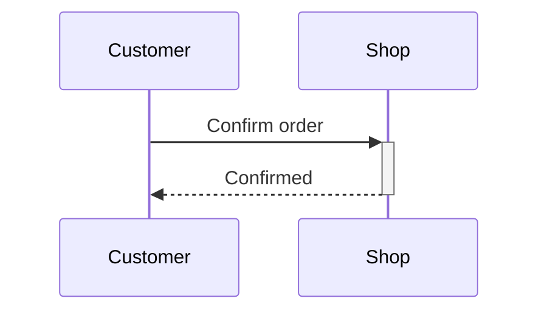

# Mermaid Animator

Play the Mermaid diagrams already in your repository as elegant, navigable animations — in `.mmd` / `.mermaid` files and in ` ```mermaid ` blocks inside Markdown.

Sequence diagrams are animated natively (sequence, topology and split views); every other Mermaid diagram type opens with a generic, ordered reveal. Export animations as GIF, video, animated SVG for your README, or a self-contained HTML player.

## Getting started

- **Markdown:** click **▶ Animate** above any ` ```mermaid ` block.
- **Mermaid files:** click the ▶ button in the editor title bar, or run **Mermaid Animator: Open Animated Preview to the Side** (`Ctrl+K Alt+M` / `Cmd+K Alt+M`).
- **Explorer:** right-click a `.md`, `.mdx`, `.mmd` or `.mermaid` file → **Animate Mermaid Diagram**.
- **Several diagrams in one file:** **Animate All Diagrams in File**, or switch diagrams from the panel toolbar.
- **Every diagram in the workspace:** the **Mermaid Diagrams** view in the Explorer lists each file with its diagrams (by title, `@id` or first line, with a type icon). Click to animate; the context menu offers *Open Source* and *Export…*; the title bar has *Filter by Diagram Type…* and *Refresh*. It indexes `mermaidAnimator.files.include`, honours `files.exclude` and `search.exclude`, updates as files are saved, and stops after `mermaidAnimator.diagramsView.maxFiles` files.
- **New here?** *Help → Get Started* has the walkthrough **Get started with Mermaid Animator**: open a sample, step through it, switch views, add an annotation and export.

Nothing in your diagrams needs to change. Edits appear live, and the panel keeps your place while you type.

## What you see

- **Overview first.** Step 0 shows the complete diagram, framed to fit, so you see the whole picture before the reveal. The first step clears it, and the diagram then builds up step by step; stepping back to 0 brings the overview back. Turn it off with `mermaidAnimator.playback.initialOverview` or, for one diagram, `%% @animator overview=false`.
- Messages draw from sender to receiver with a travelling pulse; activations rise and fall; notes, created participants and destroyed lifelines appear on their step; `loop` / `alt` / `opt` / `par` / `critical` / `break` / `rect` frames light up while their steps play.
- Loops repeat with an `n / N` counter in their tab; `par` lanes play together, each message with its own pulse; `alt` / `critical` / `opt` play the branch you choose — in the inspector, with `%% @branch`, or on the canvas when `playback.altBranches` is `ask`.
- **Camera.** With *Camera follows playback* on (the eye button or `C`), the camera keeps each step in view at a steady zoom: 100 % by default (`camera.playZoom`). It zooms out, never below 75 %, only for a step too wide to fit, and it never leaves most of the view empty: the drawing stays against the edges of the view, or centred when it is smaller. Pan, scroll or zoom whenever you like: following stays on, and if the animation is playing it pauses. Press play (or step) and the camera returns to the current step at the zoom you chose, which it keeps (replay included) until you open another diagram. Only the eye button or `C` turns following off.
- **Settings.** The gear button at the end of the panel toolbar (or **Mermaid Animator: Open Settings**, also in the Mermaid Diagrams view's title bar) opens the Settings editor filtered to Mermaid Animator.
- **Zoom.** The toolbar's zoom group shows the current zoom: `−` and `+` zoom out and in (like the `-` and `+` keys), and clicking the percentage offers 25 %–400 % and *Fit*. `Ctrl`/`Cmd` + wheel or a pinch zooms about the pointer.
- **Bold and italic labels.** `<b>…</b>` / `<strong>…</strong>` and `<i>…</i>` / `<em>…</em>` in labels render as bold and italic, as in Mermaid's own preview — in sequence and topology views, flowcharts and every other diagram, and in every export. Wrapping and box sizes account for the formatting. Search, the transcript, captions and screen readers use the text without tags; other HTML stays as written.
- The current step is highlighted in the source editor, and clicking a statement in the editor moves playback to its step (`sync.cursorToStep`); **Alt + double-click** any element to jump to its line.

## Sequence, topology, split

- **Topology** (`T`). The same steps as a live service map: participants become nodes (shaped by type), `box` groups become clusters, messages merge into edges with `×n` badges, return messages run as dashed lanes beside their request, and each step sends a pulse along its edge. Hover an edge to list its messages and jump to any of them; click a node to focus it.
- **Morph.** Switching between Sequence and Topology animates by identity — headers travel into nodes, arrows follow and merge into edges — without losing your step or focus (a short cross-fade under reduced motion).
- **Split** (`S`). Both views side by side (stacked on narrow panels) on one timeline, each with its own camera; hovering an element highlights its counterpart in the other view.
- **Layouts.** `layered` (default, left-to-right or top-to-bottom), a deterministic `force` layout, or `manual` — drag nodes and the positions are remembered for that diagram (*Reset Topology Layout* forgets them).
- **Minimap.** An overview in the corner whenever the drawing is larger than the view: drag the frame to pan, click to jump there.
- **Who is who when zoomed in.** Once the participant headers scroll out of view, a slim band at the top of the sequence view names every visible lifeline (click a name to focus it), and participants of the current step that are off to the left or right get a marker on that edge — click it to pan there. The ends of the arrow that is playing are labelled with the sender and receiver names when their headers are out of view (`mermaidAnimator.display.arrowEndNames`: `auto` by default, or `always` / `off`).

## Narrate, explore, present

- **Captions and chapters.** `%% @caption "…"` narrates a step in the caption strip (`**bold**`, `*italic*`, `` `code` ``); `%% @chapter "…"` divides the flow into chapters shown as scrubber ticks — jump between them with `Shift+→ / ←`.
- **Inspector** (`D`). The current step, its fragment and loop iteration, a link to its line, participants, chapters and branch choices. It sits beside the diagram on wide panels and opens as a sheet on narrow ones.
- **Focus.** Click a participant's header to dim everything that does not involve it; `Ctrl`/`Cmd`+click adds more. *Play only focused steps* (inspector) skips the rest, shown hatched on the scrubber.
- **Search** (`/` or `Ctrl`/`Cmd+F`). Participants, messages, notes and captions, highlighted on the canvas and the scrubber; `Enter` seeks.
- **A–B loop.** `I` and `O` mark a range that autoplay repeats; `Shift+I` clears it.
- **Transcript** (`R`). The whole flow as an ordered, screen-reader-friendly list grouped by chapter; activate an entry to seek.
- **Presentation** (`P`, or *Mermaid Animator: Start Presentation*). The editor area is maximised, the camera frames each step at 150 % (`camera.presentationZoom`; a zoom you choose while presenting is kept for presentations only), chrome hides after 2 s, captions switch to a serif face, and title and chapter cards open the story. Advance with `→`, `Space` or a clicker (`PageDown`); `B` blanks the screen, hold `Z` for a laser pointer, `Esc` ends.
- Syntax errors never blank the panel: the last good drawing stays, dimmed, with the error and a *Reveal in source* link, and the problem is listed in the Problems panel.

## Keyboard (panel focused)

| Key | Action | Key | Action |
|---|---|---|---|
| `Space` / `K` | Play / pause | `+` / `-` | Zoom in / out (also in the toolbar) |
| `→` / `←` | Next / previous step | `0` | Fit diagram |
| `Shift+→` / `Shift+←` | Next / previous chapter | `F` | Frame current step |
| `Home` / `End` | First / last step | `C` | Camera follow on/off |
| `G` | Go to step (number or text) | `D` | Inspector |
| `[` / `]` | Slower / faster | `/` | Search |
| `L` | Loop | `R` | Transcript view |
| `T` | Sequence / topology view | `S` | Split view |
| `I` / `O` | A–B loop start / end (`Shift` clears) | `P` | Presentation mode |
| Click a header | Focus (`Ctrl`/`Cmd` adds) | `B` / `.` | Blank screen (presenting) |
| `E` | Export | `Z` (hold) | Laser pointer (presenting) |
| `Esc` | Close, clear focus, end presentation | `?` | All shortcuts |

From the editor: **Play / Pause** `Ctrl+Alt+Space`, **Next / Previous Step** `Ctrl+Alt+→ / ←` (`Cmd` on macOS) while a panel is active.

## Export and share

**Export…** (toolbar, `E`, the CodeLens, or *Mermaid Animator: Export…*) opens the export sheet: pick a format and see a live preview with the estimated duration and file size. Options that do not apply to the chosen format are disabled.

| Format | What you get |
|---|---|
| **GIF** | Animated GIF with a global palette (optional dithering) and transparency; loops forever, once or *n* times. |
| **WebM / MP4** | VP9 video; MP4 (H.264) where the editor's encoder supports it — otherwise the sheet says so and WebM is offered. |
| **Animated SVG** | Plays as an image, for example in a GitHub README; CSS keyframes, no scripts. *Export for GitHub (light + dark pair)* writes `name.light.anim.svg` and `name.dark.anim.svg`. |
| **HTML player** | One self-contained, offline file with transport, keyboard control, chapters and `#step=` / `#chapter=` links. |
| **SVG / PNG** | The current frame (SVG self-contained with fonts embedded; PNG at 1×/2×/3×, optionally transparent), or copy it to the clipboard. |

For GIF and video you choose the range (all steps, current chapter, A–B range, current step), view, camera (fit, cinematic, current), size preset, frame rate (12–60 fps), speed, theme, background, what to burn in (captions, title card, step counter, progress bar), end hold and quality. Frames are rendered and encoded in a background worker with frame-exact timing, and the progress notification has **Cancel**. *Export as GIF… / Video… / Animated SVG… / HTML Player…* open the sheet with that format selected; bind them with `"args": { "start": true }` to export straight away with your defaults.

After exporting from a Markdown file, **Insert below diagram** adds an image reference (or a `<picture>` element for a light/dark pair) after the diagram's closing fence.

**Animated SVG notes.** Motion is sampled at 30 Hz into merged keyframes, so a long flow can pass 1 MB — the sheet warns and suggests a GIF. By default the file has a transparent background and a palette meant to read on both GitHub's light and dark backgrounds; because no single colour reaches 4.5:1 contrast on both `#ffffff` and `#0d1117`, lines and text carry a thin contrasting halo. For the best result on GitHub use the light + dark pair.

**Copy Link to Current Step** (palette) copies `vscode://enbinario.mermaid-animator/open?path=…&diagram=…&step=…`. Opening it in VS Code opens the file, the diagram (by `@id` or position) and the step (by step id, then by number), or says what could not be found.

## Annotations (optional)

Refine an animation with Mermaid comments, which other renderers ignore:



Supported in this release: `@animator`, `@id`, `@title`, `@step-id`, `@skip`, `@pause`, `@duration`, `@speed`, `@emphasis`, `@with-next`, `@type`, `@caption`, `@chapter`, `@focus` (Follow, Cinematic and presentation framing), `@latency` (shown in the inspector), `@iterations` and `@branch` (`1`, `"label"`, `all`, `ask`, `skip`). Mistakes are reported in the Problems panel.

The editor helps as you write: typing `%% @` suggests directives and their values (participants, branch labels, `@animator` keys and values); hovering a directive shows what it does and which statement and step it applies to; unknown names get a one-click fix; **Mermaid Animator: Insert Annotation…** adds one above the current statement.

## Sidecar files (optional)

Prefer your Mermaid source free of annotations? Keep settings, captions, chapters and topology positions beside it in `<file>.animator.json` (for example `README.md.animator.json`), with completion and validation from the bundled JSON schema:

```jsonc
{
  "version": 1,
  "diagrams": {
    "sign-in": {                                   // the diagram's @id, or "#2" for the second diagram
      "settings": { "view.default": "split", "playback.speed": 1.25 },
      "captions": { "lookup-user": "Auth looks the user up.", "#4": "The database returns the hash." },
      "chapters": [{ "title": "Credentials", "firstStep": "#1" }],
      "topology": { "layout": "manual", "positions": { "U": [40, 160], "G": [260, 160] } }
    }
  }
}
```

Steps are referenced by `#<number>`, `@step-id`, or the step's content or structural id; entries that no longer match a step are flagged with a warning in the sidecar instead of being dropped silently. Sidecar settings sit above your user and workspace settings and below front matter and annotations, and edits apply to open panels immediately. **Save Topology Layout** and **Save Current Settings as Diagram Defaults** (speed, view and camera) write the sidecar, keeping its comments and formatting; saving a layout moves positions you dragged (kept per workspace until then) into the file. In untrusted workspaces sidecars are read but never written.

## Settings

| Setting | Default | Description |
|---|---|---|
| `mermaidAnimator.theme.mode` | `auto` | `auto` follows the editor theme; `ivory`, `graphite`, `highContrast` force a palette. |
| `mermaidAnimator.codeLens.enabled` | `true` | CodeLens above Markdown diagrams. |
| `mermaidAnimator.liveReload.enabled` / `.debounceMs` | `true` / `250` | Re-render while editing. |
| `mermaidAnimator.sync.stepToEditor` | `true` | Highlight the current step in the source. |
| `mermaidAnimator.sync.cursorToStep` | `click` | Clicking a statement moves playback to its step; `follow` also tracks keyboard moves; `off`. |
| `mermaidAnimator.playback.autoplay` | `false` | Start playing when a panel opens. |
| `mermaidAnimator.playback.speed` | `1` | Initial speed (0.25–4). |
| `mermaidAnimator.playback.dwell` / `.dwellMs` | `adaptive` / `900` | Rest after each step (adaptive = reading time). |
| `mermaidAnimator.playback.onEnd` | `stop` | `stop`, `loop` or `rewind`. |
| `mermaidAnimator.playback.reverse` | `animate` | Step back animated or `cut`. |
| `mermaidAnimator.playback.pauseOnHover` | `true` | Pause while the pointer is over the diagram. |
| `mermaidAnimator.playback.startAt` | `beginning` | Or `end` to open on the complete diagram. |
| `mermaidAnimator.playback.initialOverview` | `true` | Show the complete diagram at step 0; the first step clears it and the reveal starts (`@animator overview=false` per diagram). |
| `mermaidAnimator.playback.notes` | `step` | Notes as steps, `attach`ed to the previous step, or `hidden`. |
| `mermaidAnimator.playback.loopIterations` / `.compressRepeats` | `1` / `true` | Loop repetitions without `@iterations`; repeats after the first at double speed. |
| `mermaidAnimator.playback.altBranches` | `first` | `first`, `all` or `ask` for `alt` / `critical`. |
| `mermaidAnimator.playback.parallel` | `concurrent` | `par` lanes together or `sequential`. |
| `mermaidAnimator.scrubber.snap` | `true` | Snap to a step when the scrubber is released. |
| `mermaidAnimator.display.futureSteps` | `hidden` | `hidden`, `ghosted` or `visible`. |
| `mermaidAnimator.display.pastSteps` / `.trailLength` | `full` / `3` | `full`, `muted` or a fading `trail`. |
| `mermaidAnimator.display.showCaptions` / `.showInspector` | `true` / `true` | Caption strip; inspector beside the diagram on wide panels. |
| `mermaidAnimator.motion.profile` | `formal` | `formal`, `expressive`, `minimal` or `none`. |
| `mermaidAnimator.motion.respectReducedMotion` | `true` | Minimal motion when reduced motion is requested. |
| `mermaidAnimator.motion.travelIndicator` | `pulse` | `pulse`, `comet` or `none`. |
| `mermaidAnimator.camera.mode` | `auto` | `auto`, `fit`, `follow`, `cinematic` or `manual`. |
| `mermaidAnimator.camera.playZoom` | `100` | Zoom (10–800 %) at which a following camera frames steps during playback. Your own zoom replaces it until you open another diagram. |
| `mermaidAnimator.camera.presentationZoom` | `150` | The same for presentation mode, kept separately from the normal zoom. |
| `mermaidAnimator.view.default` | `sequence` | `sequence`, `topology` or `split` (`@animator view=` overrides it). |
| `mermaidAnimator.topology.layout` / `.direction` | `layered` / `LR` | `layered`, `force` or `manual`; `LR` or `TB`. |
| `mermaidAnimator.topology.edgeStyle` / `.edgeWeight` | `curved` / `count` | `curved`, `orthogonal` or `straight`; width by message count or `uniform`. |
| `mermaidAnimator.topology.returnMessages` | `merge` | Return lanes beside their request, `separate` edges, or `hide`. |
| `mermaidAnimator.display.showMinimap` | `auto` | `auto`, `always` or `never`. |
| `mermaidAnimator.display.participantNames` | `auto` | Name band and off-screen markers when headers are out of view, or `off`. |
| `mermaidAnimator.display.arrowEndNames` | `auto` | Sender and receiver names on the current arrow: `off`, `auto` (only when their header is out of view) or `always`. |
| `mermaidAnimator.presentation.chapterCards` / `.zenMode` | `true` / `false` | Chapter cards while presenting; also enter Zen Mode. |
| `mermaidAnimator.annotations.highlight` | `true` | Highlight `%% @…` directive names in the editor. |
| `mermaidAnimator.files.languages` | `markdown, mdx, mermaid` | Languages scanned for diagrams. |
| `mermaidAnimator.files.include` | `**/*.{md,mdx,mmd,mermaid}` | Files the *Mermaid Diagrams* view indexes. |
| `mermaidAnimator.diagramsView.enabled` / `.maxFiles` | `true` / `10000` | Show the *Mermaid Diagrams* view; files it scans at most. |
| `mermaidAnimator.export.defaultFormat` | `animatedSvg` | Format preselected in the export sheet (`gif`, `webm`, `mp4`, `animatedSvg`, `html`, `svg`, `png`). |
| `mermaidAnimator.export.fps` | `30` | Video frame rate; GIF uses 15 fps unless you set this. |
| `mermaidAnimator.export.scale` | `2` | Raster scale (1, 2 or 3). |
| `mermaidAnimator.export.background` | `theme` | `theme`, `transparent` or a colour such as `#ffffff`. |
| `mermaidAnimator.export.includeCaptions` | `true` | Burn captions into GIF and video. |
| `mermaidAnimator.export.outputDirectory` | `${fileDirname}` | Where the save dialog starts (`${workspaceFolder}`, relative or absolute paths work too). |
| `mermaidAnimator.export.svgAdaptiveTheme` | `false` | Also embed a `prefers-color-scheme: dark` palette in animated SVGs. |

## Accessibility and languages

Every control is keyboard operable and labelled; each step is announced to screen readers ("Step 7 of 24. Gateway to Auth: verify token. In loop Retry, iteration 2 of 3."), and the transcript view offers the whole flow as text. High-contrast themes and reduced motion are honoured. The interface is available in English and Spanish.

## Privacy

Diagram content never leaves your machine. The animator makes no network requests, and exported HTML players and SVGs reference nothing outside themselves.
