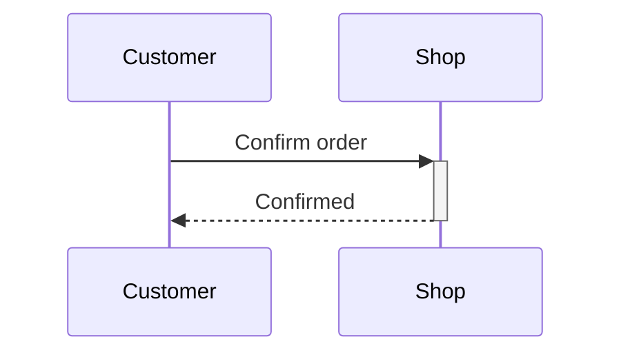

# Mermaid Animator

Play the Mermaid diagrams already in your repository as elegant, navigable animations — in `.mmd` / `.mermaid` files and in ` ```mermaid ` blocks inside Markdown.

> **Status: preview (0.1).** Sequence diagrams are fully animated; every other Mermaid diagram type opens with a generic, ordered reveal.

## Getting started

- **Markdown:** click **▶ Animate** above any ` ```mermaid ` block.
- **Mermaid files:** click the ▶ button in the editor title bar, or run **Mermaid Animator: Open Animated Preview to the Side** (`Ctrl+K Alt+M` / `Cmd+K Alt+M`).
- **Explorer:** right-click a `.md`, `.mdx`, `.mmd` or `.mermaid` file → **Animate Mermaid Diagram**.
- **Several diagrams in one file:** **Animate All Diagrams in File**, or switch diagrams from the panel toolbar.

Nothing in your diagrams needs to change. Edits appear live, and the panel keeps your place while you type.

## What you see

- Messages draw from sender to receiver with a travelling pulse; activations rise and fall; notes, created participants and destroyed lifelines appear on their step; `loop` / `alt` / `opt` / `par` / `critical` / `break` / `rect` frames light up while their steps play.
- Loops repeat with an `n / N` counter in their tab; `par` lanes play together, each message with its own pulse; `alt` / `critical` / `opt` play the branch you choose — in the inspector, with `%% @branch`, or on the canvas when `playback.altBranches` is `ask`.
- The current step is highlighted in the source editor, and clicking a statement in the editor moves playback to its step (`sync.cursorToStep`); **Alt + double-click** any element to jump to its line.

## Narrate, explore, present

- **Captions and chapters.** `%% @caption "…"` narrates a step in the caption strip (`**bold**`, `*italic*`, `` `code` ``); `%% @chapter "…"` divides the flow into chapters shown as scrubber ticks — jump between them with `Shift+→ / ←`.
- **Inspector** (`D`). The current step, its fragment and loop iteration, a link to its line, participants, chapters and branch choices. It sits beside the diagram on wide panels and opens as a sheet on narrow ones.
- **Focus.** Click a participant's header to dim everything that does not involve it; `Ctrl`/`Cmd`+click adds more. *Play only focused steps* (inspector) skips the rest, shown hatched on the scrubber.
- **Search** (`/` or `Ctrl`/`Cmd+F`). Participants, messages, notes and captions, highlighted on the canvas and the scrubber; `Enter` seeks.
- **A–B loop.** `I` and `O` mark a range that autoplay repeats; `Shift+I` clears it.
- **Transcript** (`R`). The whole flow as an ordered, screen-reader-friendly list grouped by chapter; activate an entry to seek.
- **Presentation** (`P`, or *Mermaid Animator: Start Presentation*). The editor area is maximised, the camera frames each step (Cinematic), chrome hides after 2 s, captions switch to a serif face, and title and chapter cards open the story. Advance with `→`, `Space` or a clicker (`PageDown`); `B` blanks the screen, hold `Z` for a laser pointer, `Esc` ends.
- Syntax errors never blank the panel: the last good drawing stays, dimmed, with the error and a *Reveal in source* link, and the problem is listed in the Problems panel.

## Keyboard (panel focused)

| Key | Action | Key | Action |
|---|---|---|---|
| `Space` / `K` | Play / pause | `+` / `-` | Zoom |
| `→` / `←` | Next / previous step | `0` | Fit diagram |
| `Shift+→` / `Shift+←` | Next / previous chapter | `F` | Frame current step |
| `Home` / `End` | First / last step | `C` | Camera follow on/off |
| `G` | Go to step (number or text) | `D` | Inspector |
| `[` / `]` | Slower / faster | `/` | Search |
| `L` | Loop | `R` | Transcript view |
| `I` / `O` | A–B loop start / end (`Shift` clears) | `P` | Presentation mode |
| Click a header | Focus (`Ctrl`/`Cmd` adds) | `B` / `.` | Blank screen (presenting) |
| `E` | Export | `Z` (hold) | Laser pointer (presenting) |
| `Esc` | Close, clear focus, end presentation | `?` | All shortcuts |

From the editor: **Play / Pause** `Ctrl+Alt+Space`, **Next / Previous Step** `Ctrl+Alt+→ / ←` (`Cmd` on macOS) while a panel is active.

## Export

**Export…** (toolbar, `E`, or the CodeLens) saves the current frame as **SVG** (self-contained: fonts embedded, no scripts or external references) or **PNG** at 1×/2×/3×, optionally transparent, or copies it to the clipboard.

## Annotations (optional)

Refine an animation with Mermaid comments, which other renderers ignore:



Supported in this release: `@animator`, `@id`, `@title`, `@step-id`, `@skip`, `@pause`, `@duration`, `@speed`, `@emphasis`, `@with-next`, `@type`, `@caption`, `@chapter`, `@focus` (Cinematic framing), `@latency` (shown in the inspector), `@iterations` and `@branch` (`1`, `"label"`, `all`, `ask`, `skip`). Mistakes are reported in the Problems panel.

The editor helps as you write: typing `%% @` suggests directives and their values (participants, branch labels, `@animator` keys and values); hovering a directive shows what it does and which statement and step it applies to; unknown names get a one-click fix; **Mermaid Animator: Insert Annotation…** adds one above the current statement.

## Settings

| Setting | Default | Description |
|---|---|---|
| `mermaidAnimator.theme.mode` | `auto` | `auto` follows the editor theme; `ivory`, `graphite`, `highContrast` force a palette. |
| `mermaidAnimator.codeLens.enabled` | `true` | CodeLens above Markdown diagrams. |
| `mermaidAnimator.liveReload.enabled` / `.debounceMs` | `true` / `250` | Re-render while editing. |
| `mermaidAnimator.sync.stepToEditor` | `true` | Highlight the current step in the source. |
| `mermaidAnimator.sync.cursorToStep` | `click` | Clicking a statement moves playback to its step; `follow` also tracks keyboard moves; `off`. |
| `mermaidAnimator.playback.autoplay` | `false` | Start playing when a panel opens. |
| `mermaidAnimator.playback.speed` | `1` | Initial speed (0.25–4). |
| `mermaidAnimator.playback.dwell` / `.dwellMs` | `adaptive` / `900` | Rest after each step (adaptive = reading time). |
| `mermaidAnimator.playback.onEnd` | `stop` | `stop`, `loop` or `rewind`. |
| `mermaidAnimator.playback.reverse` | `animate` | Step back animated or `cut`. |
| `mermaidAnimator.playback.pauseOnHover` | `true` | Pause while the pointer is over the diagram. |
| `mermaidAnimator.playback.startAt` | `beginning` | Or `end` to open on the complete diagram. |
| `mermaidAnimator.playback.notes` | `step` | Notes as steps, `attach`ed to the previous step, or `hidden`. |
| `mermaidAnimator.playback.loopIterations` / `.compressRepeats` | `1` / `true` | Loop repetitions without `@iterations`; repeats after the first at double speed. |
| `mermaidAnimator.playback.altBranches` | `first` | `first`, `all` or `ask` for `alt` / `critical`. |
| `mermaidAnimator.playback.parallel` | `concurrent` | `par` lanes together or `sequential`. |
| `mermaidAnimator.scrubber.snap` | `true` | Snap to a step when the scrubber is released. |
| `mermaidAnimator.display.futureSteps` | `hidden` | `hidden`, `ghosted` or `visible`. |
| `mermaidAnimator.display.pastSteps` / `.trailLength` | `full` / `3` | `full`, `muted` or a fading `trail`. |
| `mermaidAnimator.display.showCaptions` / `.showInspector` | `true` / `true` | Caption strip; inspector beside the diagram on wide panels. |
| `mermaidAnimator.motion.profile` | `formal` | `formal`, `expressive`, `minimal` or `none`. |
| `mermaidAnimator.motion.respectReducedMotion` | `true` | Minimal motion when reduced motion is requested. |
| `mermaidAnimator.motion.travelIndicator` | `pulse` | `pulse`, `comet` or `none`. |
| `mermaidAnimator.camera.mode` | `auto` | `auto`, `fit`, `follow`, `cinematic` or `manual`. |
| `mermaidAnimator.presentation.chapterCards` / `.zenMode` | `true` / `false` | Chapter cards while presenting; also enter Zen Mode. |
| `mermaidAnimator.annotations.highlight` | `true` | Highlight `%% @…` directive names in the editor. |
| `mermaidAnimator.files.languages` | `markdown, mdx, mermaid` | Languages scanned for diagrams. |

## Accessibility and languages

Every control is keyboard operable and labelled; each step is announced to screen readers ("Step 7 of 24. Gateway to Auth: verify token. In loop Retry, iteration 2 of 3."), and the transcript view offers the whole flow as text. High-contrast themes and reduced motion are honoured. The interface is available in English and Spanish.

## Privacy

Diagram content never leaves your machine. The animator makes no network requests.
