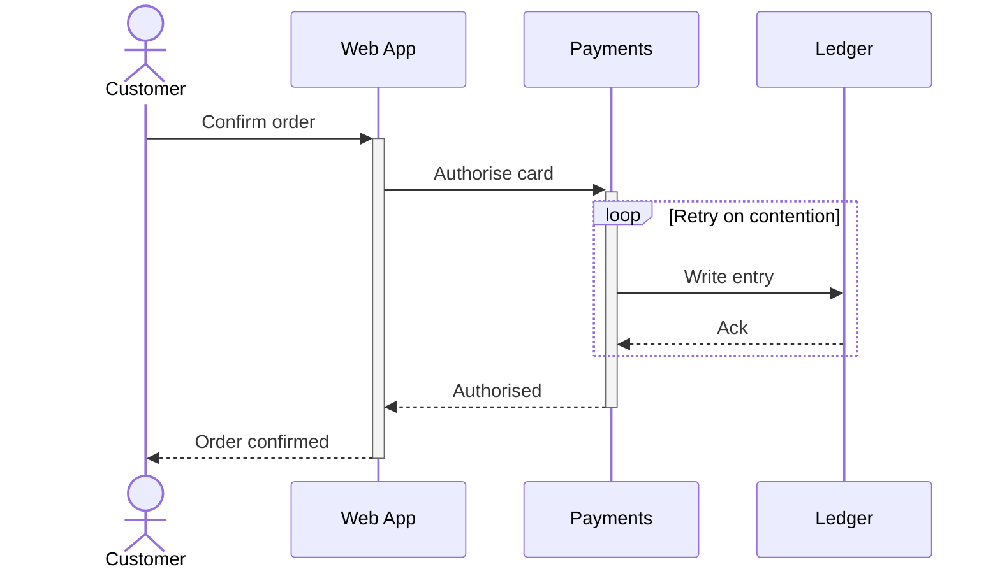

# Annotations

Annotations refine an animation without breaking the diagram anywhere else. Mermaid treats lines that begin with `%%`
as comments, so GitHub, GitLab and other renderers ignore them.



An annotation is `%% @name` followed by its arguments: quoted text (`"Place order"`), a duration (`1.5s`, `300ms`), a
number (`2`, `0.5x`), a word, a comma-separated list, or `key=value` pairs. Mermaid directives (`%%{ … }%%`) are not
annotations and are passed to Mermaid untouched.

## Scope

- **Diagram** directives apply to the whole diagram wherever they appear; put them at the top by convention.
- **Statement** directives apply to the **next step-producing statement**: a message, note, state transition, commit
  or fragment. Declarations (`participant`, `actor`, `box`) don't produce steps and are skipped over, except by
  `@type`, which applies to the next declaration.
- **Fragment** directives apply to the next fragment opener (`loop`, `alt`, …).
- Several statement directives can stack on consecutive lines.

## Directives

| Directive | Scope | Arguments | Effect |
|---|---|---|---|
| `@animator` | Diagram | `key=value …` | Settings for this diagram; see [below](#animator) |
| `@id` | Diagram | a word | Stable identifier for [sidecar](sidecar-files.md) keys and [step links](../guide/export.md#links-to-a-step) |
| `@title` | Diagram | `"text"` | Title of the panel, the presentation title card and exports |
| `@chapter` | Statement | `"title"` | Starts a chapter at the next step |
| `@caption` | Statement | `"text"` | Caption of the next step; consecutive `@caption` lines join |
| `@pause` | Statement | a duration | Rest after the next step, instead of the adaptive dwell |
| `@duration` | Statement | a duration | Transition duration of the next step |
| `@speed` | Statement | a number, e.g. `0.5x` | Speed multiplier for the next step only |
| `@emphasis` | Statement | — | Draws the next step with the emphasised style |
| `@skip` | Statement | — | The next statement is drawn from the start and produces no step |
| `@with-next` | Statement | `[n]` | Merges the next step with the following *n* (default 1) into one step |
| `@step-id` | Statement | a slug | A fixed identity for the next step, for sidecar references and step links. Duplicates are an error |
| `@focus` | Statement | participant IDs | The camera frames these participants for the next step (Follow, Cinematic and presentation framing) |
| `@latency` | Statement | a duration | Modelled latency of the next message, shown in the inspector |
| `@iterations` | Fragment | a number | Iterations to play for the next `loop` |
| `@branch` | Fragment | `1` (1-based), `"label"`, `all`, `ask`, `skip` | Branch to play for the next `alt` / `opt` / `critical` |
| `@type` | Declaration | `participant`, `actor`, `database`, `queue`, `collections`, `boundary`, `control`, `entity` | Node shape of the next declaration in the topology view |

Mistakes are reported in the Problems panel: an unknown directive (with a *Did you mean…?* fix), an invalid argument,
a directive with no statement to apply to, or a `@branch` number out of range.

## `@animator` {#animator}

`@animator` sets any of these settings for one diagram, by a short name:

| Key | Setting |
|---|---|
| `speed` | [`playback.speed`](../reference/settings.md#mermaidanimator-playback-speed) (0.25–4) |
| `autoplay` | [`playback.autoplay`](../reference/settings.md#mermaidanimator-playback-autoplay) |
| `overview` | [`playback.initialOverview`](../reference/settings.md#mermaidanimator-playback-initialoverview) |
| `dwell`, `dwellMs` | [`playback.dwell`](../reference/settings.md#mermaidanimator-playback-dwell), [`playback.dwellMs`](../reference/settings.md#mermaidanimator-playback-dwellms) |
| `onEnd` | [`playback.onEnd`](../reference/settings.md#mermaidanimator-playback-onend) |
| `reverse` | [`playback.reverse`](../reference/settings.md#mermaidanimator-playback-reverse) |
| `startAt` | [`playback.startAt`](../reference/settings.md#mermaidanimator-playback-startat) |
| `notes` | [`playback.notes`](../reference/settings.md#mermaidanimator-playback-notes) |
| `iterations` | [`playback.loopIterations`](../reference/settings.md#mermaidanimator-playback-loopiterations) |
| `branches` | [`playback.altBranches`](../reference/settings.md#mermaidanimator-playback-altbranches) |
| `parallel` | [`playback.parallel`](../reference/settings.md#mermaidanimator-playback-parallel) |
| `future` | [`display.futureSteps`](../reference/settings.md#mermaidanimator-display-futuresteps) |
| `past`, `trail` | [`display.pastSteps`](../reference/settings.md#mermaidanimator-display-paststeps), [`display.trailLength`](../reference/settings.md#mermaidanimator-display-traillength) |
| `motion` | [`motion.profile`](../reference/settings.md#mermaidanimator-motion-profile) |
| `indicator` | [`motion.travelIndicator`](../reference/settings.md#mermaidanimator-motion-travelindicator) |
| `camera` | [`camera.mode`](../reference/settings.md#mermaidanimator-camera-mode) |
| `view` | [`view.default`](../reference/settings.md#mermaidanimator-view-default) |
| `layout`, `direction` | [`topology.layout`](../reference/settings.md#mermaidanimator-topology-layout), [`topology.direction`](../reference/settings.md#mermaidanimator-topology-direction) |
| `returns` | [`topology.returnMessages`](../reference/settings.md#mermaidanimator-topology-returnmessages) |

```mermaid
sequenceDiagram
    %% @animator speed=1.25 view=split camera=follow future=ghosted overview=false
```

## Where settings come from

From lowest to highest priority:

1. Built-in defaults
2. User settings
3. Workspace and folder settings
4. The [sidecar file](sidecar-files.md)
5. Mermaid front matter and `%%{init}%%`, for Mermaid's own options such as the theme
6. `@animator`
7. Statement and fragment annotations
8. Changes you make in the panel, for the session only (unless saved to the sidecar)

## Editor help

- Typing `%% @` suggests directives and their values: participants, branch labels, `@animator` keys and values.
- Hovering a directive shows what it does and which statement and step it applies to.
- Unknown names get a one-click fix.
- **Mermaid Animator: Insert Annotation…** adds one above the current statement.
- Directive names are highlighted in the editor
  ([`annotations.highlight`](../reference/settings.md#mermaidanimator-annotations-highlight)).
