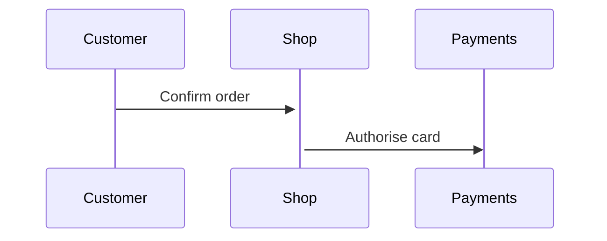

# Narrate, explore, present

## Captions and chapters

`%% @caption "…"` narrates a step in the caption strip, with `**bold**`, `*italic*` and `` `code` ``.
`%% @chapter "…"` divides the flow into chapters, shown as ticks on the scrubber; jump between them with `Shift+→` and
`Shift+←`.

Captions can also live in a [sidecar file](../authoring/sidecar-files.md), keyed by step. Hide the strip with
[`display.showCaptions`](../reference/settings.md#mermaidanimator-display-showcaptions).

## Inspector

Press `D` for the inspector: the current step, its fragment and loop iteration, a link to its line, the participants,
chapters and branch choices. It sits beside the diagram on wide panels and opens as a sheet on narrow ones.

## Focus

Click a participant's header to dim everything that doesn't involve it; `Ctrl`/`Cmd`+click adds more. *Play only
focused steps* in the inspector skips the rest, shown hatched on the scrubber. `Esc` clears the focus.

## Search

Press `/` or `Ctrl`/`Cmd+F` to search participants, messages, notes and captions. Matches are highlighted on the
canvas and the scrubber; `Enter` seeks to a match.

## A–B loop

`I` and `O` mark a range that autoplay repeats; `Shift+I` clears it.

## Transcript

Press `R` for the whole flow as an ordered, screen-reader-friendly list grouped by chapter. Activate an entry to seek
to it.

## Presentation

Press `P`, or run **Mermaid Animator: Start Presentation**:

- The editor area is maximised and the panel's chrome hides after 2 s.
- The camera frames each step at 150 %
  ([`camera.presentationZoom`](../reference/settings.md#mermaidanimator-camera-presentationzoom)). A zoom you choose
  while presenting is kept for presentations only.
- Captions switch to a serif face, and title and chapter cards open the story
  ([`presentation.chapterCards`](../reference/settings.md#mermaidanimator-presentation-chaptercards)).
- Advance with `→`, `Space` or a clicker (`PageDown`). `B` or `.` blanks the screen, hold `Z` for a laser pointer, and
  `Esc` ends.

Set [`presentation.zenMode`](../reference/settings.md#mermaidanimator-presentation-zenmode) to enter Zen Mode as
well.
