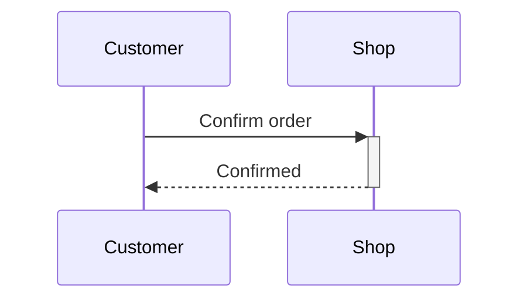

# Mermaid Animator

**Mermaid Animator** is a VS Code extension that plays the Mermaid diagrams already in your repository as elegant,
navigable animations, in `.mmd` / `.mermaid` files and in ` ```mermaid ` blocks inside Markdown. Nothing in your
diagrams needs to change: edits appear live, and the panel keeps your place while you type.

## What it does

- **Sequence diagrams, animated natively.** Messages travel from sender to receiver, activations rise and fall, and
  `loop`, `alt`, `par` and the other frames light up while their steps play. See
  [Playing a diagram](guide/playback.md).
- **Three views of one flow.** The classic sequence view, a live **topology** map of the same steps, or both side by
  side in **split** view. See [Sequence, topology, split](guide/views.md).
- **Every other diagram type** (flowcharts, state, class, ER, Gantt, pie, mindmap, timeline, Git graph and more)
  opens with a generic, ordered reveal.
- **Tell the story.** Captions, chapters, focus on a participant, search, a transcript, and a presentation mode with
  title cards and a laser pointer. See [Narrate, explore, present](guide/narrate-and-present.md).
- **Share it.** Export as GIF, WebM or MP4 video, an animated SVG that plays in a GitHub README, a self-contained HTML
  player, or a still SVG or PNG. See [Export and share](guide/export.md).
- **Refine it without breaking it.** [Annotations](authoring/annotations.md) are Mermaid comments that other
  renderers ignore; [sidecar files](authoring/sidecar-files.md) keep the same settings next to the source instead.



## Requirements

- VS Code 1.95 or later, on the desktop or on the web.
- Nothing else: the animator bundles everything it needs and makes no network requests. See
  [Accessibility and privacy](accessibility-and-privacy.md).

The interface is available in English and Spanish.
