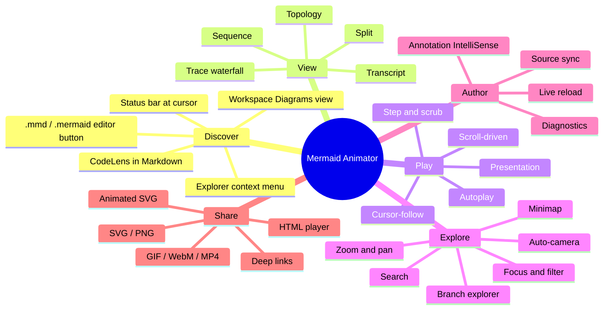
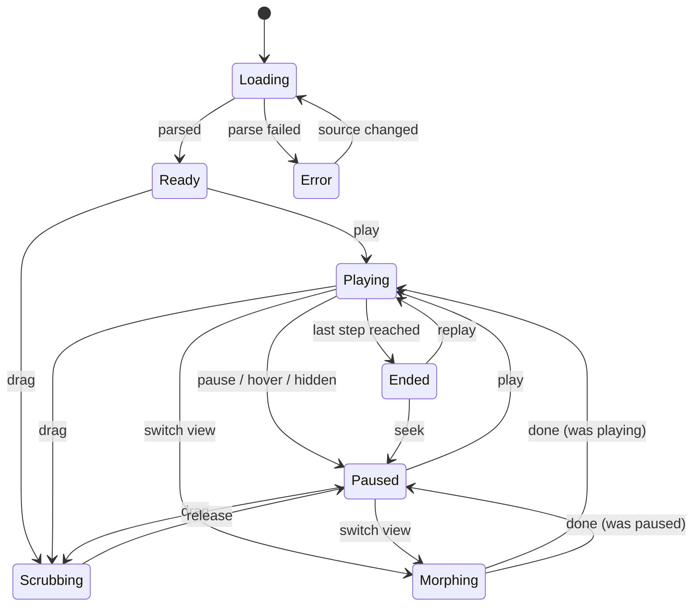
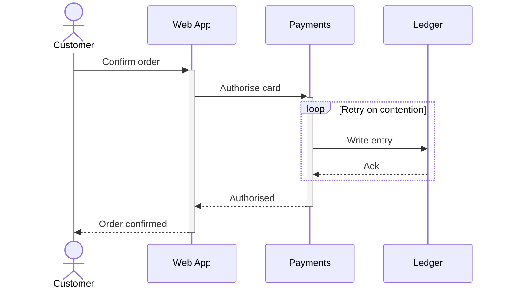
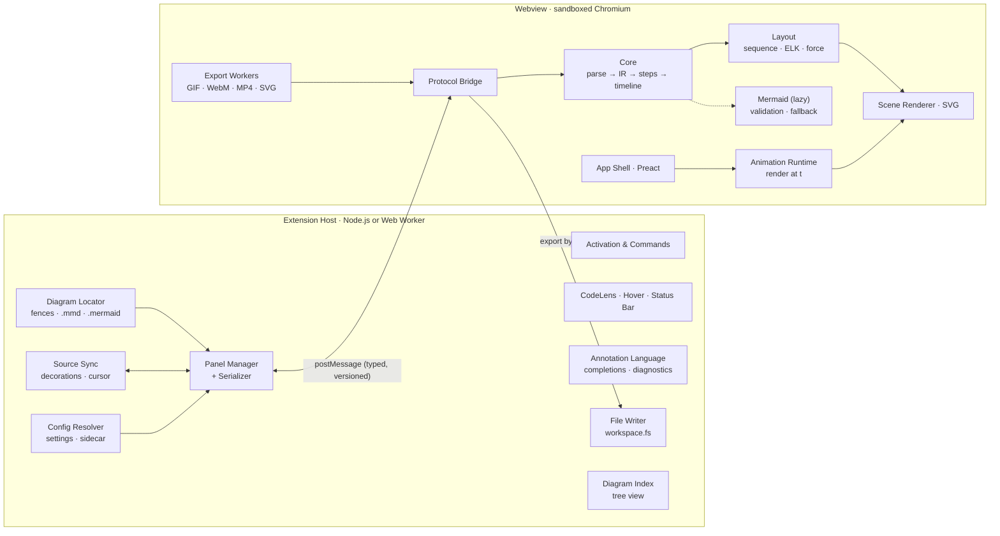
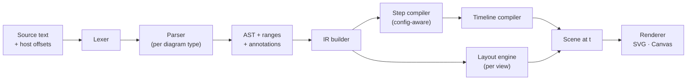
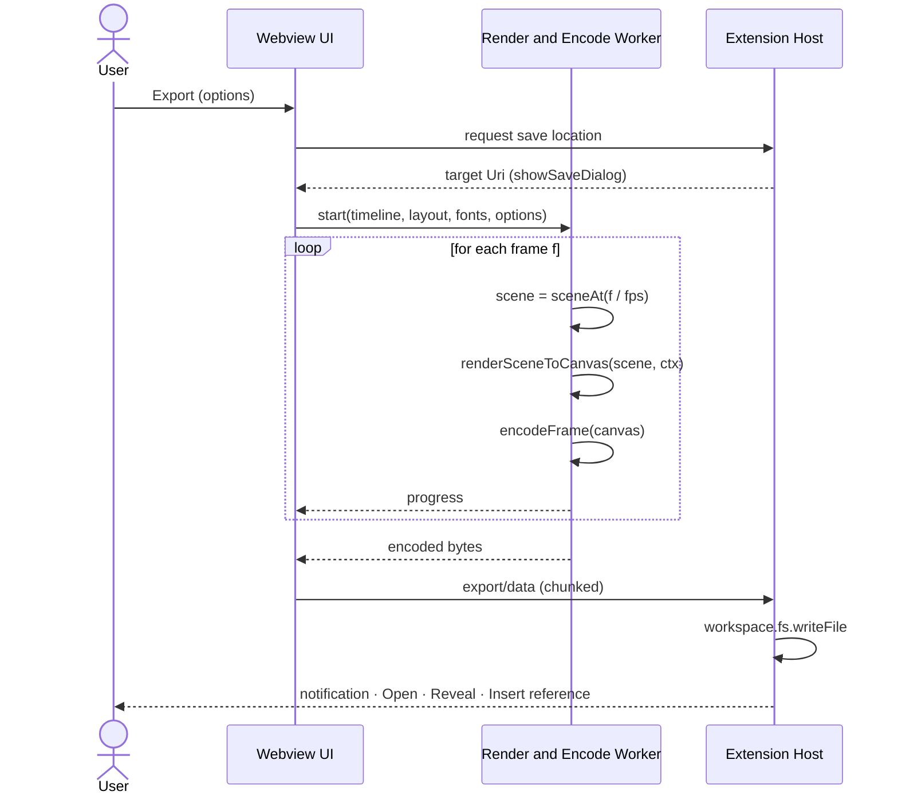
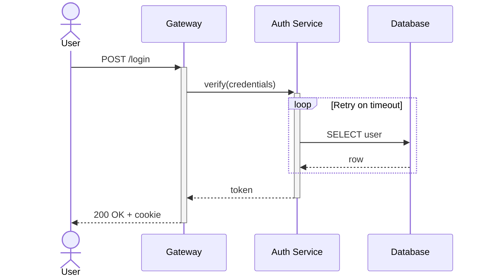

# Mermaid Animator — VS Code Extension Specification

> An elegant, animated viewer for the Mermaid diagrams already in your repository.

| | |
|---|---|
| **Document** | Product & Technical Specification |
| **Product** | Mermaid Animator (VS Code extension) |
| **Version** | 1.1 — Revised after technical review |
| **Date** | 2026-09-25 |
| **Status** | Approved for M0/M1 implementation |
| **Review** | [vscode-extension-specification-review.md](vscode-extension-specification-review.md) — disposition in Appendix E |
| **Delivery workflow** | OpenSpec (`openspec/`) — see §23.1 |
| **Implementation status** | M0 and M1 delivered (2026-09-25); living requirements in `openspec/specs/` |
| **Source material** | [ideas-exploration.md](ideas-exploration.md) |
| **Working identifier** | `enbinario.mermaid-animator` *(publisher ID to be confirmed — see §25)* |

---

## Table of Contents

1. [Introduction](#1-introduction)
2. [Product Vision & Principles](#2-product-vision--principles)
3. [Goals, Non-Goals & Success Metrics](#3-goals-non-goals--success-metrics)
4. [Users & Scenarios](#4-users--scenarios)
5. [Glossary](#5-glossary)
6. [Feature Overview](#6-feature-overview)
7. [Diagram Support Matrix](#7-diagram-support-matrix)
8. [User Experience](#8-user-experience)
9. [Visual Design System — "Ink & Ivory"](#9-visual-design-system--ink--ivory)
10. [Animation Semantics by Diagram Type](#10-animation-semantics-by-diagram-type)
11. [Annotation Language](#11-annotation-language)
12. [Functional Requirements](#12-functional-requirements)
13. [Architecture](#13-architecture)
14. [Export & Sharing](#14-export--sharing)
15. [Extension Manifest: Commands, Settings & Contributions](#15-extension-manifest-commands-settings--contributions)
16. [Accessibility](#16-accessibility)
17. [Performance & Non-Functional Requirements](#17-performance--non-functional-requirements)
18. [Security & Privacy](#18-security--privacy)
19. [Localisation](#19-localisation)
20. [Telemetry](#20-telemetry)
21. [Quality Assurance & Testing](#21-quality-assurance--testing)
22. [Engineering Foundations](#22-engineering-foundations)
23. [Delivery Plan](#23-delivery-plan)
24. [Risks & Mitigations](#24-risks--mitigations)
25. [Open Questions & Decision Log](#25-open-questions--decision-log)
- [Appendix A — Annotated Example & Compiled Steps](#appendix-a--annotated-example--compiled-steps)
- [Appendix B — Sidecar File Example](#appendix-b--sidecar-file-example)
- [Appendix C — `package.json` Contribution Excerpt](#appendix-c--packagejson-contribution-excerpt)
- [Appendix D — Traceability to the Ideas Document](#appendix-d--traceability-to-the-ideas-document)
- [Appendix E — Review Disposition](#appendix-e--review-disposition)

---

## 1. Introduction

### 1.1 Purpose

This document specifies **Mermaid Animator**, a Visual Studio Code extension that opens existing Mermaid diagrams — in `.mmd` / `.mermaid` files and in fenced ` ```mermaid ` blocks inside Markdown — and presents them as **animated, navigable, explorable diagrams**. It is the single reference for product behaviour, visual design, architecture and delivery, and is intended to be sufficient for an engineering team (or coding agent) to implement the extension without further product input, except where §25 lists an open question.

### 1.2 Product summary

A sequence diagram is a story told in order, but a static render shows every sentence at once. Mermaid Animator plays the story back: messages draw themselves from sender to receiver, activations rise and fall, fragments light up as their contents run, and a camera keeps the action legible. The same data can be re-laid out as a **topology** — a live service map — with a smooth morph between the two. Playback can be driven by autoplay, by stepping, by scrubbing, by scrolling, or by the cursor in the source file. The result can be presented full-screen or exported as GIF, video, animated SVG or a self-contained HTML player.

The extension **never requires changes to the diagram**. Optional enhancements (captions, chapters, timings) are expressed as Mermaid comments (`%% @caption …`), so annotated files remain valid Mermaid everywhere else — GitHub, GitLab, documentation sites and other tools.

### 1.3 Conventions

- The key words **MUST**, **MUST NOT**, **SHOULD**, **SHOULD NOT** and **MAY** are to be read as described in RFC 2119.
- Requirements carry identifiers of the form `FR-<AREA>-<NN>` (functional) and `NFR-<AREA>-<NN>` (non-functional).
- Priority is expressed as **P0** (required for the first public release), **P1** (required for 1.x), **P2** (planned, later), mapped to milestones in §23.
- Code identifiers, settings and commands appear in `monospace`. Setting keys are abbreviated from `mermaidAnimator.*` where unambiguous.

---

## 2. Product Vision & Principles

### 2.1 Vision

> *Every Mermaid diagram in a repository should be able to explain itself — step by step, in motion, with the quiet precision of a well-set page.*

### 2.2 Product principles

| # | Principle | Implication |
|---|---|---|
| P1 | **Zero-touch first** | Any valid Mermaid diagram animates with no edits. Annotations only refine. |
| P2 | **The source stays canonical** | We never rewrite user diagrams. All extra configuration lives in comments, settings, or an optional sidecar file. |
| P3 | **One step list rules all** | A single canonical, ordered step list drives every view, control, export and synchronisation path. |
| P4 | **Motion explains, never decorates** | Every animation must communicate causality, order or focus. No ornamental motion. |
| P5 | **Formal, calm, precise** | A restrained visual language: hairlines, generous whitespace, one accent colour, no bounce. |
| P6 | **Native to VS Code** | Respects editor themes, keybindings, accessibility settings, workspace trust, remote and web environments. |
| P7 | **Deterministic** | Visual state is a pure function of time `t`. This makes scrubbing, testing and frame-exact export trivial. |
| P8 | **Private by construction** | Diagram content never leaves the machine. No network access at runtime. |

---

## 3. Goals, Non-Goals & Success Metrics

### 3.1 Goals

1. Animate Mermaid **sequence diagrams** with complete syntax coverage and first-class semantics (activations, fragments, notes, participant creation/destruction, boxes, autonumbering).
2. Provide an alternative **topology view** generated from the same data, with a continuous morph between views.
3. Offer multiple **playback modes** (autoplay, step, scrub, scroll, cursor-follow, presentation).
4. Provide **bidirectional source synchronisation** with the editor and **live reload** while typing.
5. **Export and share** animations in formats that work in READMEs, slides, chat and documentation sites.
6. Extend the same engine to **flowcharts, state diagrams** and further types, with a graceful generic fallback for every other Mermaid diagram.
7. Deliver an interface and diagram style that feel **formal and elegant** in both light and dark themes.

### 3.2 Non-goals

- A visual **editor** for Mermaid diagrams (drag-to-author). The source file remains the authoring surface.
- Pixel-identical reproduction of Mermaid's own renderer. The native renderer is *Mermaid-faithful in structure*, not in pixels; a `mermaid-overlay` engine exists for users who need Mermaid's exact look (§13.9).
- Cloud rendering, accounts, collaboration or hosting of shared animations.
- Support for non-Mermaid diagram languages (PlantUML, D2, Graphviz) in 1.x. The core is designed to permit this later (§13.3).

### 3.3 Success metrics

| Metric | Target (6 months after 1.0) |
|---|---|
| Diagrams that open without error (from a corpus of real-world public repositories) | ≥ 99% render; ≥ 95% via native engine |
| Median time from command to first animated frame | ≤ 400 ms |
| Marketplace rating | ≥ 4.6 ★ |
| Weekly active users returning after first use | ≥ 35% |
| Exports per active user per month | ≥ 1.5 |
| Accessibility defects of severity "serious" or higher (axe-core) | 0 |

---

## 4. Users & Scenarios

### 4.1 Personas

| Persona | Context | What they need |
|---|---|---|
| **Ana — Backend engineer** | Maintains architecture docs with sequence diagrams in `docs/*.md`. | To *understand* a 60-message flow quickly; to see which services talk to which. |
| **Marcus — Tech lead / presenter** | Walks the team through designs in reviews and onboarding sessions. | Keyboard-driven presentation, captions, chapters, a clicker-friendly mode. |
| **Priya — Technical writer** | Publishes docs to a static site and GitHub. | Exports: animated SVG for READMEs, GIF/MP4 for release notes, HTML player for the docs site. |
| **Leo — New joiner** | Reading an unfamiliar codebase. | A guided, captioned tour of how a request flows through the system. |
| **Sofia — Reviewer** | Reviews pull requests that change diagrams. | To see *what changed* in a diagram between revisions, animated. |

### 4.2 Key scenarios

**S1 — Understand a flow.** Ana opens `docs/checkout.md`, clicks the **▶ Animate** CodeLens above a ` ```mermaid ` block. A panel opens beside the editor; the diagram plays. She presses `→` to step through, clicks the *Payments* participant to dim everything unrelated, then presses `T` to morph into the topology view and sees Payments is called four times from two services.

**S2 — Present.** Marcus opens the animator, presses `P` for presentation mode. The editor chrome recedes; captions appear in a serif typeface under the diagram; his presentation clicker (`PageDown`) advances steps; chapter titles introduce each phase.

**S3 — Publish.** Priya runs *Mermaid Animator: Export…*, chooses **Animated SVG**, and inserts the generated `checkout.anim.svg` beneath the source block in the README with one click. GitHub renders it animated.

**S4 — Edit live.** While Ana types a new message in the source, the panel updates within a fraction of a second, keeping her position; the new message is drawn in as the current step. When she places her cursor on any message line, the viewer jumps to that step.

**S5 — Review a change.** Sofia runs *Compare with Revision…* on a changed diagram. The animator plays the *difference*: removed messages fade out in crimson, new ones draw in, renamed labels morph.

### 4.3 User stories (representative)

```gherkin
Feature: Step through a sequence diagram
  Scenario: Advance one step with the keyboard
    Given an animator panel showing a sequence diagram at step 3 of 12
    And the panel has keyboard focus
    When I press the Right Arrow key
    Then message 4 draws from its sender to its receiver
    And the step counter reads "04 / 12"
    And the source line of message 4 is highlighted in the editor

Feature: Live reload
  Scenario: Editing the source preserves position
    Given the animator is paused on the step "Gateway → Auth: verify"
    When I insert a new message before it in the source
    Then the diagram re-renders within 150 ms after the debounce interval
    And the current step is still "Gateway → Auth: verify"
```

---

## 5. Glossary

| Term | Definition |
|---|---|
| **Diagram** | One Mermaid source unit: an entire `.mmd` file, or one fenced block in Markdown. |
| **IR** | *Intermediate Representation*: the typed, renderer-independent model of a parsed diagram. |
| **Step** | The smallest unit of playback: one message, note, state transition, commit, etc. Steps are ordered and have stable IDs. |
| **Step list** | The canonical ordered list of steps compiled from the IR plus configuration. |
| **Timeline** | The continuous-time schedule of tweens derived from the step list; defines visual state for any `t`. |
| **Scene** | The set of renderable elements and their properties at a given `t`. |
| **View** | A layout + rendering strategy over the same IR and step list (Sequence, Topology, Split, Trace, Transcript). |
| **Fragment** | A sequence-diagram grouping block: `loop`, `alt`/`else`, `opt`, `par`/`and`, `critical`/`option`, `break`, `rect`. |
| **Chapter** | A named range of steps used for navigation and presentation. |
| **Caption** | Plain-language narration attached to a step. |
| **Annotation** | A directive written as a Mermaid comment (`%% @name args`), ignored by other Mermaid renderers. |
| **Sidecar** | Optional `*.animator.json` file storing configuration and layout alongside a diagram. |
| **Camera** | The pan/zoom transform applied to the scene, controlled by the user and/or by playback. |
| **Engine** | The renderer backing a panel: `native` (our own scene) or `mermaid-overlay` (Mermaid's SVG, animated). |

---

## 6. Feature Overview

### 6.1 Feature map



### 6.2 Improvements beyond the ideas document

The ideas document ([ideas-exploration.md](ideas-exploration.md)) established the core: a canonical step list, progressive arrow drawing with a travelling pulse, activation animation, fragment highlighting, zoom/pan with auto-camera and minimap, a sequence ↔ architecture morph, multiple playback modes, captions and exports. This specification retains all of it (see Appendix D) and adds:

| Area | Addition |
|---|---|
| **Coverage** | Tiered support for flowcharts, state diagrams, git graphs, Gantt charts, class/ER diagrams and more, plus a generic fallback that animates *any* Mermaid diagram. |
| **Authoring** | Annotation language in Mermaid comments (captions, chapters, pauses, latencies, loop iterations, branch choice) with completions, hovers and diagnostics. Optional sidecar file. |
| **Editor integration** | Bidirectional source sync (cursor ↔ step), live reload with position preservation, "last known good" render on syntax errors, Problems-panel diagnostics. |
| **Views** | Split view (sequence + topology synchronised), **Trace view** (distributed-tracing waterfall from activations and latencies), **Transcript view** (accessible text rendition). |
| **Semantics** | Branch explorer for `alt`/`opt`, configurable loop iterations with counters, true concurrency for `par`, participant creation/destruction, `box` groups as topology clusters, participant types mapped to node shapes. |
| **Camera** | Four camera modes (Fit, Follow, Cinematic, Manual) using smooth van Wijk–Nuij zoom interpolation; motion-sickness guard rails. |
| **Playback** | Adaptive dwell (time scales with text length), A–B loop ranges, reverse stepping, continuous scrubbing with step snapping, presenter-clicker support. |
| **Review** | **Revision playback**: animate the difference between the working copy and any Git revision. |
| **Export** | Frame-exact offline rendering; **animated SVG** that plays inside GitHub READMEs; self-contained HTML player; deep links to a specific step. |
| **Design** | A complete "Ink & Ivory" design system: tokens, typography pairing, motion profiles, component specifications, verified contrast. |
| **Platform** | Works in desktop, remote (SSH/WSL/containers), Codespaces and vscode.dev; restores panels after reload; English and Spanish at launch. |

---

## 7. Diagram Support Matrix

Support is delivered in three tiers.

- **Tier 1 — Native, full semantics.** Our own parser, IR, layout and renderer. Every syntax feature has a defined animation.
- **Tier 2 — Native, core semantics.** Our own pipeline covering the commonly used syntax; uncommon constructs render statically inside the animated scene.
- **Tier 3 — Generic fallback.** Mermaid renders the SVG; the extension discovers animatable groups and reveals them in a sensible order (§10.12).

| Diagram type | Mermaid keyword | Tier | Milestone | Step unit | Signature animation |
|---|---|---|---|---|---|
| Sequence | `sequenceDiagram` | 1 | M1 | Message / note | Arrow draws with travelling pulse; activations rise; fragments illuminate |
| Flowchart | `flowchart` / `graph` | 1 | M4 | Node or edge (by traversal strategy) | Token flows along edges; decisions branch |
| State | `stateDiagram-v2` | 2 → 1 | M4 | Transition | Token moves between states; interactive simulator |
| Git graph | `gitGraph` | 2 | M4 | Commit / branch / merge | Lanes extend; merges curve in |
| Gantt | `gantt` | 2 | M5 | Time tick / task | Playhead sweeps; bars fill |
| Class | `classDiagram` | 2 | M5 | Class + its relations | Guided tour by hierarchy depth |
| Entity-relationship | `erDiagram` | 2 | M5 | Entity + its relations | Tour by connectivity; cardinalities emphasised |
| User journey | `journey` | 2 | M5 | Task | Score line traces the journey |
| Timeline | `timeline` | 2 | M5 | Period | Chronological reveal |
| Mindmap | `mindmap` | 2 | M5 | Depth level | Radial bloom from root |
| Sankey | `sankey-beta` | 2 | M5 | Flow | Link widths grow; optional particle flow |
| Architecture | `architecture-beta` | 2 | M5 | Edge | Data-flow pulses along services |
| Pie, XY chart, quadrant, radar | `pie`, `xychart-beta`, `quadrantChart`, `radar-beta` | 3 | M4 | Slice / series / point | Entrance per data element |
| C4, block, packet, requirement, kanban, treemap, others | various | 3 | M4 | SVG group | Ordered reveal |

> **Version policy.** The extension pins a Mermaid version (12.0.0 at M0 — the latest release when M0 began) and tracks it in `fixtures/mermaid-version.json`. Tier coverage is validated against that version's documentation examples (§21.2). Diagram types introduced by later Mermaid releases automatically receive Tier 3 support once the bundled Mermaid is upgraded.

---

## 8. User Experience

### 8.1 Entry points

| # | Entry point | Where | Behaviour | Priority |
|---|---|---|---|---|
| E1 | **CodeLens** `▶ Animate` · `Export…` | Above each ` ```mermaid ` fence in Markdown (and MDX) | Opens the animator for that block. | P0 |
| E2 | **Editor title button** (`$(play-circle)`) | `.mmd` / `.mermaid` files; Markdown files containing Mermaid | Opens the animator (for Markdown: the block at the cursor, else the first). | P0 |
| E3 | **Command palette** | Anywhere | *Mermaid Animator: Open Animated Preview*, *…to the Side*, *Animate Diagram at Cursor*, *Animate All Diagrams in File*. | P0 |
| E4 | **Explorer context menu** | `.mmd`, `.mermaid`, `.md` | *Animate Mermaid Diagram*. For `.md` with several diagrams, a quick pick lists them by title / `@id` / first line. | P0 |
| E5 | **Custom editor** | *Reopen Editor With… → Mermaid Animator* for `.mmd` / `.mermaid` | Full-editor animator (priority `option`, never the default). | P1 |
| E6 | **Status bar item** | When the cursor is inside a Mermaid block | `$(play) Animate` — single click opens beside. | P1 |
| E7 | **Hover** | Over the ` ```mermaid ` fence line | A hover with *Animate* and *Export* command links. | P1 |
| E8 | **Workspace Diagrams view** | Explorer sidebar section | Tree of all diagrams in the workspace, grouped by file, with type icons (§8.14). | P1 |
| E9 | **Deep link** | `vscode://enbinario.mermaid-animator/open?…` | Opens a file, diagram and step (§14.6). | P1 |
| E10 | **Markdown preview control** | Built-in Markdown preview | A discreet play control on rendered Mermaid diagrams that opens the animator. | P2 |

**Panel placement.** By default the animator opens in the editor group beside the active one (`panel.openBeside`). Panels are reused per diagram (`panel.reuse = "perDiagram"`); alternatives are `perDocument` and `single`. Whenever a panel switches to another diagram — through `perDocument`/`single` reuse or the toolbar diagram switcher — the existing webview is kept and receives a new `document/load` message (target: < 40 ms to first frame for a cached diagram); the webview iframe is never torn down and recreated for a diagram switch.

**Panel title.** `▶ <diagram title or file name> · <n>` where `<n>` is the diagram's index when a document has more than one diagram. The diagram title comes, in order of precedence, from the `@id`/`@title` annotation, the front-matter `title:`, or the file name.

### 8.2 Viewer anatomy

```
┌────────────────────────────────────────────────────────────────────────────────────────┐
│  checkout.md  ›  Diagram 2 ▾          ⟨ Sequence │ Topology │ Split ⟩     ⌕   ⤢   ⋯     │ ← Toolbar · 40 px
├───────────────────────────────────────────────────────────────────────┬────────────────┤
│                                                                       │  STEP 07 / 24  │
│      ┌────────┐          ┌──────────┐          ┌──────────┐           │  Gateway → Auth│
│      │  User  │          │ Gateway  │          │   Auth   │           │  verify(token) │
│      └───┬────┘          └────┬─────┘          └────┬─────┘           │                │
│          ┆                    ┆                     ┆                 │  LOOP › ALT    │
│          ┆──── POST /login ──▶┃                     ┆                 │  iteration 2/3 │
│          ┆                    ┃── verify(token) ─●─▶┃                 │                │
│          ┆               ┌ LOOP  retry ───────────────────┐           │  Source  L42 ↗ │
│          ┆               │    ┃                     ┃      │   ┌─────┐ │ ────────────── │
│          ┆               └──────────────────────────────── ┘  │ ▭ ▪ │ │  PARTICIPANTS  │
│          ┆                    ┆                     ┆          └─────┘ │  ◉ User        │
│                                                        minimap ↗       │  ◉ Gateway …   │
├───────────────────────────────────────────────────────────────────────┴────────────────┤
│    The gateway asks the Auth service to verify the session token.                      │ ← Caption · 56 px
├────────────────────────────────────────────────────────────────────────────────────────┤
│  ⏮  ◀  ▶  ▶|  ⏭    ━━━━━━━━━━━━━━●━━━━━━━┿━━━━━━━━━━━━┿━━━━━━━━━━━━    07 / 24    1.0×   ⟲   │ ← Transport · 48 px
└────────────────────────────────────────────────────────────────────────────────────────┘
```

| Region | Purpose | Default | Collapsible |
|---|---|---|---|
| **Toolbar** | Breadcrumb (file › diagram switcher), view segmented control, search, fullscreen/presentation, overflow menu (export, settings, shortcuts, reveal source). | Visible | Auto-hides in Presentation mode |
| **Canvas** | The animated scene; pan/zoom surface. | — | — |
| **Minimap** | Overview with viewport rectangle and current-step marker. | Auto (shown when content exceeds viewport) | Yes (`display.showMinimap`) |
| **Inspector** | Current step details, fragment path, source link, participants list with visibility toggles, chapters, branch selectors. | Visible when panel width ≥ 880 px | Yes (`display.showInspector`, `D`) |
| **Caption strip** | Narration for the current step. | Visible if any captions exist | Yes (`display.showCaptions`) |
| **Transport** | Playback controls, scrubber with chapter ticks, step counter, speed, loop. | Visible | Auto-hides after 2 s idle in Presentation mode |

**Responsive behaviour.**

| Panel width | Layout |
|---|---|
| ≥ 880 px | Canvas + inspector (280 px) side by side. |
| 560–879 px | Inspector becomes an overlay sheet toggled with `D`. |
| < 560 px | Toolbar collapses the view control into a menu; transport hides the speed and loop controls into overflow. |

### 8.3 Views

#### 8.3.1 Sequence view (default)

A faithful structural rendition of the Mermaid sequence diagram — participants, lifelines, messages, activations, notes, fragments, boxes, autonumbers — laid out by our deterministic sequence layout engine (§13.8.1) and animated step by step.

#### 8.3.2 Topology view

The same participants rendered as **nodes** and messages aggregated into **directed edges**, turning the sequence into a service map.

```
        ┌────────┐   1   ┌───────────┐
        │  User  │──────▶│  Gateway  │
        └────────┘◀┄┄┄┄┄┄└─────┬─────┘
                               │ ×2
                               ▼
                         ┌───────────┐  ×2   ╭──────────╮
                         │   Auth    │──────▶│ Database │
                         └───────────┘◀┄┄┄┄┄┄╰──────────╯
```

| Aspect | Specification |
|---|---|
| **Nodes** | One per participant. Shape follows participant type: `participant` → rounded rectangle; `actor` → person glyph above label; `database` → cylinder; `queue` → horizontal cylinder; `collections` → stacked rectangles; `boundary`, `control`, `entity` → their UML glyphs. |
| **Clusters** | Mermaid `box` groups become labelled cluster containers (label in small caps). |
| **Edges** | One per ordered pair `(from, to)`. A count badge (`×n`) appears when `n > 1`. Edge width optionally encodes call count on a log scale (`topology.edgeWeight`). |
| **Return messages** | `topology.returnMessages`: `merge` (default — drawn as a dashed return lane paired with the request edge), `separate` (own edge), or `hide`. |
| **Self-calls** | Rendered as a loop arc on the node. |
| **Playback** | A pulse travels along the edge for each step; the receiving node shows a thin activity ring while active; concurrent `par` steps pulse simultaneously. |
| **Heat overlay** (P2) | Optional (`H`): cumulative traffic tints edges from hairline to accent; the "hot path" (most frequent chain) is emphasised in brass. |
| **Layouts** | `layered` (default; ELK layered in a web worker, direction `LR`/`TB`, ordered by first call), `force` (seeded d3-force, deterministic), `radial` (initiator at centre, rings by call depth; P2), `grid` (P2), `manual` (drag nodes; nodes without a stored position take their layered place; positions are kept per diagram in workspace state and move into the sidecar in M3; *Reset Topology Layout* clears them). |
| **Edge routing** | `topology.edgeStyle`: `curved` (default), `orthogonal` (ELK's orthogonal routes in the layered layout), `straight`. Opposite request pairs are drawn apart and merged return lanes run beside their request edge. |
| **Interaction** | Hover an edge → list of all messages it aggregates, each a link that seeks to that step. Click a node → focus (§8.7). |

#### 8.3.3 Split view

Sequence and topology side by side (horizontal split ≥ 1100 px wide, vertical otherwise), sharing one timeline. Hovering an element in either view highlights its counterpart in the other. The camera of each view operates independently.

#### 8.3.4 Trace view (P2)

A distributed-tracing **waterfall**. Each activation becomes a span bar on a horizontal time axis; nesting follows the call stack; messages without activations appear as instantaneous events. Durations come from `@latency` / `@duration` annotations (§11) or, when absent, from uniform synthetic timing (clearly labelled "synthetic"). Playback advances a vertical playhead.

```
            0 ms        50        100       150       200
 User       ├──────────────────── POST /login ───────────────┤
 Gateway      ├────────────── handle ────────────────────┤
 Auth            ├──── verify ─────┤
 Database          ├─ q ─┤  ├─ q ─┤
                         ▲ playhead
```

#### 8.3.5 Transcript view

An accessible, text-first rendition: an ordered list of steps (`07. Gateway → Auth: verify(token) — inside loop "retry", iteration 2 of 3`) with captions and chapter headings. It is synchronised with playback, fully keyboard navigable, and doubles as a searchable outline for sighted users. Toggle with `R`.

### 8.4 View transitions

Switching between Sequence and Topology **MUST** morph continuously rather than cut, making the correspondence between the two representations evident. In the FLIP spirit (First, Last, Invert, Play), every element with a shared identity is drawn from its first to its last geometry by a pure interpolation of the two drawings (`morphAt`), rendered in a transient layer while the camera eases between the two views' framings.

**Identity mapping.** Participant header ↔ node; message arrow ↔ aggregated edge (many-to-one); activation ↔ node activity ring; `box` ↔ cluster; current-step highlight ↔ current-step pulse.

**Choreography (Sequence → Topology, `deliberate` = 640 ms at 1×):**

| Phase | Window | Motion |
|---|---|---|
| 1. Retract | 0–160 ms | Lifelines retract upward into their headers (`scaleY → 0`), activation bars and notes fade out. Fragment frames dissolve. |
| 2. Travel | 80–480 ms | Participant headers translate and resize to node positions and shapes. Each message arrow's endpoints stay attached to their (moving) participants, becoming chords. |
| 3. Merge | 320–560 ms | Chords sharing a `(from, to)` pair cross-fade into a single edge; count badges tick up from 1 to *n*. |
| 4. Settle | 480–640 ms | Edges ease into final routing curves; labels fade in; the current-step pulse resumes on its edge. |

The reverse transition mirrors this schedule. Playback state (current step, play/pause) is preserved across the transition; if playing, playback pauses for the transition duration and resumes after. Under reduced motion the transition becomes a 150 ms cross-fade.

### 8.5 Playback & transport

#### 8.5.1 Playback model

- Playback operates on a **global timeline** of duration `Σ (transitionᵢ + dwellᵢ)`. Each step has a *transition* (the animated change) followed by a *dwell* (a rest during which the step is read).
- **Autoplay** advances automatically. **Stepping** plays exactly one transition and stops at the next dwell.
- **Dwell** is `fixed` (`playback.dwellMs`, default 900 ms) or `adaptive` (default): `dwell = clamp(600 ms, 250 ms + 230 ms × words(label + caption), 4000 ms)`, approximating comfortable reading speed. Explicit `@pause` overrides.
- **Speed** multiplies both transitions and dwells: `0.25× · 0.5× · 0.75× · 1× · 1.25× · 1.5× · 2× · 3× · 4×`.
- **Reverse stepping** (`←`) either animates the transition backwards at 2× speed (`playback.reverse = "animate"`, default) or cuts (`"cut"`).
- **End behaviour** (`playback.onEnd`): `stop` (default), `loop`, `rewind`.
- **Pause on hover** over the canvas (`playback.pauseOnHover`, default on) — resumes on pointer leave.
- **A–B loop.** Press `I` / `O` to set in/out points on the scrubber; playback repeats that range. Useful for rehearsal.
- Playback **pauses automatically** when the panel loses visibility and resumes (if it was playing) when visible again.

#### 8.5.2 Transport controls

| Control | Glyph (codicon) | Action | Shortcut |
|---|---|---|---|
| First step | `debug-restart` | Seek to step 0 (initial state). | `Home` |
| Previous | `chevron-left` | Step back one. | `←` |
| Play / Pause | `play` / `debug-pause` | Toggle autoplay. | `Space` / `K` |
| Next | `chevron-right` | Step forward one. | `→` |
| Last step | `debug-step-out` | Seek to final state. | `End` |
| Scrubber | — | Continuous seek; snaps to nearest step boundary on release (`scrubber.snap`, default on). Chapter ticks with tooltips; hover shows step label. A–B range shown as a tinted band. | Drag, click |
| Step counter | — | `07 / 24`, tabular figures. Click → *Go to step* input (number or label search). | `G` |
| Speed | — | Popover with the discrete speeds. | `[` / `]` |
| Loop | `sync` | Toggles `onEnd = loop`. | `L` |

#### 8.5.3 Playback state machine



When the source changes while in `Ready`, `Playing` or `Paused`, the machine re-enters `Loading` silently (no visual flash), re-parses, and returns to the prior state at the preserved step (§8.12.2). A failed re-parse enters `Error` but continues to display the last good scene (§8.12.3).

### 8.6 Camera, zoom & navigation

#### 8.6.1 Direct manipulation

| Input | Action |
|---|---|
| `Ctrl`/`Cmd` + wheel, trackpad pinch | Zoom about the pointer |
| Wheel (no modifier) | Pan vertically; `Shift` + wheel pans horizontally |
| Drag on empty canvas, or `Space` + drag | Pan |
| Double-click element | Zoom to fit that element and its step context |
| `+` / `-` | Zoom in / out about the viewport centre |
| `0` | Fit entire diagram |
| `F` | Frame the current step |

Zoom range: 0.1× – 8×. Wheel zoom steps are ±12% per notch.

#### 8.6.2 Camera modes

| Mode | Behaviour |
|---|---|
| **Fit** | The whole diagram is framed; the camera never moves during playback. Default for diagrams that fit at ≥ 0.75× zoom. |
| **Follow** | "Lazy camera": moves only when the current step's bounding box leaves a central safe area (80% of the viewport), then pans the minimum distance to re-centre it with 24 px padding. Default for larger diagrams. |
| **Cinematic** | Frames each step tightly (sender, receiver and label, 48 px padding) and glides between steps. Intended for presentation and export. |
| **Manual** | The camera never moves on its own. |

Any user pan/zoom during Follow or Cinematic temporarily switches to Manual and shows a discreet **"Resume following"** chip at the bottom-right of the canvas (`C` also toggles).

**Camera motion rules (to prevent disorientation):**

- Transitions use `d3.interpolateZoom` (van Wijk & Nuij smooth zooming), which zooms out slightly for long pans so the viewer retains context.
- Duration = `clamp(320 ms, 0.6 × interpolateZoom.duration, 900 ms)` ÷ speed.
- Zoom change per step **MUST NOT** exceed 1.6× in either direction; larger changes are split over consecutive steps.
- Camera motion begins 80 ms before the message transition so the destination is in view when drawing starts.
- Under reduced motion the camera cuts, with a 120 ms opacity dip.

#### 8.6.3 Minimap

- 160 × 110 px maximum, bottom-right of the canvas, 12 px inset; surface colour with hairline border and elevation 1.
- Shows a simplified rendition without text — lifelines and message lines in the sequence view, nodes and edges in the topology view (each slot of the split view has its own) — the viewport rectangle (accent, 1 px), and the current step (brass dot). Hidden during presentations.
- Drag the viewport rectangle to pan; click to centre. Auto-hides when the diagram is fully visible (`auto` mode).

#### 8.6.4 Level of detail

Below 0.45× zoom, message labels are hidden (revealed on hover) and participants show labels only; below 0.25×, fragments show frames without labels. This keeps very large diagrams legible and fast.

### 8.7 Focus, filtering & search

| Feature | Interaction | Result |
|---|---|---|
| **Participant focus** | Click a participant header / node. | Messages, activations and notes not involving it dim to 18% opacity; its lifeline is emphasised. `Esc` clears. |
| **Multi-focus** | `Ctrl`/`Cmd` + click additional participants. | Only interactions *among* the selected participants stay prominent. |
| **Focused playback** | Toggle in inspector: *Play only focused steps*. | Playback and stepping skip unrelated steps; the scrubber shows skipped ranges hatched. |
| **Hide participant** | Participant list eye toggle. | Removes its lifeline; messages to/from it collapse into an ellipsis stub at the edge; re-layout animates. |
| **Collapse fragment** | Click the fragment's label tab. | The fragment collapses to a single row labelled `loop retry (6 steps)`; playback treats it as one step. |
| **Search** | `/` or `Ctrl`/`Cmd` + `F` in the panel. | Fuzzy search over participants, message labels, notes and captions; results list with step numbers; `Enter` seeks; matches highlighted on canvas and scrubber. |

### 8.8 Branches, loops & parallel fragments

| Construct | Default behaviour | Options |
|---|---|---|
| `alt` / `else` | Plays the **first** branch; other branches render ghosted (12%) so their existence is evident. | **Branch explorer**: inspector chips (`[valid] [invalid] [locked]`) choose the branch to play; `playback.altBranches`: `first` (default), `all` (plays branches sequentially, each introduced by its label), `ask` (pauses at the fragment and offers choices on canvas). Per-fragment override: `@branch`. |
| `opt` | Plays the content. | Chip toggles *include / skip*; `@branch skip`. |
| `loop` | Plays **one** iteration (`playback.loopIterations = 1`). | `@iterations n` or setting; a counter `2 / 3` sits in the fragment label tab; iterations after the first may be compressed (`playback.compressRepeats`: later iterations at 2× speed). |
| `par` / `and` | Branches play **concurrently**: each branch is a lane, and the k-th message of every lane animates together as one step. | `playback.parallel`: `concurrent` (default) or `sequential`. |
| `critical` / `option` | Plays the main section; options behave like `alt` branches. | As `alt`. |
| `break` | Plays content; upon completion, animates an exit marker and skips the remainder of the enclosing fragment, as Mermaid semantics imply. | — |
| `rect` | Background highlight; fades in with its first contained step. | — |

While a fragment's contents play, its frame border transitions to **brass** at 1.5 px and its label tab fills with `accent-muted`; nested fragments show their path in the inspector (`LOOP retry › ALT valid`).

### 8.9 Captions, chapters & narrative

- **Captions** come from `@caption` annotations or the sidecar. When absent, an optional **auto-caption** (`captions.auto`, default off) renders a neutral sentence from the step: *"Gateway sends 'verify(token)' to Auth."* — deterministic templates, no AI, localised.
- **Chapters** from `@chapter "Title"` divide the step list. They appear as ticks on the scrubber, as a list in the inspector, and as **title cards** in Presentation mode. `Shift` + `←`/`→` moves between chapters.
- **Notes** in the diagram are, by default, their own steps (`playback.notes = "step"`); alternatives are `attach` (appear with the preceding message) and `hidden`.
- Caption text supports a safe inline subset: `**bold**`, `*italic*`, `` `code` ``. Nothing else is interpreted.

### 8.10 Presentation mode

Activated with `P` or *Mermaid Animator: Start Presentation*.

- The webview asks the host to change the layout (`presentation/toggle`); the host executes `workbench.action.maximizeEditorHideSidebar` and confirms with `presentation/state`, so both sides agree however the presentation ends. On exit (`Esc`, *Stop Presentation*, closing the panel, or another panel starting to present) the host runs `workbench.action.toggleMaximizeEditorGroup` only if it maximised the group itself. Zen Mode is **opt-in** (`presentation.zenMode`, default `false`): `workbench.action.toggleZenMode` is a blind toggle and the API exposes no Zen-Mode state, so on exit the extension uses `workbench.action.exitZenMode`, which acts only while the `inZenMode` context key is true — a Zen Mode the user already left is never re-entered. Layout commands missing from the running VS Code degrade to a webview-only presentation.
- Canvas uses **Cinematic** camera; the inspector and minimap hide; toolbar and transport auto-hide after 2 s of pointer inactivity.
- Captions render in the serif caption face at 22–28 px (responsive), centred, max 68 characters per line.
- **Title card** at start: the diagram title set in the serif display size, with a subtitle (`6 participants · 4 chapters · 24 steps`), fading after 1.6 s or on first key press. Chapter title cards appear at each chapter boundary (`presentation.chapterCards`, default on).
- **Presenter clickers** are supported: `PageDown`/`PageUp`, `→`/`←`, `Space` (advances while presenting), `B`/`.` (blank screen toggle).
- A thin 2 px progress hairline runs along the bottom edge.
- **Laser pointer** (`Z` held): the cursor becomes a soft brass dot with a short trail.

### 8.11 Scrollytelling mode (P2)

Maps scroll position to playback, as suggested in the ideas document, and is the basis of the HTML-player "article" layout.

- The panel switches to a two-column layout: a scrollable narrative column (one block per step or per chapter, containing captions) on the left and a **pinned** diagram on the right (stacked on narrow panels).
- Each narrative block's entry into the upper third of the viewport seeks to its step; progress *within* a block maps to progress through that step's transition (`scroll.scrub = true`), yielding scrubbed, reversible motion.
- Implemented with native `IntersectionObserver` plus scroll-progress calculation, or CSS scroll-driven animations (`animation-timeline: view()`) where they simplify the implementation. **No GSAP dependency** (see §25, ADR-006).

### 8.12 Source synchronisation & live editing

#### 8.12.1 Bidirectional sync

| Direction | Setting | Behaviour |
|---|---|---|
| **Step → Editor** | `sync.stepToEditor` (default `true`) | The source range of the current step receives a subtle background decoration and a gutter mark in the originating editor (if visible). The editor does **not** scroll unless `sync.revealInEditor` is on. |
| **Editor → Step** | `sync.cursorToStep` (`off` \| `click` \| `follow`; default `click`) | `click`: clicking on a statement line seeks to its step. `follow`: every cursor movement onto a statement line seeks (debounced 120 ms). |
| **Canvas → Editor** | Always available | Double-click with `Alt`, or inspector *Source L42 ↗*, reveals and selects the statement in the editor. |
| **Hover** | Always available | Hovering a canvas element shows a tooltip with its source line number. |

#### 8.12.2 Live reload

- The panel re-parses on document change, debounced (`liveReload.debounceMs`, default 250 ms). Unsaved changes are reflected (the extension reads the `TextDocument`, not the file on disk).
- **Position preservation.** Steps have stable identities (§13.6.3). After re-compilation the player resolves the previous current step in this order: explicit `@step-id` → content `StepId` → `structuralId` (label-independent, so editing a message label character by character never moves the playhead) → a step whose source range contains the editor cursor → the nearest preceding surviving step.
- **Change emphasis.** Newly added elements draw in (accent), removed elements fade out, and moved elements glide to their new positions (240 ms). Can be disabled (`liveReload.animateChanges`).
- The topology layout is **stable** under edits: existing nodes keep their positions unless the layout strategy requires re-ordering; ELK is seeded with previous positions.

#### 8.12.3 Errors

- On a syntax error, the viewer keeps the **last known good** scene at 40% opacity and displays a banner: a 2 px crimson rule at the left, the message in `ink-1`, the location (`Line 18, column 7`), and a *Reveal in source* link. Errors never cause a blank panel.
- Diagnostics are published to the **Problems** panel via a `DiagnosticCollection` (source: `Mermaid Animator`) for syntax errors and annotation warnings, with quick fixes where applicable (§11.6).

### 8.13 Revision playback (P2)

*Mermaid Animator: Compare with Revision…* (also in the SCM changes context menu for files containing diagrams).

1. Obtain the prior content via the built-in Git extension API (`vscode.git`): `HEAD`, the merge base with a chosen branch, or a commit picked from history.
2. Parse both versions; match elements by stable identity (participant IDs; message signatures with occurrence indices; LCS alignment of step lists).
3. Produce a **diff step list**: unchanged steps play quickly (4×) in `ink-2`; **removed** steps fade out with a strike-through in `crimson`; **added** steps draw in with `viridian`; **modified** labels morph (cross-fade with width tween) and show both versions in the inspector.
4. The inspector offers *Only changes* (skips unchanged steps) and a summary (`+3 messages · −1 message · 2 relabelled · 1 participant renamed`).

### 8.14 Workspace Diagrams view (P1)

- An Explorer view, **Mermaid Diagrams**, lists every diagram in the workspace: file nodes containing diagram nodes labelled by title / `@id` / first meaningful line, each with a diagram-type icon.
- Built by a lightweight indexer: `workspace.findFiles` with the configured globs (`files.include`, default `**/*.{md,mdx,mmd,mermaid}`; `files.exclude` honours `files.exclude` and `search.exclude`), scanning with a fence regex — no full parse — and refreshed by a `FileSystemWatcher`.
- Context actions: *Animate*, *Open Source*, *Export…*. Filters by type. Disabled with `diagramsView.enabled`.
- The indexer yields to the event loop every 50 files and caps its scan at 10,000 files (configurable), reporting progress in the view's title.

### 8.15 Keyboard & pointer reference

Keyboard shortcuts below apply when the animator panel has focus. `?` displays them in an overlay.

| Key | Action | Key | Action |
|---|---|---|---|
| `Space` / `K` | Play / pause | `T` | Toggle Sequence ↔ Topology |
| `→` / `←` | Next / previous step | `S` | Split view |
| `Shift` + `→`/`←` | Next / previous chapter | `R` | Transcript view |
| `Home` / `End` | First / last step | `P` | Presentation mode |
| `G` | Go to step… | `H` | Heat overlay (topology) |
| `[` / `]` | Slower / faster | `C` | Toggle camera follow |
| `L` | Loop | `F` | Frame current step |
| `I` / `O` | Set A–B loop in / out (`Shift`: clear) | `0` | Fit diagram |
| `+` / `-` | Zoom in / out | `/` or `Ctrl`/`Cmd`+`F` | Search |
| `Esc` | Clear focus / exit presentation / close overlay | `?` | Shortcut overlay |
| `PageDown` / `PageUp` | Next / previous (clicker) | `B` / `.` | Blank screen (presentation) |
| `E` | Export… | `Z` (hold) | Laser pointer (presentation) |
| `D` | Toggle inspector (details) | `M` | Simulator mode (state diagrams) |

Global keybindings (VS Code keybinding contributions, all rebindable):

| Command | Windows / Linux | macOS | `when` |
|---|---|---|---|
| Open Animated Preview to the Side | `Ctrl+K Alt+M` | `Cmd+K Alt+M` | `mermaidAnimator.editorHasDiagram` |
| Play / Pause | `Ctrl+Alt+Space` | `Cmd+Alt+Space` | `mermaidAnimator.panelActive` |
| Next / Previous Step | `Ctrl+Alt+Right` / `Left` | `Cmd+Alt+Right` / `Left` | `mermaidAnimator.panelActive` |

> Global defaults are chosen to avoid known built-in conflicts; conflicts with popular extensions are checked during M1 and adjusted before release.

---

## 9. Visual Design System — "Ink & Ivory"

### 9.1 Design principles

1. **Restraint.** One accent colour (Prussian ink) plus one emphasis colour (brass). Colour is information, never decoration.
2. **Hairline precision.** Structure is drawn with 1–1.25 px lines; weight is reserved for what is active.
3. **Typographic hierarchy.** A humanist sans for labels, an editorial serif for narration and titles, tabular numerals for anything counted.
4. **Generous whitespace.** An 8 px spatial rhythm; no element crowds another.
5. **Quiet motion.** Decelerating curves, no overshoot, no bounce, no gratuitous parallax. Motion guides the eye to the next thing to read.
6. **Flat and calm.** No gradients, no glow, no heavy shadows. A single subtle elevation for floating surfaces.
7. **Native manners.** Chrome inherits VS Code conventions (codicons, focus rings, theme colours) so the extension feels like part of the editor.

### 9.2 Colour tokens

All tokens are CSS custom properties on the webview root (`--ma-*`). Contrast ratios were computed against each theme's canvas (WCAG 2.x relative luminance).

#### 9.2.1 Ivory (light)

| Token | Hex | Role | Contrast vs canvas |
|---|---|---|---|
| `--ma-canvas` | `#FAF8F3` | Canvas background (warm paper) | — |
| `--ma-surface` | `#FFFFFF` | Participant boxes, panels, sheets | — |
| `--ma-surface-sunken` | `#F2EFE8` | Inspector background, input wells | — |
| `--ma-hairline` | `#E2DDD2` | Dividers, fragment frames at rest | decorative |
| `--ma-rule` | `#C9C2B4` | Participant borders, lifelines | decorative |
| `--ma-ink-1` | `#1B1E23` | Primary text, current labels | 15.75 : 1 |
| `--ma-ink-2` | `#4F555E` | Secondary text, past messages, return arrows | 7.08 : 1 |
| `--ma-ink-3` | `#6B7078` | Tertiary text, metadata, ghosted labels (at full opacity) | 4.70 : 1 |
| `--ma-accent` | `#1F3B61` | Prussian ink: current message, focus, selection, links | 10.66 : 1 |
| `--ma-accent-muted` | `#DCE4EE` | Activation fill, active tab fill, selection backgrounds | accent-on-muted 8.82 : 1 |
| `--ma-brass` | `#8C6A3A` | Emphasis: active fragment frame, current-step marker, hot path | 4.67 : 1 |
| `--ma-sage` | `#4E6E60` | Optional tint for return messages (`display.returnStyle = "tinted"`) | 5.31 : 1 |
| `--ma-note-fill` | `#F5EEDC` | Note background | ink-1 on note 14.44 : 1 |
| `--ma-note-rule` | `#CDB98C` | Note border and folded corner | decorative |
| `--ma-crimson` | `#9E2B2B` | Errors, `destroy`, removed (diff), `-x` cross heads | 6.98 : 1 |
| `--ma-viridian` | `#2E6B4F` | Added (diff) | 5.94 : 1 |

#### 9.2.2 Graphite (dark)

| Token | Hex | Contrast vs canvas |
|---|---|---|
| `--ma-canvas` | `#121417` | — |
| `--ma-surface` | `#1A1D21` | — |
| `--ma-surface-sunken` | `#0E1013` | — |
| `--ma-hairline` | `#2A2E34` | decorative |
| `--ma-rule` | `#3A3F47` | decorative |
| `--ma-ink-1` | `#ECE9E3` | 15.23 : 1 |
| `--ma-ink-2` | `#B3B6BC` | 9.08 : 1 |
| `--ma-ink-3` | `#868B93` | 5.38 : 1 |
| `--ma-accent` | `#9DBCE3` | 9.43 : 1 |
| `--ma-accent-muted` | `#1F2D42` | accent-on-muted 7.10 : 1 |
| `--ma-brass` | `#D4B27C` | 9.19 : 1 |
| `--ma-sage` | `#94B8A6` | 8.49 : 1 |
| `--ma-note-fill` | `#26231C` | ink-1 on note 12.94 : 1 |
| `--ma-note-rule` | `#5E5238` | decorative |
| `--ma-crimson` | `#E38080` | 6.74 : 1 |
| `--ma-viridian` | `#7FC4A2` | 9.07 : 1 |

#### 9.2.3 Derived values

| Token | Definition |
|---|---|
| `--ma-opacity-ghost` | `0.12` — future steps in `ghosted` mode, unplayed branches |
| `--ma-opacity-dim` | `0.18` — elements outside focus |
| `--ma-opacity-muted` | `0.45` — past steps in `muted` mode; last-good scene under an error banner uses `0.40` |
| `--ma-pulse-halo` | accent at 22% alpha, 10 px radius, used only for the travelling pulse |

**Rules.** Text **MUST** use `ink-1`, `ink-2`, `ink-3`, `accent`, `brass`, `crimson` or `viridian` at full opacity (all ≥ 4.5 : 1). Dimming by opacity applies to *graphics*; dimmed text additionally switches to `ink-3` so that its colour, not only its opacity, conveys its state. `hairline`, `rule` and `note-rule` are for non-essential boundaries only; essential boundaries (participant boxes at focus, active fragments) switch to `accent` or `brass`.

### 9.3 Theme modes

`theme.mode` selects the palette:

| Mode | Behaviour |
|---|---|
| `auto` (default) | Ivory for light VS Code themes, Graphite for dark, Ivory HC / Graphite HC for high-contrast themes. Detected via the webview `body` classes `vscode-light`, `vscode-dark`, `vscode-high-contrast`, `vscode-high-contrast-light`. |
| `ivory`, `graphite` | Fixed palettes regardless of editor theme. |
| `vscode` | Maps tokens to VS Code theme variables (table below), so the animator adopts the user's theme exactly. |
| `mermaid` | Uses the diagram's Mermaid theme (`default`, `neutral`, `dark`, `forest`, `base` + `themeVariables`) from front matter or `%%{init}%%`. |
| `highContrast` | Forces the high-contrast variant of the light/dark palette. |

Mapping for `vscode` mode:

| Animator token | VS Code variable |
|---|---|
| `canvas` | `--vscode-editor-background` |
| `surface` | `--vscode-editorWidget-background` |
| `surface-sunken` | `--vscode-sideBar-background` |
| `hairline` | `--vscode-editorWidget-border` → fallback `--vscode-panel-border` |
| `rule` | `--vscode-editorIndentGuide-background1` |
| `ink-1` | `--vscode-editor-foreground` |
| `ink-2` | `--vscode-descriptionForeground` |
| `ink-3` | `--vscode-disabledForeground` |
| `accent` | `--vscode-focusBorder` → fallback `--vscode-textLink-foreground` |
| `accent-muted` | `--vscode-editor-selectionHighlightBackground` |
| `brass` | `--vscode-charts-yellow` |
| `crimson` | `--vscode-errorForeground` |
| `viridian` | `--vscode-charts-green` |
| `note-fill` | `--vscode-editorHoverWidget-background` |

**High-contrast variants.** Opacity-based dimming is replaced by pattern and stroke changes (dimmed lines become dotted `1 3`); every border becomes 2 px; `hairline`/`rule` map to `--vscode-contrastBorder`; focus uses `--vscode-contrastActiveBorder`.

A user override `theme.accent` (hex) replaces `accent`; `accent-muted` is derived by mixing 16% accent into canvas (light) or 22% (dark), and the result is validated for ≥ 4.5 : 1 against canvas — non-compliant overrides produce a warning notification and are not applied.

### 9.4 Typography

**Families** (bundled locally as WOFF2; no network fonts):

| Role | Family | Licence | Fallback stack |
|---|---|---|---|
| Diagram labels & UI numerals | **Inter** (variable, opsz) | SIL OFL 1.1 | `var(--vscode-font-family), system-ui, sans-serif` |
| Captions, titles, chapter cards | **Source Serif 4** (variable, opsz) | SIL OFL 1.1 | `Georgia, "Times New Roman", serif` |
| Code-like labels (`` `code` `` in captions, `@latency` values) | Editor font | — | `var(--vscode-editor-font-family), ui-monospace, monospace` |
| UI chrome (toolbar, inspector) | VS Code UI font | — | `var(--vscode-font-family)` |

**Presets** (`typography.preset`): `editorial` (default — as above), `technical` (Inter for captions too; labels in editor font when they look like code, e.g. contain `(` or `/`), `editor` (everything inherits VS Code fonts).

**Scale** (px / line-height / weight):

| Token | Size | Line height | Weight | Usage |
|---|---|---|---|---|
| `--ma-type-micro` | 10.5 | 14 | 600, `letter-spacing: 0.08em`, small caps | Fragment keywords (`LOOP`, `ALT`), section labels in inspector |
| `--ma-type-caption` | 11.5 | 16 | 450 | Badges, counters, metadata |
| `--ma-type-label` | 13 | 18 | 450 (current: 560) | Message labels, node labels |
| `--ma-type-participant` | 13.5 | 18 | 560 | Participant headers |
| `--ma-type-body` | 15 | 22 | 400 | Caption strip (panel mode), transcript |
| `--ma-type-lead` | 18 | 26 | 400 serif | Caption strip (large panels) |
| `--ma-type-present` | 22–28 (fluid) | 1.35 | 400 serif | Presentation captions |
| `--ma-type-display` | 34 | 1.2 | 500 serif, `opsz` 60 | Title and chapter cards |

**Rules.** `font-variant-numeric: tabular-nums` for counters, step numbers, badges and autonumbers. No text below 10.5 px. Maximum caption measure 68 characters. Labels longer than 40 characters wrap to at most three lines (Mermaid `<br/>` is honoured), then truncate with an ellipsis and a full-text tooltip. Mermaid `wrap` directives are honoured.

### 9.5 Spacing, radii & elevation

| Category | Tokens |
|---|---|
| **Spacing** (8 px rhythm with 4 px half-steps) | `4 · 8 · 12 · 16 · 24 · 32 · 48 · 64` |
| **Radii** | `--ma-radius-xs 2px` (badges) · `--ma-radius-sm 4px` (controls, fragment tabs) · `--ma-radius-md 6px` (participants, nodes) · `--ma-radius-lg 10px` (floating panels, sheets) |
| **Elevation 0** | None — everything in the canvas plane |
| **Elevation 1** (minimap, popovers, export sheet) | Light: `0 1px 2px rgb(27 30 35 / 6%), 0 6px 16px rgb(27 30 35 / 6%)`. Dark: no shadow; `1px` border in `rule` instead. |
| **Strokes** | Hairline `1px`; structural `1.25px`; active `2px`; high-contrast minimum `2px` |

### 9.6 Diagram shape language

#### 9.6.1 Sequence view

| Element | Specification |
|---|---|
| **Participant** | Rounded rectangle, radius 6, `surface` fill, 1.25 px `rule` border; label `type-participant` in `ink-1`; min 112 × 40, padding 10 × 16. Mirrored footer headers if Mermaid `mirrorActors` is set. |
| **Actor** | 1.25 px line-art figure (head ⌀ 10, body 16) in `ink-1` above the label — no fill. |
| **Typed participants** | `database`, `queue`, `collections`, `boundary`, `control`, `entity`: refined line glyphs at 16 px to the left of the label inside the box. |
| **Lifeline** | 1 px `rule`, dash `2 4`. When its participant is involved in the current step: 1 px solid `accent` for the duration of the step. |
| **Message (sync, `->>`)** | 1.25 px solid stroke; filled narrow arrowhead 8 × 5. |
| **Message (return, `-->>`)** | 1.25 px dash `5 4`; filled arrowhead; colour `ink-2` (or `sage` when tinted). |
| **Open / async (`-)`, `--)`)** | Open chevron arrowhead 8 × 5, 1.25 px. |
| **No arrowhead (`->`, `-->`)** | Butt end with a 2 px terminal tick. |
| **Cross (`-x`, `--x`)** | 7 px ✕ at the end in `crimson`. |
| **Bidirectional (`<<->>`, `<<-->>`)** | Arrowheads at both ends; the pulse travels outward then returns. |
| **Self-message** | Rectangular loop 32 px wide, radius 4, label to the right. |
| **Label** | Centered above the line, 6 px gap, `type-label`. Autonumber badge: 18 px circle, `surface` fill, 1 px `rule`, `type-caption` tabular — becomes `accent` fill with `surface` text when current. |
| **Activation** | 10 px wide bar, `accent-muted` fill, 1 px `accent` border at 60% opacity; stacked activations offset 5 px to the right. |
| **Note** | `note-fill`, 1 px `note-rule`, 8 px folded top-right corner, text `ink-1` in `type-label`; padding 8 × 12. |
| **Fragment** | 1 px `hairline` frame, radius 4; label tab at top-left: keyword in `type-micro` (small caps) + condition in `type-label` italic; `else`/`and` separators as 1 px dashed `hairline` lines with their condition label. |
| **Box (group)** | Background `surface-sunken` at 70% (or the Mermaid colour desaturated by 40% to remain calm), label in `type-micro` at top-centre. |
| **Create / destroy** | Created participants' headers appear at their creation row; destroyed lifelines end with a 10 px ✕ in `crimson`. |

#### 9.6.2 Topology view

| Element | Specification |
|---|---|
| **Node** | Rounded rectangle radius 6, `surface`, 1.25 px `rule`; min 120 × 44; label `type-participant`. Typed nodes adopt their shape (§8.3.2). |
| **Node, active** | Border `accent` 2 px; a 1 px activity ring at 4 px offset in `accent` at 50%, fading in over 150 ms. |
| **Edge** | 1.25 px `ink-3` (at rest) → `ink-2` when played; curved (cubic, 0.35 tension) by default; arrowhead as in sequence view. |
| **Edge, weighted** | Width `1.25 + 1.5 × log₂(count)` px, capped at 5 px. |
| **Count badge** | Pill radius 9, `surface` fill, 1 px `rule`, `type-caption` tabular in `ink-2`, positioned at edge midpoint. |
| **Cluster** | 1 px `hairline` frame, radius 10, `surface-sunken` at 50%; label top-left in `type-micro`. |
| **Pulse** | 5 px disc in `accent` with `pulse-halo`; or `comet` (disc + 24 px tapering tail). |

### 9.7 Step state encoding

| State | Arrow | Label | Other |
|---|---|---|---|
| **Future — hidden** (`display.futureSteps = "hidden"`, default) | Not drawn | Not drawn | Activations and notes not drawn |
| **Future — ghosted** | `rule` at `opacity-ghost` | `ink-3` at `opacity-ghost` | Shows the shape of what is to come |
| **Future — visible** | `ink-3` 1 px | `ink-3` | Full static diagram; the current step is emphasised on top |
| **Current** | `accent` 2 px + pulse | `ink-1` weight 560 | Sender and receiver lifelines `accent`; autonumber badge filled |
| **Past — full** (default) | `ink-2` 1.25 px | `ink-2` weight 450 | — |
| **Past — muted** | `ink-2` at `opacity-muted` | `ink-3` | — |
| **Past — trail** | The last *n* (`display.trailLength`, default 3) steps fade progressively from `ink-2` toward `opacity-muted` | — | Communicates recency |
| **Dimmed** (outside focus) | `opacity-dim` | `ink-3` at `opacity-dim` | High contrast: dotted stroke instead |
| **Emphasised** (`@emphasis`) | `brass` 2 px | `ink-1` 560 | A small brass diamond precedes the label |

### 9.8 Motion system

#### 9.8.1 Easing tokens

| Token | Curve | Use |
|---|---|---|
| `--ma-ease-standard` | `cubic-bezier(0.2, 0, 0, 1)` | Most property changes, camera |
| `--ma-ease-enter` | `cubic-bezier(0, 0, 0.2, 1)` | Elements appearing |
| `--ma-ease-exit` | `cubic-bezier(0.4, 0, 1, 1)` | Elements leaving |
| `--ma-ease-travel` | `cubic-bezier(0.45, 0, 0.25, 1)` | Arrow drawing and pulse travel — calm start, decisive arrival |
| `--ma-ease-linear` | `linear` | Playheads, scrubbed scroll progress |

#### 9.8.2 Duration tokens (at 1× speed)

| Token | ms | Use |
|---|---|---|
| `instant` | 0 | Reduced motion, `none` profile |
| `xfast` | 90 | Hover, focus states |
| `fast` | 150 | Fades, activity rings, small reveals |
| `base` | 240 | Activations, badges, layout shifts |
| `slow` | 400 | Fragment illumination, panel sheets |
| `deliberate` | 640 | View morphs, title cards |
| `travel(Δcol)` | `clamp(280, 220 + 95 × Δcol, 900)` where `Δcol` is the absolute difference between the receiver's and sender's column indices — a **logical** span (1 for self-messages and non-sequence steps) | Message drawing |

#### 9.8.3 Message step choreography (Sequence view, *Formal* profile)

Let `T = travel(Δcol)`. The duration is **layout-invariant**: the step compiler derives it from logical columns, never from pixel lengths, so every view (Sequence, Topology, Split) draws its own path `0 → L_view` over the *same* millisecond window of the shared timeline, and switching views never changes `Timeline.duration`.

| Order | Window | Motion |
|---|---|---|
| 1 | `−80 → 0` | Camera begins moving if required (§8.6.2). |
| 2 | `0 → 120` | Sender lifeline transitions to `accent`; previous current step recedes to its *past* state (`base`, `ease-exit`). |
| 3 | `0 → T` | Arrow draws from sender to receiver (`stroke-dashoffset` from `L` to `0`, `ease-travel`); the pulse rides the leading tip. |
| 4 | `0.6T → T` | Label fades in and rises 4 px (`ease-enter`). |
| 5 | `T − 60 → T + 90` | Arrowhead scales from 0.6 → 1 and fades in; pulse dissolves into the receiver lifeline. |
| 6 | `T → T + 240` | Receiver activation (if `+`) grows downward from the message row (`scaleY 0 → 1`, `ease-standard`); deactivation (`-`) shrinks upward. |
| 7 | `T → T + 150` | Receiver lifeline to `accent`; autonumber badge fills. |

**Notes** fade in and rise 4 px over `base`. **Fragments** illuminate over `slow` when their first step begins and return to rest over `base` after their last. **Participant creation** slides the header 8 px downward into place with a fade (`base`); **destruction** draws the ✕ (`fast`) after the final message.

#### 9.8.4 Motion profiles

| Profile (`motion.profile`) | Character |
|---|---|
| **Formal** (default) | As specified above. No overshoot, no spring, no scale above 1.0. |
| **Expressive** | Adds a gentle spring on node arrival (damping ratio 0.85, overshoot ≤ 3%) and a comet pulse. For casual presentations. |
| **Minimal** | Fades only (`fast`); arrows appear whole; no pulse; camera cuts with a short dip. |
| **None** | All durations `instant`. |

**Reduced motion.** When `workbench.reduceMotion` resolves to `on` (or `auto` with OS `prefers-reduced-motion: reduce`) and `motion.respectReducedMotion` is `true` (default), the effective profile becomes **Minimal** with camera cuts, no pulses, no parallax and view morphs replaced by cross-fades.

**Travel indicator** (`motion.travelIndicator`): `pulse` (default), `comet`, `none`. **Arrow reveal** (`motion.arrowReveal`): `draw` (default), `fade`, `instant`.

### 9.9 UI components

| Component | Specification |
|---|---|
| **Toolbar** | 40 px, `surface` background, 1 px bottom `hairline`. Breadcrumb in `ink-2` with the diagram name in `ink-1`; diagram switcher opens a list of all diagrams in the source document. View segmented control: 28 px tall, radius 4, 1 px `rule` outline; selected segment filled `accent-muted` with `accent` text; transitions `xfast`. Icon buttons 28 × 28 (hit area 32 × 32), codicons at 16 px in `ink-2`, hover `ink-1` on `surface-sunken`. |
| **Canvas** | `canvas` background. Optional dot grid (`display.grid`, default off): 1 px dots in `hairline` every 24 px. 32 px content padding. |
| **Transport** | 48 px, `surface`, 1 px top `hairline`. Buttons 32 × 32. Play/pause is the only filled control: 36 px circle, `accent` fill, `surface` glyph. |
| **Scrubber** | 2 px track in `hairline`; played portion in `ink-2`; thumb 12 px circle, `surface` fill, 1.5 px `accent` border, grows to 14 px on hover. Chapter ticks: 1 × 8 px `rule`; hover tooltip with chapter name. A–B band in `accent-muted`. Hover preview tooltip: step number and label. Keyboard: arrow keys when focused. |
| **Step counter** | `type-caption`, tabular, `ink-2`, current number in `ink-1`: **07** / 24. |
| **Inspector** | 280 px, `surface-sunken`, 1 px left `hairline`. Section headings in `type-micro` small caps `ink-3`; content in `type-label`. Sections: *Step*, *Context* (fragment path, iteration), *Source*, *Participants* (checkbox list with focus/eye toggles), *Chapters*, *Branches*. Sections collapsible; state remembered. |
| **Caption strip** | 56 px minimum, `canvas` background with 1 px top `hairline`; text `type-body` or `type-lead` (serif) centred, max 68 ch, `ink-1`. Caption changes cross-fade over `fast` with 4 px vertical drift. |
| **Minimap** | See §8.6.3. |
| **Export sheet** | Slides in from the right over `slow`, 360 px wide, elevation 1, radius 10 on the leading edge. Form rows 32 px, labels `ink-2`. Live preview thumbnail at the top plays the selected range. Estimated duration and file size update live. |
| **Banner** | Inline at the top of the canvas: `surface` background, 2 px leading rule in semantic colour (`crimson` error, `brass` warning, `accent` info), text `ink-1`, actions as text links in `accent`. Dismissible except for errors. |
| **Chip** ("Resume following", branch chips) | 24 px tall, radius 12, 1 px `rule`, `type-caption`; selected: `accent-muted` fill, `accent` text. |
| **Tooltip** | `surface` (dark: `surface-sunken`), 1 px `rule`, radius 4, `type-caption`, 6 × 8 padding, appears after 400 ms, `fast` fade. |
| **Focus ring** | 1 px `--vscode-focusBorder` outline, 2 px offset, on every interactive element. |
| **Empty & loading** | Loading: a 2 px indeterminate hairline progress bar under the toolbar (as VS Code does), never a spinner. Empty (no diagram found): centred serif message *"No Mermaid diagram at the cursor."* with a secondary action *Choose a diagram…*. |

### 9.10 Iconography & brand

- **UI icons:** VS Code codicons exclusively (`@vscode/codicons`), 16 px, `ink-2`.
- **Diagram-type icons** (Diagrams view): custom 16 px line icons, 1.25 px stroke, drawn on the same grid as codicons.
- **Extension icon** (128 × 128): three hairline lifelines on warm ivory with one Prussian-ink arrow crossing between two of them and a small brass dot at its tip — the essence of the product: *a message in motion*. A dark variant is used for the Marketplace banner (`galleryBanner.color: "#121417"`, `theme: "dark"`).
- **Name treatment:** "Mermaid Animator" set in Source Serif 4, weight 500, tracking −0.01em.

### 9.11 Design QA checklist

Every visual change is reviewed against:

- [ ] At most one accent hue plus brass visible in any frame (semantic diff colours excepted).
- [ ] All text ≥ 4.5 : 1; all essential graphics ≥ 3 : 1 in Ivory, Graphite and both high-contrast variants.
- [ ] Alignment to the 4/8 px grid; hairlines render crisp (half-pixel offsets on 1 px strokes at 1× DPR).
- [ ] No overshoot, bounce or scale > 1.0 in the Formal profile.
- [ ] Every animation has a purpose statement (order, causality, or focus).
- [ ] Reduced-motion rendering verified.
- [ ] Tabular numerals wherever numbers change.
- [ ] No text below 10.5 px; no caption line above 68 characters.

---

## 10. Animation Semantics by Diagram Type

### 10.1 Sequence diagrams (Tier 1)

| Syntax | Semantics |
|---|---|
| `participant` / `actor` (with `as` alias) | Declared up front; rendered at t = 0 (headers always visible). |
| Participant types (e.g. `participant DB@{ "type": "database" }` in recent Mermaid 11 releases) | Glyph/shape mapping per §9.6. Unknown types fall back to `participant`. |
| `create participant X` / `create actor X` | Merged into the immediately following message that targets `X`: the header reveal runs over `[0, base]` of that step. With no such message, it is its own step. |
| `destroy X` | Merged into the adjacent message involving `X` (Mermaid allows `destroy` before *or* after it; the IR records `attachTo` = `prev`, `next` or `standalone`): the lifeline ✕ draws over `[T, T + fast]`. |
| Labels | Mermaid entity codes (`#quot;`, `#9829;`, `#35;`) are decoded by the lexer; `<br>` / `<br/>` break lines; Markdown strings (`` "`**bold** text`" ``) are rendered through the whitelist inline parser of §8.9 into `<tspan>`s. |
| `title`, `accTitle`, `accDescr` | The title feeds the panel title and title card; the accessibility title and description feed the SVG `aria-label` and the Transcript view. |
| `properties` / `details` | Parsed and preserved; shown in the participant menu (no animation). |
| `par_over` | Treated as `par`; its frame spans all participants. |
| `box <colour> <label> … end` | Group background visible from t = 0; label emphasised while any member is active. |
| All arrow types of the pinned grammar: `->`, `-->`, `->>`, `-->>`, `<<->>`, `<<-->>`, `-x`, `--x`, `-)`, `--)`, and the Mermaid 12 half-arrow family (listed below the table) | One step per message; visual per §9.6.1 (half arrowheads draw only the upper or lower barb). |
| Central connections `A()->>B`, `A->>()B`, `A()->>()B` (Mermaid 12) | A small circle on the lifeline at the connected end(s); the pulse starts/ends at the circle. |
| Statement separator `;`; `%%` and `#` comments | `;` splits statements on one line; comments are ignored except annotations (§11). |
| Activation: `activate X` / `deactivate X` / `+` / `-` suffixes | Merged into an adjacent message step. An explicit `activate X` attaches to the **immediately preceding** message when `X` is its target or sender (unless that message already activated `X` via `+`); otherwise to the **immediately following** message when `X` is its sender. Consecutive `deactivate` statements merge into the immediately preceding message. Activations with no eligible adjacent message become their own micro-step. |
| `Note left of / right of / over A[,B]` | Step (default), attached, or hidden (§8.9). |
| `loop`, `alt`/`else`, `opt`, `par`/`and`, `critical`/`option`, `break`, `rect` | §8.8. |
| `autonumber` (with start/increment) | Badges animate with messages; numbering honours Mermaid rules. |
| `link` / `links` | Participant menu in inspector and on header click-and-hold; opening requires confirmation (§18). |
| Comments `%%` | Ignored except for annotations (§11). |
| Front matter / `%%{init}%%` | `title`, `config.sequence.*` (`mirrorActors`, `wrap`, `showSequenceNumbers`, margins) honoured where meaningful to layout. |

**Half-arrow family (Mermaid 12).** Solid forms, arrowhead at the receiver: `-|\` (half filled, top), `-|/` (half filled, bottom), `-\\` (half stick, top), `-//` (half stick, bottom). Reverse forms, arrowhead at the sender: `/|-`, `\|-`, `//-`, `\\-`. Dotted variants double the line dash: `--|\`, `--|/`, `--\\`, `--//`, `/|--`, `\|--`, `//--`, `\\--`. The lexer is case-insensitive for keywords, as Mermaid's is.

### 10.2 Flowcharts (Tier 1)

**Step unit.** Configurable via `flowchart.order` (or `@order`):

| Strategy | Description |
|---|---|
| `topological` (default) | Kahn's algorithm from source nodes; ties broken by declaration order; cycles are detected (DFS) and back-edges animate after their target, styled as loops. A step = one node reveal together with its incoming edge(s) from already-revealed nodes. |
| `source` | Edges in declaration order; each step draws one edge and reveals its target. |
| `bfs` | Breadth-first from start nodes (in-degree 0, or `@start`); each step reveals one whole level. |
| `path` | Only the path given by `@path A, B, D, F` (or shortest path between two nodes picked in the UI) animates; other elements are ghosted. |
| `token` | Simulates execution: a token starts at the start node and follows edges; at decision nodes (rhombus `{}`) it follows `@choose` directives or pauses and offers the outgoing edge labels as on-canvas choices. |

**Additional semantics.** Subgraphs reveal their frame before their first child and the camera may frame them; edge types (`-->`, `-.->`, `==>`, `--o`, `--x`, `<-->`, multi-length) are respected; Mermaid edge IDs and `animate: true` / animation classes on edges produce a continuous, subtle dash flow in our renderer; `classDef`/`style` colours are desaturated toward the active palette unless `theme.mode = "mermaid"`; `click` handlers are never executed (links go through the confirmation flow).

**Layout.** ELK layered with Mermaid's direction (`TB`, `BT`, `LR`, `RL`), or Mermaid's own layout when using the `mermaid-overlay` engine.

### 10.3 State diagrams (Tier 2 → 1)

- A **token** (brass ring) marks the current state; transitions animate as a pulse along the edge; the entered state's border transitions to `accent`.
- **Script** from `@events login, timeout, retry` or the sidecar defines the transition sequence; without a script, the order is a depth-first walk from `[*]` covering every transition once.
- **Simulator mode** (`M`): outgoing transitions of the current state appear as clickable chips labelled with their events; the user drives the machine. History is recorded as steps and can be scrubbed.
- **Composite states** expand with a zoom when entered; **fork/join** spawn and merge parallel tokens; **choice** pseudo-states behave like flowchart decisions; **history** states restore the last sub-state.

### 10.4 Git graphs (Tier 2)

Commits appear in declaration order; `branch` extends a new lane with a 240 ms curve; `checkout` moves a HEAD marker; `merge` draws a curve into the target lane; `cherry-pick` draws a dashed arc; tags unfurl as small flags. Step = one command.

### 10.5 Gantt charts (Tier 2)

A playhead sweeps the date axis at `gantt.daysPerSecond` (default: fit the whole chart into 20 s at 1×). Task bars fill left to right as the playhead crosses them; dependencies (`after`) draw as the dependent task begins; milestones fade in with a brass diamond; `crit` tasks use brass fills; section labels emphasise while their tasks are active. Steps are task starts, enabling stepping.

### 10.6 Class diagrams (Tier 2)

A guided **tour**: classes reveal in order of inheritance depth (roots first), each followed by its relationships (inheritance, composition, aggregation, association, dependency, realisation) drawn with their correct end markers. Namespaces act as clusters. `@order` may list classes explicitly.

### 10.7 Entity-relationship diagrams (Tier 2)

Entities are revealed in order of connectivity (most connected first), with attributes cascading in (40 ms stagger); relationships draw with crow's-foot markers; cardinality markers receive a brief brass emphasis as they appear.

### 10.8 User journeys & timelines (Tier 2)

Journeys: sections step left to right; each task reveals with actor chips; the satisfaction score line draws progressively. Timelines: periods reveal chronologically; events cascade beneath each period.

### 10.9 Mindmaps (Tier 2)

Radial bloom from the root: each depth level reveals with a 60 ms stagger; branches draw from parent to child. Step = one depth level, or one branch (`mindmap.order = "branch"`).

### 10.10 Sankey & architecture (Tier 2)

Sankey: links grow in width from their source (`slow`) in source-node order; optional particle flow with density proportional to value. Architecture: services and groups reveal; edges carry pulses in declaration order, as in the topology view.

### 10.11 Data charts (Tier 3+)

Pie slices sweep in; XY bars grow from the baseline, lines draw; quadrant points fade in in order; radar polygons scale from the centre. Step = one slice / series / point.

### 10.12 Generic fallback (Tier 3)

For any diagram without a native pipeline — or when the native parser fails but Mermaid succeeds — the extension:

1. Renders the diagram with the bundled Mermaid (`securityLevel: "strict"`).
2. Identifies animatable groups via a per-type selector table (e.g. `.node`, `.edgePath`, `.cluster`, `.messageLine0`, `.actor`, `.commit-*`, `.task`), falling back to top-level `<g>` children in DOM order.
3. Orders groups: known types by their semantics (nodes before incident edges, left-to-right/top-to-bottom for unknown types, by bounding-box position).
4. Animates each group as a step: stroke paths draw (`stroke-dashoffset`), fills fade in (`fast`), text fades after its container.

All general features (transport, camera, export, captions via sidecar keyed by step index) remain available. The inspector notes *"Generic animation — full semantics not available for this diagram type."*

---

## 11. Annotation Language

### 11.1 Rationale

Annotations let authors refine an animation without breaking the diagram elsewhere. Mermaid treats lines beginning with `%%` as comments, so every annotation is invisible to other renderers.

### 11.2 Grammar (EBNF)

```ebnf
annotation  = ws, "%%", ws, "@", name, { ws1, argument }, ws, EOL ;
name        = letter, { letter | digit | "-" } ;
argument    = pair | value ;
pair        = name, "=", value ;
value       = quoted | duration | number | list | word ;
quoted      = '"', { char - '"' | '\"' }, '"' ;
duration    = number, ( "ms" | "s" ) ;
number      = [ "-" ], digit, { digit }, [ ".", digit, { digit } ], [ "x" ] ;
list        = value, { ws, ",", ws, value } ;
word        = ( letter | "_" ), { letter | digit | "_" | "-" | "." } ;
ws          = { " " | "\t" } ;   ws1 = ( " " | "\t" ), ws ;
```

Mermaid directives (`%%{ … }%%`) are **not** annotations and are passed to Mermaid untouched.

### 11.3 Scope rules

- **Diagram-scoped** directives (`@animator`, `@id`, `@title`, `@order`, `@events`) apply to the whole diagram wherever they appear; conventionally placed at the top.
- **Statement-scoped** directives apply to the **next step-producing statement** (message, note, state transition, commit, fragment). Declarations (`participant`, `actor`, `box`) do not produce steps and are skipped over, except for `@type`, which applies to the next declaration.
- **Fragment-scoped** directives (`@iterations`, `@branch`, `@collapse`) apply to the next fragment opener.
- Multiple statement-scoped directives may stack on consecutive lines.

### 11.4 Directive reference

| Directive | Scope | Arguments | Effect |
|---|---|---|---|
| `@animator` | Diagram | `key=value …` for any setting in §15.2 using its short name (e.g. `speed=1.25 view=topology camera=cinematic future=ghosted`) | Per-diagram configuration. |
| `@id` | Diagram | `word` | Stable identifier for sidecar keys, deep links and panel binding. |
| `@title` | Diagram | `"text"` | Title for panel, title card and exports. |
| `@chapter` | Statement | `"title"` | Starts a chapter at the next step. |
| `@caption` | Statement | `"text"` | Caption for the next step. Consecutive `@caption` lines concatenate. |
| `@pause` | Statement | `duration` | Dwell after the next step (overrides adaptive dwell). `@pause` alone = wait for user during autoplay. |
| `@duration` | Statement | `duration` | Transition duration override for the next step. |
| `@latency` | Statement | `duration` | Modelled latency of the next message; drives Trace view and `playback.timing = "proportional"`. |
| `@speed` | Statement | `number` (e.g. `0.5x`) | Speed multiplier for the next step only. |
| `@emphasis` | Statement | — | Emphasised style (§9.7). |
| `@skip` | Statement | — | The next statement is drawn statically (from t = 0) and produces no step. |
| `@with-next` | Statement | `[n]` | Merges the next step with the following *n* (default 1) into one step. |
| `@step-id` | Statement | `word` (slug) | Pins an immutable identity for the next step, used for sidecar references and position preservation (§13.6.3). Duplicates are an error. |
| `@focus` | Statement | `list` of participant IDs | Camera frames these participants for the next step. |
| `@iterations` | Fragment | `number` | Iterations to play for the next `loop`. |
| `@branch` | Fragment | `number` (1-based), `"label"`, `all`, `ask`, `skip` | Branch selection for the next `alt`/`opt`/`critical`. |
| `@collapse` | Fragment | — | Starts the next fragment collapsed. |
| `@type` | Declaration | `participant \| actor \| database \| queue \| collections \| boundary \| control \| entity` | Node shape override for the next declaration (for Mermaid versions without typed participants). |
| `@group` | Diagram | `"label": A, B, C` | Topology cluster (in addition to `box`). |
| `@order` | Diagram | `topological \| source \| bfs \| path \| token` | Flowchart/class traversal strategy. |
| `@path` | Diagram | `list` of node IDs | Path for `order = path`. |
| `@start` | Diagram | `list` of node IDs | Start nodes for `bfs` / `token`. |
| `@choose` | Statement (decision node) | node ID or edge label | Token route at the next decision. |
| `@events` | Diagram | `list` | Event script for state diagrams. |

### 11.5 Example



### 11.6 Editor support

| Feature | Behaviour |
|---|---|
| **Completions** | After `%% @` in Mermaid contexts (`.mmd`, `.mermaid`, Markdown Mermaid fences): directive names with documentation; after a directive: argument values (participant IDs, branch labels, setting names and enum values). |
| **Hover** | Directive documentation and resolved effect (e.g. *"Applies to: W->>+P: Authorise card (step 3)"*). |
| **Diagnostics** | Unknown directive (warning, with *Did you mean…?* quick fix); invalid argument (error); directive with no target (warning); `@branch` index out of range (error). |
| **Snippets** | *Mermaid Animator: Insert Annotation…* quick pick inserts a directive at the cursor. |
| **Highlighting** | Annotation lines receive a subtle decoration (directive name in `accent` foreground) inside Mermaid contexts, configurable via `annotations.highlight`. |

### 11.7 Sidecar file

For teams who prefer diagrams free of annotations, the same configuration can live in a sidecar:

- **Location.** `<source-file>.animator.json` next to the source (e.g. `README.md.animator.json`, `flow.mmd.animator.json`).
- **Keys.** Diagrams are keyed by `@id` or, failing that, by `#<index>` (1-based) in the source document. Steps are keyed by `@step-id` slug, by content `StepId`, or by `#<step-number>`. Lookup falls back from content `StepId` to `structuralId`, so fixing a typo in a label does not orphan its caption; an entry that no longer resolves produces a warning diagnostic on the sidecar file rather than being silently dropped. Authors who want references that survive any edit use `@step-id`.
- **Schema.** Contributed via `jsonValidation` for IntelliSense (`schemas/animator.schema.json`). See Appendix B.
- **Writes.** The extension writes the sidecar only on explicit user action (*Save layout*, *Save as diagram defaults*), never implicitly.

### 11.8 Configuration precedence

From lowest to highest:

1. Built-in defaults
2. User settings
3. Workspace / folder settings
4. Sidecar file
5. Mermaid front matter / `%%{init}%%` (for Mermaid-owned options such as theme and `mirrorActors`)
6. `@animator` diagram annotation
7. Statement / fragment annotations
8. Runtime UI changes (session-only, unless saved to the sidecar)

---

## 12. Functional Requirements

### 12.1 Discovery & entry (DISC)

| ID | Requirement | Priority |
|---|---|---|
| FR-DISC-01 | The extension MUST detect Mermaid diagrams in `.mmd` and `.mermaid` files and in Markdown fenced blocks with the info string `mermaid` (backtick and tilde fences, any fence length ≥ 3, with optional attributes after the info string). | P0 |
| FR-DISC-02 | A CodeLens `▶ Animate` and `Export…` MUST appear above each detected Markdown Mermaid block when `codeLens.enabled` is true. | P0 |
| FR-DISC-03 | An editor title action MUST open the animator for `.mmd` / `.mermaid` files and for Markdown files that contain at least one diagram. | P0 |
| FR-DISC-04 | Commands for opening (current, beside, at cursor, all in file) MUST be available in the command palette, gated by appropriate `when` clauses. | P0 |
| FR-DISC-05 | An Explorer context menu entry MUST open the animator; for multi-diagram files it MUST present a quick pick. | P0 |
| FR-DISC-06 | The languages and globs considered MUST be configurable (`files.languages`, `files.include`). MDX SHOULD be supported by default. | P1 |
| FR-DISC-07 | A custom editor (`priority: option`) SHOULD be offered for `.mmd` / `.mermaid`. | P1 |
| FR-DISC-08 | A status bar item SHOULD appear while the cursor is inside a diagram. | P1 |
| FR-DISC-09 | The *Mermaid Diagrams* Explorer view SHOULD list workspace diagrams (§8.14). | P1 |
| FR-DISC-10 | The extension MAY contribute a play control to diagrams rendered in the Markdown preview. | P2 |

### 12.2 Parsing & model (PARSE)

| ID | Requirement | Priority |
|---|---|---|
| FR-PARSE-01 | The native sequence parser MUST accept every sequence diagram accepted by the pinned Mermaid version's parser across the conformance corpus (§21.2), and reject those Mermaid rejects. | P0 |
| FR-PARSE-02 | Every IR element MUST carry its source range (line/column, relative to the host document). | P0 |
| FR-PARSE-03 | The parser MUST recover from errors and report all diagnostics with ranges, while producing a partial IR where possible. | P0 |
| FR-PARSE-04 | Front matter and `%%{init}%%` directives MUST be parsed and forwarded. | P0 |
| FR-PARSE-05 | Annotations MUST be parsed per §11 and validated with diagnostics. | P0 |
| FR-PARSE-06 | When the native parser fails but Mermaid's parser succeeds, the extension MUST fall back to the generic engine and log the discrepancy (local output channel). | P0 |
| FR-PARSE-07 | Flowchart parser to the same standard as FR-PARSE-01. | P1 |
| FR-PARSE-08 | Parsers for Tier 2 types. | P2 |

### 12.3 Rendering & animation (ANIM)

| ID | Requirement | Priority |
|---|---|---|
| FR-ANIM-01 | Visual state MUST be a pure function of timeline time `t` and view configuration (P7). | P0 |
| FR-ANIM-02 | Messages MUST draw progressively with a travelling indicator and staged label/arrowhead/activation choreography per §9.8.3. | P0 |
| FR-ANIM-03 | Activations MUST grow/shrink rather than pop. | P0 |
| FR-ANIM-04 | Active fragments MUST illuminate while their content plays; loop fragments MUST show an iteration counter. | P0 |
| FR-ANIM-05 | Future/past/current/dimmed/emphasised states MUST render per §9.7 with the configured options. | P0 |
| FR-ANIM-06 | Motion profiles and reduced motion MUST be supported per §9.8.4. | P0 |
| FR-ANIM-07 | `par` branches MUST animate concurrently by default. | P1 |
| FR-ANIM-08 | Live-reload changes SHOULD animate (added/removed/moved). | P1 |
| FR-ANIM-09 | The generic engine MUST animate any Mermaid diagram (§10.12). | P0 |

### 12.4 Playback (PLAY)

| ID | Requirement | Priority |
|---|---|---|
| FR-PLAY-01 | Play, pause, step forward/back, first/last and seek MUST be available via transport, keyboard and commands. | P0 |
| FR-PLAY-02 | Speed MUST be adjustable among the discrete values of §8.5.1. | P0 |
| FR-PLAY-03 | The scrubber MUST support continuous seeking with optional snapping, chapter ticks and hover labels. | P0 |
| FR-PLAY-04 | Dwell MUST support `fixed` and `adaptive` modes; `@pause` MUST override. | P1 |
| FR-PLAY-05 | Loop, rewind and stop end-behaviours; A–B loop ranges. | P1 |
| FR-PLAY-06 | Branch explorer for `alt`/`opt`/`critical`; loop iteration control. | P1 |
| FR-PLAY-07 | Playback MUST pause when the panel is hidden and SHOULD pause on hover when configured. | P0 |
| FR-PLAY-08 | Proportional timing from `@latency` (`playback.timing = "proportional"`). | P2 |
| FR-PLAY-09 | Scroll-driven playback (§8.11). | P2 |

### 12.5 Camera & navigation (CAM)

| ID | Requirement | Priority |
|---|---|---|
| FR-CAM-01 | Pan and zoom via pointer, wheel, trackpad and keyboard within 0.1–8×. | P0 |
| FR-CAM-02 | Camera modes Fit, Follow and Manual. | P0 |
| FR-CAM-03 | Cinematic mode. | P1 |
| FR-CAM-04 | Camera transitions MUST use smooth zoom interpolation and respect the limits in §8.6.2. | P0 |
| FR-CAM-05 | Minimap with draggable viewport. | P1 |
| FR-CAM-06 | Level-of-detail rendering below zoom thresholds. | P1 |
| FR-CAM-07 | Double-click an element to frame it. | P1 |

### 12.6 Views (VIEW)

| ID | Requirement | Priority |
|---|---|---|
| FR-VIEW-01 | Sequence view. | P0 |
| FR-VIEW-02 | Topology view with aggregated edges, count badges, typed node shapes and `box` clusters. | P1 |
| FR-VIEW-03 | Continuous morph between Sequence and Topology per §8.4. | P1 |
| FR-VIEW-04 | Topology layouts `layered`, `force`, `manual`; `radial`, `grid`. | P1 / P2 |
| FR-VIEW-05 | Split view. | P1 |
| FR-VIEW-06 | Transcript view. | P1 |
| FR-VIEW-07 | Trace view. | P2 |
| FR-VIEW-08 | Heat overlay in topology. | P2 |

### 12.7 Interaction & exploration (INT)

| ID | Requirement | Priority |
|---|---|---|
| FR-INT-01 | Participant focus and multi-focus with dimming. | P1 |
| FR-INT-02 | Focused playback (skip unrelated steps). | P1 |
| FR-INT-03 | Hide participants; collapse fragments. | P2 |
| FR-INT-04 | Search across participants, labels, notes and captions. | P1 |
| FR-INT-05 | Inspector with step details, fragment path, source link, participants, chapters, branches. | P1 |
| FR-INT-06 | Hover tooltips with full labels and source lines. | P0 |
| FR-INT-07 | Diagram switcher for multi-diagram documents. | P0 |

### 12.8 Source sync & editing (SYNC)

| ID | Requirement | Priority |
|---|---|---|
| FR-SYNC-01 | Live reload from the in-memory `TextDocument` with debounce and step preservation by stable ID. | P0 |
| FR-SYNC-02 | Last-known-good rendering with an error banner on syntax errors; diagnostics in the Problems panel. | P0 |
| FR-SYNC-03 | Step → editor decoration of the current statement. | P0 |
| FR-SYNC-04 | Editor → step on click (default) or follow. | P1 |
| FR-SYNC-05 | Reveal source from the canvas and inspector. | P0 |
| FR-SYNC-06 | Panels MUST remain bound to their diagram when blocks move within a document (match by `@id`, then content similarity, then index). | P0 |
| FR-SYNC-07 | Annotation completions, hovers, diagnostics and quick fixes. | P1 |
| FR-SYNC-08 | Revision playback via the Git extension API. | P2 |

### 12.9 Presentation & narrative (PRES)

| ID | Requirement | Priority |
|---|---|---|
| FR-PRES-01 | Captions from annotations and sidecar, shown in the caption strip. | P1 |
| FR-PRES-02 | Chapters with scrubber ticks, inspector list and chapter navigation. | P1 |
| FR-PRES-03 | Presentation mode with layout maximisation, auto-hiding chrome, title/chapter cards, clicker support, blank screen, laser pointer. | P1 |
| FR-PRES-04 | Auto-captions from deterministic templates (opt-in). | P2 |

### 12.10 Export & sharing (EXP) — see §14

| ID | Requirement | Priority |
|---|---|---|
| FR-EXP-01 | Static SVG and PNG (1×/2×/3×) of the current step or final state; copy image to clipboard. | P0 |
| FR-EXP-02 | GIF export with range, fps, size, background and caption options. | P1 |
| FR-EXP-03 | WebM export; MP4 where the platform encoder supports H.264. | P1 |
| FR-EXP-04 | Animated SVG (CSS keyframes, no script) suitable for GitHub READMEs. | P1 |
| FR-EXP-05 | Self-contained interactive HTML player. | P1 |
| FR-EXP-06 | Deep links to a step (`vscode://…`) and `#step=` fragments in HTML exports. | P1 |
| FR-EXP-07 | *Insert image reference* after export for Markdown sources. | P1 |
| FR-EXP-08 | Exports MUST be frame-exact (offline rendering by seeking `t`), independent of machine speed. | P0 (for all animated formats) |

### 12.11 Theming & configuration (CFG)

| ID | Requirement | Priority |
|---|---|---|
| FR-CFG-01 | Ivory/Graphite palettes and `auto` selection from the VS Code theme kind; live update on theme change. | P0 |
| FR-CFG-02 | `vscode`, `mermaid` and high-contrast modes. | P1 |
| FR-CFG-03 | All settings in §15.2 honoured with precedence per §11.8, with live application on change. | P0 |
| FR-CFG-04 | Sidecar read/write with JSON schema validation. | P1 |

---

## 13. Architecture

### 13.1 Overview



### 13.2 Process model & responsibilities

| Layer | Runs in | Responsibilities | Must not |
|---|---|---|---|
| **Extension host** | Node.js (desktop/remote) or Web Worker (vscode.dev) | Activation; locating diagrams in documents; commands, CodeLens, hovers, status bar; panel lifecycle and restoration; configuration resolution; editor decorations and cursor sync; diagnostics; annotation language features (using the **same core parser**); writing files. | Load heavy libraries (Mermaid, ELK) or do layout. Use Node-only APIs in shared code paths. |
| **Webview** | Sandboxed Chromium iframe | Parsing, IR, step compilation, layout, rendering, animation, UI, export encoding. | Access the file system or network; execute diagram-provided scripts. |
| **Workers** (within webview) | Web Workers, created through a same-origin `Blob` shim (below) | ELK layout, offline frame rendering (Canvas 2D backend), GIF quantisation, video encoding. | Touch the DOM; decode SVG. |

The host also imports `@mermaid-animator/core` (pure TypeScript, no DOM) to provide diagnostics, completions and source ranges without a webview.

**Worker instantiation.** The webview document's origin is `vscode-webview://…` while `asWebviewUri` resources are served from `https://file+.vscode-resource.vscode-cdn.net/…`, so the `Worker` constructor's same-origin check rejects a resource URL. Workers MUST be created from a same-origin blob. The blob MUST contain the worker's whole source: an `importScripts(resourceUri)` wrapper fails in VS Code, because resource URLs are answered by the webview's service worker, which does not serve requests made by dedicated workers (found in M3; the harness did not show it). The build embeds each worker's source as a text module in a lazily loaded chunk (`virtual:elk-worker`, `virtual:export-worker`), and the webview creates the worker from it:

```ts
const { default: source } = await import('virtual:export-worker'); // a lazily loaded chunk
const url = URL.createObjectURL(new Blob([source], { type: 'text/javascript' }));
const worker = new Worker(url);
```

Chunks load through the document (and its service worker), so no fetch is needed and `connect-src 'none'` stands (§18).

### 13.3 Core pipeline



Each stage is pure and cacheable: identical inputs yield identical outputs, keyed by content hash. On a source edit, only stages whose inputs changed recompute. The pipeline is language-agnostic from the IR onward, permitting future non-Mermaid front ends.

### 13.4 Parsing strategy (ADR-001)

**Decision.** Implement **native hand-written parsers** (line-oriented lexer + recursive descent) for Tier 1/2 diagram types, producing ASTs with precise source ranges; use the bundled **Mermaid** parser for validation and as the Tier 3 renderer.

**Rationale.**

| Option | Pros | Cons |
|---|---|---|
| Mermaid's internal API (`mermaidAPI`, diagram DBs such as the sequence DB's actors and messages) | Exact semantics; zero grammar maintenance | Internal, unstable APIs across versions; **no source ranges** for messages (required for source sync and annotations); requires DOM; large bundle in the host |
| Parser generator (Langium, Chevrotain, Lezer) | Formal grammar; good tooling | Extra runtime and bundle weight; Mermaid's grammar is irregular and line-oriented; custom error recovery still needed |
| **Hand-written parser** | Small, fast, precise ranges, excellent error recovery and messages, runs in host and webview | Must track Mermaid syntax changes — mitigated by a differential conformance corpus and weekly CI against Mermaid `latest` (§21.2) |

### 13.5 Data model

```ts
/** Location in the host document (0-based). */
export interface SourceRange {
  startLine: number; startCol: number;
  endLine: number;   endCol: number;
}

export type DiagramType =
  | 'sequence' | 'flowchart' | 'state' | 'gitGraph' | 'gantt' | 'class'
  | 'er' | 'journey' | 'timeline' | 'mindmap' | 'sankey' | 'architecture'
  | 'generic';

export interface DiagramDocument {
  key: DiagramKey;               // stable binding key (see FR-SYNC-06)
  type: DiagramType;
  title?: string;
  source: string;                // diagram text only
  origin: { uri: string; range: SourceRange; index: number };
  mermaidConfig: Record<string, unknown>;   // front matter / init
  annotations: Annotation[];
  config: ResolvedConfig;        // after precedence (§11.8)
  ir: DiagramIR;
  diagnostics: Diagnostic[];
}

export interface DiagramKey { id?: string; index: number; contentHash: string }

export type DiagramIR = SequenceIR | FlowchartIR | StateIR | GenericIR /* | … */;

// ---------- Sequence ----------
export type ParticipantKind =
  | 'participant' | 'actor' | 'boundary' | 'control'
  | 'entity' | 'database' | 'collections' | 'queue';

export interface Participant {
  id: string; label: string; kind: ParticipantKind;
  boxId?: string; links?: { label: string; url: string }[];
  created?: ElementRef; destroyed?: ElementRef;   // statement refs
  range: SourceRange;
}

export type ArrowKind =
  | 'solid' | 'dotted'                          // ->   -->
  | 'solidArrow' | 'dottedArrow'                // ->>  -->>
  | 'solidBidirectional' | 'dottedBidirectional'// <<->> <<-->>
  | 'solidCross' | 'dottedCross'                // -x   --x
  | 'solidOpen' | 'dottedOpen'                  // -)   --)
  // Mermaid 12 half arrows; the `dotted` flag on Message distinguishes -- forms
  | 'halfTop' | 'halfBottom'                    // -|\   -|/
  | 'stickTop' | 'stickBottom'                  // -\\   -//
  | 'halfTopReverse' | 'halfBottomReverse'      // /|-   \|-
  | 'stickTopReverse' | 'stickBottomReverse';   // //-   \\-

export interface Message {
  id: string; from: string; to: string; label: string;
  arrow: ArrowKind; dotted: boolean;
  activatesTarget?: boolean; deactivatesSource?: boolean;
  central?: 'source' | 'target' | 'both';       // Mermaid 12 () connections
  sequenceNumber?: number; range: SourceRange;
}

export interface Note {
  id: string; placement: 'leftOf' | 'rightOf' | 'over';
  participants: [string] | [string, string]; text: string; range: SourceRange;
}

export type FragmentKind = 'loop' | 'alt' | 'opt' | 'par' | 'critical' | 'break' | 'rect';

export interface Fragment {
  id: string; kind: FragmentKind; label: string;
  branches: { label: string; children: SequenceNode[]; range: SourceRange }[];
  color?: string; range: SourceRange;
}

export type SequenceNode =
  | { type: 'message'; message: Message }
  | { type: 'note'; note: Note }
  | { type: 'activation'; participant: string; on: boolean; range: SourceRange }
  | { type: 'create'; participant: string; range: SourceRange }
  | { type: 'destroy'; participant: string; attachTo: 'prev' | 'next' | 'standalone'; range: SourceRange }
  | { type: 'fragment'; fragment: Fragment };

export interface SequenceIR {
  kind: 'sequence';
  participants: Participant[];
  boxes: { id: string; label: string; color?: string; members: string[] }[];
  body: SequenceNode[];
  autonumber?: { start: number; step: number } | false;
}

// ---------- Steps & timeline ----------
export type StepId = string;     // stable hash, see §13.6.3

export interface Step {
  id: StepId;                    // @step-id slug, else content hash (§13.6.3)
  structuralId: StepId;          // label-independent identity for live-edit stability
  index: number;                 // steps[i].index === i, always
  kind: 'message' | 'note' | 'activation' | 'create' | 'destroy'
      | 'transition' | 'node' | 'edge' | 'commit' | 'task' | 'group';
  targets: ElementRef[];         // IR element ids animated by this step
  fragmentPath: { fragmentId: string; branch: number; iteration?: number; of?: number }[];
  lanes?: {                      // populated when concurrent par branches zip into one step
    lane: number;
    label: string;
    targets: ElementRef[];
    source: SourceRange;
    caption?: string;
  }[];
  chapter?: string;
  caption?: string;
  emphasis?: boolean;
  timing: { transitionMs: number; dwellMs: number; latencyMs?: number }; // layout-invariant
  source: SourceRange;           // primary range (first lane when concurrent)
  sources: SourceRange[];        // every range to decorate in the editor (FR-SYNC-03)
}

export interface StepList {
  diagramKey: DiagramKey;
  steps: Step[];
  chapters: { title: string; firstStep: number }[];
  branchSelections: Record<string /*fragmentId*/, number | 'all' | 'skip'>;
}

export interface Tween {
  target: ElementRef; prop: AnimProp;
  from: AnimValue; to: AnimValue;
  start: number; end: number;    // ms on the global timeline
  easing: EasingToken;
}

export interface Timeline {
  duration: number;
  stepStarts: number[];          // ms at which each step's transition begins
  tweens: Tween[];               // sorted by start; indexed by interval tree
}
```

### 13.6 Step compilation

#### 13.6.1 Algorithm (sequence)

1. Walk `SequenceIR.body` in document order, maintaining a fragment stack.
2. For each **message**, emit one step. Merge adjacent explicit `activate`/`deactivate` statements (attachment rules in §10.1). Merge a preceding `create participant X` into the immediately following message targeting `X` (header reveal over `[0, base]`), and a `destroy X` into the adjacent message involving `X` (✕ over `[T, T + fast]`). Standalone `create`/`destroy`/activation statements with no eligible neighbour emit their own step.
3. For each **note**, emit per `playback.notes`.
4. For each **fragment**:
   - `loop`: expand `iterations` times; each expansion's steps carry `{iteration, of}`.
   - `alt`/`critical`: include the selected branch; if `all`, include every branch in order; if `ask`, emit a *choice point* that halts autoplay.
   - `opt`: include or skip.
   - `par`: compile each branch to a lane; zip lanes so that the *k*-th step of each lane shares a step index (`concurrent`), or concatenate (`sequential`).
   - `break`: include content; mark the step after the break's last step as the continuation after the enclosing fragment.
5. Apply statement annotations (`@caption`, `@chapter`, `@pause`, `@skip`, `@with-next`, `@emphasis`).
6. Apply focus filter if *Play only focused steps* is active (filter is a view over the step list; step IDs are unchanged).
7. Compute timing per step: transition from `travel(Δcol)` using **logical** columns (no layout dependency — the step compiler stays pure and all views share one timeline), dwell per §8.5.1.

#### 13.6.2 Invariants (property-tested)

- Step indices are contiguous from 0 and `steps[i].index === i`; concurrent `par` lanes live inside one step's `lanes`, never as duplicate indices.
- Every message in the selected branches/iterations appears exactly `iterations` times.
- Every step's `source` lies within the diagram's range.
- Step IDs are unique within a step list.
- Compiling the same IR and config twice yields byte-identical output.

#### 13.6.3 Stable step IDs

```
structuralSig = kind | from | to | fragmentPathSignature
structuralOcc = count of earlier steps with the same structuralSig
structuralId  = base36( fnv1a64( structuralSig + "#" + structuralOcc ) )

contentSig    = structuralSig | normalise(label)
contentOcc    = count of earlier steps with the same contentSig
StepId        = explicitStepId ?? base36( fnv1a64( contentSig + "#" + contentOcc ) )
```

`normalise` lowercases, collapses whitespace and strips autonumber prefixes. Inserting unrelated statements does not change existing IDs. Authors MAY pin an immutable `explicitStepId` with `%% @step-id <slug>`. During live reload (§8.12.2) and sidecar lookup (§11.7), resolution tries `StepId` first, then `structuralId` — unchanged while a user edits a message's label — and finally the nearest preceding surviving step.

### 13.7 Timeline & animation runtime (ADR-002)

**Decision.** A custom, dependency-free **scene interpolator** rather than GSAP or per-element Web Animations.

- `sceneAt(t)` evaluates all tweens active at `t` (interval-tree lookup, O(log n + k)) and produces a scene state (property values per element).
- The **renderer** diffs the new scene against the last applied one and writes only changed attributes, batched in one `requestAnimationFrame` callback.
- The **clock** advances `t` with `performance.now()` deltas × speed; seeking sets `t` directly. Export samples `t = frame / fps` with no clock at all — which is what makes exports frame-exact.
- Arrow drawing uses `stroke-dasharray = L` and `stroke-dashoffset = L × (1 − p)`; pulses use `SVGGeometryElement.getPointAtLength(p × L)` computed once per path and cached as a lookup table (64 samples, linear interpolation).
- Properties are restricted to compositor-friendly ones where possible (`transform`, `opacity`); SVG attributes (`stroke-dashoffset`, `d` for morphs) are used where unavoidable.

**Rationale.** Determinism, trivial testing (`sceneAt` is testable without a DOM), frame-exact export, reversible playback and small bundle size. GSAP's licence terms and bundle size are avoided (ADR-006).

### 13.8 Layout engines

#### 13.8.1 Sequence layout

Deterministic, single-pass, text-measured:

1. Measure all labels with `CanvasRenderingContext2D.measureText` after `document.fonts.ready`, cached by `(font, text)`.
2. Participant column widths: `max(header width, widest adjacent message label / span)`; gaps respect Mermaid `actorMargin` / `messageMargin` defaults when configured.
3. Rows: each message, note, fragment boundary and branch separator occupies a row with type-specific heights; `par` lanes share rows in `concurrent` mode.
4. Activation depths are computed with a per-participant stack.
5. Fragment frames span the columns of all participants they contain plus 12 px padding.

Output: absolute coordinates for every element and a path for every message; stable across edits (column order = declaration order, then first-appearance order).

#### 13.8.2 Topology layout

| Layout | Engine | Notes |
|---|---|---|
| `layered` | **ELK.js** (`layered` algorithm) in a Web Worker, lazy-loaded | Direction `LR`/`TB`; node order seeded by first call; clusters as compound nodes; previous positions passed as hints for stability. |
| `force` | `d3-force` with a fixed seed | Link distance by call count; collision by node size; runs to convergence offline (not animated) then positions are tweened. |
| `radial` | Custom | Initiator at centre; rings by call depth (BFS from initiator). |
| `grid` | Custom | Declaration order, row-major, √n columns. |
| `manual` | Stored positions | Drag to position; missing nodes placed by `layered`. |

#### 13.8.3 Flowchart & others

ELK layered for flowcharts, class, ER and state diagrams; bespoke deterministic layouts for git graphs, Gantt, journey, timeline and mindmap (following Mermaid's layout conventions).

### 13.9 Rendering

- **Engine `native`** (default for Tier 1/2): an SVG scene graph organised in layers — `background` → `boxes/clusters` → `fragments` → `lifelines` → `activations` → `edges/messages` → `labels` → `notes` → `overlay` (pulses, focus rings, heat) — plus HTML overlays for UI.
- **Engine `mermaid-overlay`** (`render.engine`, **P2 / M4**): Mermaid renders the SVG exactly and the **same SVG-group animator used by the Tier 3 generic engine** (§10.12) animates it, with per-type group ordering. There is deliberately no separate DOM-mapping layer for Tier 1 types: one animator serves both uses, avoiding brittle coupling to Mermaid's internal class names.
- **Canvas 2D backend** (`@mermaid-animator/renderer/canvas`): because `sceneAt(t)` is renderer-independent, raster exports draw each scene directly with `CanvasRenderingContext2D` on an `OffscreenCanvas` **inside the encoder worker**, with fonts registered via `self.fonts.add(new FontFace(…))`. SVG strings are never serialised and rasterised per frame: Chromium's `createImageBitmap` cannot decode `image/svg+xml` blobs and `HTMLImageElement` does not exist in workers.
- **Culling:** elements outside the viewport (plus 25% margin) are removed from the DOM for diagrams exceeding 500 elements.
- **Text:** labels use `textContent` exclusively — never `innerHTML` (§18).

### 13.10 Host ↔ webview protocol

All messages are JSON objects `{ v: 1, type: string, id?: string, payload: … }`. Requests expecting replies carry an `id`; replies echo it. Binary payloads use transferable `ArrayBuffer`s; exports larger than 32 MB are streamed in 8 MB chunks.

**Host → Webview**

| Type | Payload | Purpose |
|---|---|---|
| `init` | `{ settings, themeKind, reduceMotion, locale, l10nBundle, platform }` | Bootstrap. |
| `document/load` | `{ key, uri, source, originRange, version, sidecar? }` | Load a diagram. |
| `document/update` | `{ key, source, version }` | Live reload. |
| `settings/changed` | `{ settings }` | Apply configuration. |
| `editor/cursor` | `{ line, character }` | Editor → step sync. |
| `command` | `{ name: 'play' \| 'pause' \| 'toggle' \| 'next' \| 'prev' \| 'first' \| 'last' \| 'seek' \| 'setView' \| 'present' \| 'export' …, args? }` | Commands and keybindings routed from the host. |
| `revision/load` | `{ baseSource, baseLabel }` | Revision playback. |
| `export/ack` | `{ id, path }` | Confirms a file write. |

**Webview → Host**

| Type | Payload | Purpose |
|---|---|---|
| `ready` | `{ protocol: 1 }` | Webview initialised. |
| `state/changed` | `{ stepIndex, stepId, stepCount, playing, view, sourceRange }` | Status bar, decorations, context keys. |
| `diagnostics` | `{ key, items: Diagnostic[] }` | Problems panel. |
| `source/reveal` | `{ range }` | Reveal and select in editor. |
| `link/open` | `{ url }` | Request to open a diagram link (host confirms). |
| `sidecar/write` | `{ patch }` | Save layout / defaults. |
| `export/data` | `{ id, format, suggestedName, chunk, index, total }` | Export bytes. |
| `clipboard/fallback` | `{ reason }` | The webview could not copy an image. *Copy Image* runs **inside the webview** with `navigator.clipboard.write([new ClipboardItem({ 'image/png': blob })])` (`vscode.env.clipboard` is text-only); from the palette the host first reveals the panel, then sends `command: copyImage`. On failure the host offers *Save as PNG…*. |
| `telemetry` | `{ event, props }` | Forwarded to `TelemetryLogger` if enabled. |
| `log` | `{ level, message }` | Output channel. |

Protocol types live in a shared package and are validated at the boundary in development builds.

### 13.11 State, persistence & restoration

| State | Store | Lifetime |
|---|---|---|
| Panel UI state (view, step, camera, inspector sections) | `webview.setState` | Across panel hide/show and window reload |
| Panel restoration | `WebviewPanelSerializer` (`onWebviewPanel:mermaidAnimator.panel`) | Across VS Code restarts |
| Last position per diagram | `workspaceState` keyed by `uri + DiagramKey` | Per workspace (`playback.startAt = "lastPosition"`) |
| Layout / captions / defaults (shared) | Sidecar file | Committed with the repository |
| User preferences | VS Code settings | Global / workspace |

`retainContextWhenHidden` is **not** used (memory cost); state is restored from `setState` when a hidden panel becomes visible.

### 13.12 Web & remote compatibility

- `package.json` declares both `main` (Node) and `browser` (Web Worker) entry points built from the same sources; Node-only modules are excluded from shared code by lint rules.
- File access exclusively through `vscode.workspace.fs`; paths through `vscode.Uri`.
- `extensionKind: ["workspace", "ui"]` (prefers running beside the files; UI side acceptable).
- Export encoders run in the webview, so they work identically on desktop, remote and web. The optional external `ffmpeg` path (§14.3) is desktop/remote only and hidden on web.

---

## 14. Export & Sharing

### 14.1 Formats

| Format | Use case | Implementation | Priority |
|---|---|---|---|
| **SVG** (static) | Docs, print | Serialise current scene; inline styles; embed fonts (subset) as data URIs. | P0 |
| **PNG** (static) | Chat, slides | Rasterise at 1×/2×/3×; optional transparent background. | P0 |
| **Copy image** | Quick sharing | PNG to clipboard via `ClipboardItem` in the webview (§13.10). | P0 |
| **GIF** | Release notes, issues, chat | Offline frame rendering with the Canvas 2D backend and `gifenc`, both in one worker (median-cut palette per export, optional dithering). | P1 |
| **WebM** (VP9/VP8) | High quality video | WebCodecs `VideoEncoder` + WebM muxer in a Worker. | P1 |
| **MP4** (H.264) | Slides, social | WebCodecs if `VideoEncoder.isConfigSupported` allows H.264 in the host's Chromium build; otherwise offer WebM, or transcode with `ffmpeg` found on `PATH` (desktop only, opt-in). | P1 |
| **Animated SVG** | GitHub READMEs, docs sites | Self-contained SVG using CSS `@keyframes` (no script, no external resources), looping; GitHub renders it animated in ``. | P1 |
| **HTML player** | Docs sites, sharing a file | One self-contained `.html` (inlined JS, CSS, fonts) with transport, keyboard control, captions and `#step=` deep links; optional "article" (scrollytelling) layout. | P1 |
| **APNG / WebP (animated)** | Higher-quality GIF alternative | Frame encoder in a Worker. | P2 |
| **PNG sequence** | Post-production | Zip of frames. | P2 |

### 14.2 Export options (export sheet)

| Option | Values | Default |
|---|---|---|
| Range | All steps · Current chapter · A–B range · Current step only | All steps |
| View | Sequence · Topology · Split | Current |
| Camera | Fit · Cinematic · Current | Fit (GIF/SVG), Cinematic (video) |
| Size | Presets (1280×720, 1920×1080, 1080×1080, 1080×1920, *fit to content*) or custom | Fit to content |
| Scale | 1× · 2× · 3× | 2× |
| Frame rate | 12 · 15 · 24 · 30 · 60 fps | GIF 15, video 30 |
| Speed | 0.5× – 2× | 1× |
| Theme | Current · Ivory · Graphite | Current |
| Background | Theme canvas · Transparent (PNG/SVG/WebM-alpha/GIF-key) · Custom colour | Theme canvas |
| Include | Captions (burned in, serif strip) · Title card · Step counter · Transport bar | Captions on if present |
| Loop | Forever · Once · *n* times | Forever |
| End hold | 0–5 s | 1.5 s |
| Quality | GIF dithering on/off; video bitrate (auto from size) | Auto |

The sheet shows a live preview, estimated duration and file size (GIF estimate from a sampled frame; video from bitrate × duration).

### 14.3 Pipeline



- Progress is shown in the export sheet and via `window.withProgress` (notification) with **Cancel**.
- Exports never depend on real-time playback speed; a 60 s animation at 30 fps renders exactly 1,800 frames.
- Output file naming: `<diagram-id or file-name>[-<view>].<ext>` in `export.outputDirectory` (default `${fileDirname}`, variables `${workspaceFolder}`, `${fileBasenameNoExtension}`, `${diagramId}` supported).

### 14.4 Animated SVG specifics

- Each element's timeline is sampled from the same scene model as the panel at 30 Hz and compiled to CSS `@keyframes` with percentage stops; constant and linear runs collapse into single stops, so eased motion is reproduced by samples rather than per-segment `animation-timing-function`s (identical to the panel at every sample, and robust across renderers).
- `stroke-dashoffset` drawing and `opacity`/`transform` changes only; pulses use `offset-path` where supported, otherwise keyframed `transform: translate()` samples (12 per message).
- **Theme on GitHub.** Inside an ``, `prefers-color-scheme` reflects the viewer's **OS** theme, not GitHub's theme setting, so one adaptive SVG can show an Ivory canvas on a dark GitHub page. Therefore (1) the animated SVG defaults to a **transparent background** with a GitHub-safe palette whose inks keep ≥ 4.5 : 1 on `#ffffff` and whose strokes and text carry a white casing (halo) that keeps ≥ 4.5 : 1 against both the inks and `#0d1117` — no flat colour reaches 4.5 : 1 on both backgrounds (the best is ≈ 4.3 : 1), so the casing provides the contrast on dark pages; (2) *Export for GitHub (light + dark pair)* writes `<name>.light.anim.svg` and `<name>.dark.anim.svg`, and the insert-reference action emits a `<picture>` element, which GitHub resolves against its own theme. The in-SVG media query remains available (`export.svgAdaptiveTheme`, default **off**).
- **Font fallback safety.** SVGs embedded as images may not load embedded `@font-face` data (GitHub's image proxy, Safari). Exported SVGs add an 8% horizontal buffer to boxes and set `textLength` with `lengthAdjust="spacing"` on every `<text>`, so fallback fonts never overflow boxes or collide with arrowheads.
- `@media (prefers-reduced-motion: reduce)` shows the final state statically.
- Size budget: warn above 1 MB.

### 14.5 Insert reference

After exporting from a Markdown source, a notification action *Insert below diagram* inserts:

```markdown

```

beneath the fenced block, using a relative path and the diagram title as alt text. For a light/dark pair it inserts:

```html
<picture>
  <source media="(prefers-color-scheme: dark)" srcset="./checkout.dark.anim.svg">
  
</picture>
```

### 14.6 Deep links

- *Copy Link to Step* produces `vscode://enbinario.mermaid-animator/open?path=<workspace-relative path>&diagram=<id or index>&step=<StepId>` (with `vscode-insiders://` when running in Insiders). A `UriHandler` resolves the path within open workspace folders, opens the animator and seeks.
- HTML exports accept `#step=<n>` and `#chapter=<slug>`.

---

## 15. Extension Manifest: Commands, Settings & Contributions

### 15.1 Commands

All command IDs are prefixed `mermaidAnimator.`; titles are prefixed with the category *Mermaid Animator*.

| Command ID | Title | Palette `when` |
|---|---|---|
| `open` | Open Animated Preview | `mermaidAnimator.editorHasDiagram` |
| `openToSide` | Open Animated Preview to the Side | `mermaidAnimator.editorHasDiagram` |
| `openAtCursor` | Animate Diagram at Cursor | `mermaidAnimator.cursorInDiagram` |
| `animateAll` | Animate All Diagrams in File | `mermaidAnimator.editorHasDiagram` |
| `togglePlay` · `play` · `pause` | Play / Pause · Play · Pause | `mermaidAnimator.panelActive` |
| `nextStep` · `previousStep` · `firstStep` · `lastStep` | Next / Previous / First / Last Step | `mermaidAnimator.panelActive` |
| `nextChapter` · `previousChapter` | Next / Previous Chapter | `mermaidAnimator.panelActive` |
| `goToStep` | Go to Step… | `mermaidAnimator.panelActive` |
| `setView.sequence` · `setView.topology` · `setView.split` · `setView.trace` | Show Sequence / Topology / Split / Trace View | `mermaidAnimator.panelActive` |
| `showTranscript` | Show Transcript View (toggles, like `R`) | `mermaidAnimator.panelActive` |
| `toggleInspector` · `search` | Toggle Inspector · Search Diagram | `mermaidAnimator.panelActive` |
| `toggleView` | Toggle Sequence / Topology | `mermaidAnimator.panelActive` |
| `startPresentation` · `stopPresentation` | Start / Stop Presentation | `mermaidAnimator.panelActive && !mermaidAnimator.presenting` · `mermaidAnimator.presenting` |
| `export` | Export… | `mermaidAnimator.panelActive \|\| mermaidAnimator.editorHasDiagram` |
| `export.gif` · `export.video` · `export.animatedSvg` · `export.html` · `export.svg` · `export.png` · `copyImage` | Export as … / Copy Image | same |
| `copyStepLink` | Copy Link to Current Step | `mermaidAnimator.panelActive` |
| `revealSource` | Reveal Current Step in Source | `mermaidAnimator.panelActive` |
| `compareWithRevision` | Compare with Revision… | `mermaidAnimator.editorHasDiagram && config.git.enabled` |
| `insertAnnotation` | Insert Annotation… | `mermaidAnimator.cursorInDiagram` |
| `saveLayout` (M3) · `resetLayout` | Save / Reset Topology Layout | `mermaidAnimator.panelActive` |
| `saveDefaults` | Save Current Settings as Diagram Defaults | `mermaidAnimator.panelActive` |
| `showShortcuts` | Show Keyboard Shortcuts | `mermaidAnimator.panelActive` |
| `diagramsView.refresh` | Refresh Diagrams | view title |

**Context keys:** `mermaidAnimator.editorHasDiagram`, `mermaidAnimator.cursorInDiagram`, `mermaidAnimator.panelActive`, `mermaidAnimator.isPlaying`, `mermaidAnimator.view`, `mermaidAnimator.presenting`.

### 15.2 Settings

All keys are under `mermaidAnimator.`. The *short name* column is the key usable in `@animator` annotations.

**Playback**

| Key | Short | Type | Default | Description |
|---|---|---|---|---|
| `playback.autoplay` | `autoplay` | boolean | `false` | Start playing when a panel opens. |
| `playback.speed` | `speed` | number (0.25–4) | `1` | Initial speed multiplier. |
| `playback.dwell` | `dwell` | `fixed` \| `adaptive` | `adaptive` | Rest time strategy after each step. |
| `playback.dwellMs` | `dwellMs` | number | `900` | Dwell for `fixed`. |
| `playback.onEnd` | `onEnd` | `stop` \| `loop` \| `rewind` | `stop` | End behaviour. |
| `playback.reverse` | `reverse` | `animate` \| `cut` | `animate` | Stepping backwards. |
| `playback.pauseOnHover` | — | boolean | `true` | Pause while the pointer is over the canvas. |
| `playback.startAt` | `startAt` | `beginning` \| `end` \| `lastPosition` | `beginning` | Initial position. `end` shows the complete diagram first. |
| `playback.notes` | `notes` | `step` \| `attach` \| `hidden` | `step` | Note handling. |
| `playback.loopIterations` | `iterations` | integer ≥ 1 | `1` | Default loop iterations. |
| `playback.compressRepeats` | — | boolean | `true` | Play repeated loop iterations at 2×. |
| `playback.altBranches` | `branches` | `first` \| `all` \| `ask` | `first` | Branch selection. |
| `playback.parallel` | `parallel` | `concurrent` \| `sequential` | `concurrent` | `par` handling. |
| `playback.timing` | `timing` | `uniform` \| `proportional` | `uniform` | Use `@latency` for durations. |
| `scrubber.snap` | — | boolean | `true` | Snap to step boundaries on release. |

**Display**

| Key | Short | Type | Default | Description |
|---|---|---|---|---|
| `display.futureSteps` | `future` | `hidden` \| `ghosted` \| `visible` | `hidden` | Rendering of unplayed steps. |
| `display.pastSteps` | `past` | `full` \| `muted` \| `trail` | `full` | Rendering of played steps. |
| `display.trailLength` | `trail` | integer | `3` | Steps in the recency trail. |
| `display.returnStyle` | — | `muted` \| `tinted` | `muted` | Return message colour. |
| `display.stepNumbers` | `numbers` | `auto` \| `always` \| `never` | `auto` | Step badges (auto = when `autonumber`). |
| `display.showMinimap` | — | `auto` \| `always` \| `never` | `auto` | Minimap visibility. |
| `display.showInspector` | — | boolean | `true` | Inspector visibility. |
| `display.showCaptions` | — | boolean | `true` | Caption strip visibility. |
| `display.grid` | — | boolean | `false` | Dot grid on canvas. |
| `captions.auto` | — | boolean | `false` | Template captions when none are authored. |

**Motion & camera**

| Key | Short | Type | Default | Description |
|---|---|---|---|---|
| `motion.profile` | `motion` | `formal` \| `expressive` \| `minimal` \| `none` | `formal` | Motion profile. |
| `motion.respectReducedMotion` | — | boolean | `true` | Honour `workbench.reduceMotion` / OS preference. |
| `motion.travelIndicator` | `indicator` | `pulse` \| `comet` \| `none` | `pulse` | Indicator along messages/edges. |
| `motion.arrowReveal` | — | `draw` \| `fade` \| `instant` | `draw` | Arrow reveal technique. |
| `camera.mode` | `camera` | `auto` \| `fit` \| `follow` \| `cinematic` \| `manual` | `auto` | `auto` = Fit if it fits at ≥ 0.75×, else Follow. |
| `camera.maxZoom` | — | number | `3` | Maximum automatic zoom. |

**Views & layout**

| Key | Short | Type | Default | Description |
|---|---|---|---|---|
| `view.default` | `view` | `sequence` \| `topology` \| `split` \| `trace` (P2) | `sequence` | Initial view. The transcript is toggled with `R`. |
| `topology.layout` | `layout` | `layered` \| `force` \| `radial` (P2) \| `grid` (P2) \| `manual` | `layered` | Topology layout. |
| `topology.direction` | `direction` | `LR` \| `TB` | `LR` | Layered direction. |
| `topology.edgeStyle` | — | `curved` \| `orthogonal` \| `straight` | `curved` | Edge routing. |
| `topology.returnMessages` | `returns` | `merge` \| `separate` \| `hide` | `merge` | Return message handling. |
| `topology.edgeWeight` | — | `count` \| `uniform` | `count` | Edge width encoding. |
| `flowchart.order` | `order` | `topological` \| `source` \| `bfs` \| `path` \| `token` | `topological` | Flowchart traversal. |
| `render.engine` | `engine` | `auto` \| `native` \| `mermaid-overlay` | `auto` | `auto` = native when available, else the generic SVG-group engine. `mermaid-overlay` arrives in M4. |

**Theme & typography**

| Key | Type | Default | Description |
|---|---|---|---|
| `theme.mode` | `auto` \| `ivory` \| `graphite` \| `vscode` \| `mermaid` \| `highContrast` | `auto` | Palette. |
| `theme.accent` | string (hex) \| `null` | `null` | Accent override (validated). |
| `typography.preset` | `editorial` \| `technical` \| `editor` | `editorial` | Font pairing. |

**Editor integration**

| Key | Type | Default | Description |
|---|---|---|---|
| `codeLens.enabled` | boolean | `true` | CodeLens above Markdown diagrams. |
| `statusBar.enabled` | boolean | `true` | Status bar item. |
| `sync.stepToEditor` | boolean | `true` | Decorate current step in source. |
| `sync.revealInEditor` | boolean | `false` | Scroll the editor to the current step. |
| `sync.cursorToStep` | `off` \| `click` \| `follow` | `click` | Editor → step. |
| `liveReload.enabled` | boolean | `true` | Re-render on edit. |
| `liveReload.debounceMs` | number | `250` | Debounce. |
| `liveReload.animateChanges` | boolean | `true` | Animate edits. |
| `annotations.highlight` | boolean | `true` | Decorate annotation lines. |
| `files.languages` | string[] | `["markdown", "mdx", "mermaid"]` | Language IDs scanned for diagrams. |
| `files.include` | string | `**/*.{md,mdx,mmd,mermaid}` | Workspace index glob. |
| `diagramsView.enabled` | boolean | `true` | Explorer view. |
| `panel.openBeside` | boolean | `true` | Open beside the active editor. |
| `panel.reuse` | `perDiagram` \| `perDocument` \| `single` | `perDiagram` | Panel reuse. |

**Presentation & export**

| Key | Type | Default | Description |
|---|---|---|---|
| `presentation.chapterCards` | boolean | `true` | Chapter title cards. |
| `presentation.zenMode` | boolean | `false` | Also enter Zen Mode on start (opt-in; see §8.10). |
| `export.defaultFormat` | `gif` \| `webm` \| `mp4` \| `animatedSvg` \| `html` \| `svg` \| `png` | `animatedSvg` | Preselected format. |
| `export.fps` | number | `30` | Video frame rate (GIF uses 15 unless changed). |
| `export.scale` | 1 \| 2 \| 3 | `2` | Raster scale. |
| `export.background` | `theme` \| `transparent` \| string | `theme` | Background. |
| `export.includeCaptions` | boolean | `true` | Burn captions into video/GIF. |
| `export.outputDirectory` | string | `${fileDirname}` | Output directory. |
| `export.svgAdaptiveTheme` | boolean | `false` | Embed an OS-theme media query in animated SVG (§14.4 explains the default). |
| `export.ffmpegPath` | string \| `null` | `null` | Optional external encoder for MP4 fallback. |

### 15.3 Other contributions

| Contribution | Content |
|---|---|
| `activationEvents` | `onLanguage:markdown`, `onLanguage:mdx`, `onWebviewPanel:mermaidAnimator.panel`, `onUri` — only events VS Code does not generate itself (it derives `onLanguage:mermaid` from the contributed language, and activation for commands, views and custom editors). Activation is cheap (< 50 ms): only the locator and CodeLens provider are constructed eagerly. |
| `languages` | Registers `mermaid` for `.mmd` and `.mermaid` if absent (merging harmlessly with other Mermaid extensions). |
| `customEditors` | `mermaidAnimator.viewer` for `*.mmd`, `*.mermaid`, `priority: "option"`. |
| `views` | `explorer` → `mermaidAnimator.diagrams` (*Mermaid Diagrams*). |
| `menus` | `editor/title`, `editor/context`, `explorer/context`, `view/title`, `view/item/context`, `commandPalette` gating. |
| `jsonValidation` | `*.animator.json` → `./schemas/animator.schema.json`. |
| `walkthroughs` | *Get started with Mermaid Animator*: open a sample, step through, switch views, annotate, export. |
| `capabilities` | `untrustedWorkspaces: { supported: "limited" }` (sidecar writes and `ffmpeg` disabled), `virtualWorkspaces: true`. |

---

## 16. Accessibility

Target: **WCAG 2.2 AA** for all UI, and an equivalent non-visual experience for diagram content.

| Area | Requirement |
|---|---|
| **Keyboard** | Every function is reachable by keyboard (§8.15). Logical tab order: toolbar → canvas → inspector → caption → transport. Canvas elements are reachable with arrow keys when the canvas has focus (roving `tabindex` across participants and steps). No keyboard traps; `Esc` always exits overlays. |
| **Focus** | Visible focus indicators using `--vscode-focusBorder` (2 px offset); focus is never lost on re-render (restored by element ID). |
| **Screen readers** | An `aria-live="polite"` region announces each step: *"Step 7 of 24. Gateway to Auth: verify token. In loop Retry, iteration 2 of 3."* followed by the caption. Autoplay announcements are throttled to one per step and suppressed at speeds above 2×. The SVG has `role="img"` with an `aria-label` summary; the Transcript view provides the full structure as semantic lists and headings. |
| **Motion** | Reduced motion per §9.8.4; nothing flashes more than three times per second; autoplay never starts unless configured and can always be paused (WCAG 2.2.2). |
| **Colour** | Text contrast ≥ 4.5 : 1 and essential graphics ≥ 3 : 1 in all palettes (§9.2); state is never conveyed by colour alone (return = dashed, current = weight + marker, removed = strike-through, dimmed = colour change and, in high contrast, dotted strokes). Palettes validated against deuteranopia, protanopia and tritanopia simulations. |
| **Targets** | Interactive targets ≥ 24 × 24 CSS px (WCAG 2.5.8); transport targets 32 × 32. |
| **Zoom & text** | UI scales with VS Code zoom; diagram labels respect `window.zoomLevel`; layout remains usable at 200%. |
| **High contrast** | Full support for `hc-black` and `hc-light` themes per §9.3. |
| **Localisation of announcements** | All announcements localised (§19). |

---

## 17. Performance & Non-Functional Requirements

### 17.1 Budgets

Reference hardware: 4-core laptop CPU (2021 class), integrated GPU, 16 GB RAM, 1× and 2× DPR.

| ID | Metric | Budget |
|---|---|---|
| NFR-PERF-01 | Extension activation time | < 50 ms |
| NFR-PERF-02 | Command → first animated frame, ≤ 100 messages, warm | < 400 ms (cold < 1 s) |
| NFR-PERF-03 | Parse 1,000-line sequence diagram | < 30 ms |
| NFR-PERF-04 | Step compile + sequence layout, 500 messages | < 60 ms |
| NFR-PERF-05 | Frame rate during playback, ≤ 300 visible elements | 60 fps (p95 frame time < 16.7 ms) |
| NFR-PERF-06 | Frame rate, up to 2,000 elements (with culling and LOD) | ≥ 30 fps |
| NFR-PERF-07 | Keystroke → updated frame after debounce | < 150 ms for ≤ 200 messages |
| NFR-PERF-08 | Topology layered layout (ELK, 50 nodes) | < 300 ms, off main thread |
| NFR-PERF-09 | Webview memory, 1,000 messages | < 150 MB |
| NFR-PERF-10 | Bundle: extension host | < 150 KB minified |
| NFR-PERF-11 | Bundle: webview initial (excluding lazy Mermaid/ELK/encoders) | < 350 KB gzip |
| NFR-PERF-12 | GIF export, 20 s at 15 fps, 1280 px wide | < 20 s |
| NFR-PERF-13 | WebM export, 30 s at 30 fps, 1080p | < 45 s |

Budgets are enforced in CI (§21.5): bundle sizes by `size-limit`; runtime metrics by benchmark suites with a 10% regression threshold.

### 17.2 Other quality attributes

| ID | Attribute | Requirement |
|---|---|---|
| NFR-REL-01 | Robustness | No input may crash the webview; all pipeline stages catch and report errors; the last good scene is always preserved. |
| NFR-REL-02 | Determinism | Identical inputs produce identical scenes, step lists and exports (bit-identical for SVG/HTML). |
| NFR-COMP-01 | VS Code version | `engines.vscode: ^1.95.0` (to be confirmed at M0 against required APIs). |
| NFR-COMP-02 | Platforms | Windows, macOS, Linux; remote (SSH, WSL, Dev Containers, Codespaces); vscode.dev / github.dev. Also published to Open VSX for compatible editors. |
| NFR-COMP-03 | Coexistence | Works alongside popular Mermaid extensions (Markdown Preview Mermaid Support, Mermaid syntax highlighters) without duplicate language registrations or conflicting keybindings. |
| NFR-MAINT-01 | Code quality | TypeScript `strict`; ESLint; ≥ 90% line coverage in `core`, ≥ 75% overall. |
| NFR-MAINT-02 | Mermaid upgrades | A Mermaid upgrade requires only corpus regeneration and, if needed, parser updates; no changes elsewhere. |

---

## 18. Security & Privacy

| Area | Measure |
|---|---|
| **Content Security Policy** | `default-src 'none'; script-src 'nonce-<random>' ${webview.cspSource}; style-src ${webview.cspSource} 'nonce-<random>'; style-src-attr 'unsafe-inline'; img-src ${webview.cspSource} data: blob:; font-src ${webview.cspSource} data:; worker-src ${webview.cspSource} blob:; connect-src 'none';`. The native renderer sets styles via CSSOM and attributes only, which CSP permits. `${webview.cspSource}` in `script-src` is required for lazily imported chunks (including the chunks that carry worker sources, §13.2); `blob:` in `worker-src` permits the blob workers. |
| **Mermaid's inline styles** | Mermaid writes `style` *attributes* while it renders and injects `<style>` *elements* into its SVG. Style attributes are permitted with `style-src-attr 'unsafe-inline'` (decided in M1, ADR-015): scripts stay nonce-locked and `connect-src 'none'` leaves CSS no exfiltration channel. `<style>` elements remain blocked; their CSS is re-applied as a constructed stylesheet (`adoptedStyleSheets`). Because Mermaid measures labels while its own `<style>` is blocked, the generic engine renders twice with the same id — the first pass supplies the CSS that the measuring pass then sees — and uses SVG text labels (`htmlLabels: false`). The expected console messages about blocked `<style>` elements come from Mermaid and are harmless. |
| **Mermaid configuration** | `securityLevel: "strict"`, `htmlLabels` sanitised by Mermaid's DOMPurify; user `%%{init}%%` cannot lower `securityLevel` (forced after merge). |
| **Label rendering** | Native renderer uses `textContent` only; Mermaid `<br/>` handled by splitting into `<tspan>`s. Caption mini-markup is parsed by a whitelist parser into DOM nodes, never `innerHTML`. |
| **Links** | Diagram links (`link`, `links`, `click`) are never followed automatically. Opening requires a confirmation dialog showing the full URL; only `http`, `https` and `mailto` are allowed; opened via `vscode.env.openExternal`. |
| **Local resources** | `localResourceRoots` limited to the extension's `dist/` and `media/` directories. |
| **Network** | No network requests at runtime (`connect-src 'none'`); fonts and libraries bundled. |
| **Workspace Trust** | Limited support in untrusted workspaces: viewing and exporting allowed (user-initiated writes via save dialog); sidecar writes and external `ffmpeg` disabled. |
| **External process** | `ffmpeg` is invoked only if the user sets `export.ffmpegPath` or explicitly accepts a detected binary; arguments are passed as an array (no shell). |
| **Privacy** | Diagram content, file names and paths never leave the machine; telemetry (§20) contains no content. |
| **Supply chain** | Lockfile committed; dependencies pinned; `npm audit` and licence checks in CI; SBOM (CycloneDX 1.5, `mermaid-animator.cdx.json`) generated by the production build from the components actually bundled — the same set as `ThirdPartyNotices.txt`; VSIX signed via Marketplace signing. |

---

## 19. Localisation

- All user-facing strings in the extension host use `vscode.l10n.t`; manifest strings use `package.nls.json` (+ `package.nls.es.json`, …).
- Webview strings are delivered in the `init` message from the host's l10n bundle.
- **Launch languages:** English (`en`) and Spanish (`es`). Community translations accepted via the l10n workflow.
- Auto-caption templates and screen-reader announcements are localised with pluralisation rules (ICU message format).
- Numbers and durations formatted with `Intl.NumberFormat` / `Intl.RelativeTimeFormat` per locale; tabular numerals preserved.

---

## 20. Telemetry

Telemetry uses `vscode.env.createTelemetryLogger` and therefore honours the user's `telemetry.telemetryLevel`. It is additionally controllable via `mermaidAnimator.telemetry.enabled` (default follows VS Code). No diagram content, labels, file names or paths are ever collected.

| Event | Properties |
|---|---|
| `panel.opened` | `diagramType`, `entryPoint` (codelens, title, palette, explorer, …), `engine`, `stepCountBucket` |
| `view.switched` | `from`, `to` |
| `playback.used` | `mode` (autoplay, step, scrub, scroll, follow), `speedBucket` |
| `presentation.started` | `durationBucket` (on end) |
| `export.completed` / `export.failed` | `format`, `durationBucket`, `sizeBucket`, `errorCode` |
| `parse.fallback` | `diagramType`, `errorCode` (parser rule ID, not content) |
| `annotation.used` | `directive` name only |

---

## 21. Quality Assurance & Testing

### 21.1 Test pyramid

| Level | Tooling | Scope |
|---|---|---|
| **Unit** | Vitest | Lexers, parsers, IR builders, step compiler, timeline compiler, `sceneAt`, layout math, config resolution, annotation parsing. |
| **Property-based** | fast-check | Step compiler invariants (§13.6.2); stable IDs under random unrelated insertions; `sceneAt` continuity (no discontinuities within a tween). |
| **Snapshot** | Vitest snapshots | Step lists and timelines for the corpus (JSON). |
| **Visual regression** | Playwright (Chromium) against a standalone webview harness | Every Tier 1/2 fixture rendered at `t ∈ {0, each step boundary, mid-transition}` in Ivory, Graphite and HC; threshold 0.1% pixel difference. |
| **Integration** | `@vscode/test-electron` | Commands, CodeLens, panel lifecycle, sync, diagnostics, serializer restore, exports written to disk. |
| **Web** | `@vscode/test-web` | Same smoke suite in the browser host. |
| **Accessibility** | axe-core in Playwright; manual NVDA (Windows) and VoiceOver (macOS) scripts per release | UI and live-region announcements. |
| **Performance** | Benchmark suite (tinybench + Playwright tracing) | NFR-PERF budgets. |
| **Export fidelity** | Frame hashing | Frame *n* of an export equals `sceneAt(n / fps)` rasterised in the harness. |

### 21.2 Conformance corpus

- `fixtures/mermaid/<type>/` contains every example from the pinned Mermaid documentation plus curated real-world diagrams (licence-compatible, anonymised) and adversarial cases (deep nesting, Unicode, RTL labels, 2,000-message stress files, malformed input).
- **Differential testing:** each fixture is parsed by Mermaid (in a headless Chromium) and by the native parser; acceptance must agree and, where Mermaid's DB exposes structure (actors, messages), extracted structures must match.
- A scheduled weekly CI job runs the corpus against `mermaid@latest` and opens an issue on divergence.

### 21.3 Manual test charter (per release)

Presentation with a clicker; export of each format opened in its target (GitHub README preview for animated SVG, Slack/Teams for GIF, PowerPoint for MP4, a browser for HTML); remote SSH; vscode.dev; high-contrast themes; 200% zoom; reduced motion.

### 21.4 Definition of Done (per feature)

Requirements met; unit and integration tests; visual baselines updated and reviewed; accessibility check passed; strings localised (en/es); settings documented in README and `package.json` descriptions; telemetry events added where applicable; design QA checklist (§9.11) passed; no budget regressions.

### 21.5 Continuous integration

GitHub Actions matrix (Windows, macOS, Ubuntu): install → lint → typecheck → unit/property → build → size-limit → integration (xvfb on Linux) → web tests → visual regression (Ubuntu only, pinned fonts) → package VSIX artefact. Tagged releases publish to the Visual Studio Marketplace and Open VSX, generate release notes from Changesets, and attach the SBOM.

---

## 22. Engineering Foundations

### 22.1 Repository layout

```
mermaid-animator/
├── packages/
│   ├── core/                 # Pure TS: lexers, parsers, IR, annotations, steps, timeline, layout math
│   │   └── src/{parse,annotations,ir,steps,timeline,layout,config,diff}/
│   ├── renderer/             # SVG scene graph, runtime, themes, motion tokens, rasteriser
│   ├── webview/              # Preact app shell, components, workers (elk, gif, video), export
│   ├── protocol/             # Shared host↔webview message types + validators
│   ├── extension/            # VS Code host: activation, providers, panels, sync, l10n
│   └── cli/                  # (P2) headless exporter for CI/docs pipelines
├── fixtures/                 # Conformance corpus, visual baselines
├── schemas/animator.schema.json
├── media/                    # Icons, fonts (WOFF2), walkthrough assets
├── docs/                     # ADRs, contributor guide, design tokens reference
├── .github/workflows/
├── package.json              # npm workspaces
├── openspec/                 # OpenSpec living specs and change proposals
└── vscode-extension-specification.md
```

### 22.2 Technology stack

| Concern | Choice | Notes |
|---|---|---|
| Language | TypeScript 5.x, `strict` | Project references across packages |
| Package manager | npm workspaces | Ships with Node; no extra global tooling |
| Bundling | esbuild | Separate bundles: host (Node), host (web), webview, workers |
| Webview UI | **Preact** + `@preact/signals` | ~4 KB; React-like ergonomics. (The official Webview UI Toolkit was deprecated in January 2025 and is not used; components are built in-house on VS Code CSS variables and codicons.) |
| Icons | `@vscode/codicons` | |
| Zoom / interpolation | `d3-zoom`, `d3-interpolate`, `d3-ease`, `d3-shape` | Modular imports only |
| Force layout | `d3-force` | Seeded |
| Layered layout | `elkjs` | Worker, lazy |
| Mermaid | `mermaid` 12.x (exact version pinned) | Lazy-loaded in webview for validation and Tier 3 |
| GIF | `gifenc` | Worker |
| Video | WebCodecs + a WebM/MP4 muxer (e.g. Mediabunny or its predecessors `webm-muxer` / `mp4-muxer`) | Worker; licence reviewed at adoption |
| Fonts | Inter, Source Serif 4 (WOFF2 subsets) | |
| Testing | Vitest, fast-check, Playwright, `@vscode/test-electron`, `@vscode/test-web`, axe-core | |
| Release | `@vscode/vsce`, `ovsx`, Changesets | |

### 22.3 Third-party licences (to confirm at adoption)

| Dependency | Licence | Notes |
|---|---|---|
| mermaid | MIT | |
| d3-* modules | ISC | |
| elkjs | EPL-2.0 | Weak copyleft; bundling in an MIT-licensed extension is generally acceptable — confirm and include notice. |
| preact, @preact/signals | MIT | |
| gifenc | MIT | |
| Video muxer | Verify (MIT / MPL-2.0 depending on choice) | |
| @vscode/codicons | CC-BY-4.0 (font), MIT (code) | Attribution in `ThirdPartyNotices.txt` |
| Inter, Source Serif 4 | SIL OFL 1.1 | Include licence files |

A `ThirdPartyNotices.txt` is generated at build time and shipped in the VSIX.

### 22.4 Coding conventions

- `core` has **no** DOM, Node or VS Code imports (enforced by ESLint `no-restricted-imports`).
- Every pipeline stage exports a pure function plus a memoising wrapper.
- Public types documented with TSDoc; ADRs in `docs/adr/NNN-title.md`.
- Conventional Commits; Changesets for versioning.

---

## 23. Delivery Plan

Durations assume a team of two engineers plus part-time design support; they are estimates for sequencing, not commitments.

### 23.1 Delivery workflow (OpenSpec)

Each milestone is delivered as one or more **OpenSpec changes** under `openspec/changes/<change-id>/` (proposal, design, capability spec deltas, tasks). A change is implemented task by task, validated with `openspec validate --strict`, and archived with `openspec archive`, which merges its requirement deltas into the living capability specs under `openspec/specs/`. This document stays the product-level source; `openspec/specs/` holds the normative, testable requirements for what has been built. M0 is change `add-m0-foundations`; M1 is change `add-m1-sequence-mvp`.

### 23.2 Milestones

| Milestone | Duration | Scope | Exit criteria |
|---|---|---|---|
| **M0 — Foundations** | 2 weeks | Monorepo, CI, esbuild bundles, extension skeleton, webview shell with CSP, typed protocol, theme tokens (Ivory/Graphite/HC), fonts, panel serializer. | Empty panel opens from a `.mmd` in desktop and web; themes switch live; CI green on three OSes. |
| **M1 — Sequence MVP** (Preview release) | 5 weeks | Sequence parser + corpus; IR; step compiler; sequence layout; scene runtime; full message choreography; transport; Fit/Follow/Manual camera; CodeLens, title button, palette, explorer entry; live reload with preservation; last-known-good + diagnostics; step→editor sync; static SVG/PNG; reduced motion; generic fallback for other types; en/es. | All P0 requirements; corpus parity 100%; NFR-PERF-02/03/05 met; axe-core clean; VSIX packaged (Marketplace *Preview* publication once the publisher ID, Q1, is confirmed). |
| **M2a — Narrative & present** | 3 weeks | Annotations + editor support, captions, chapters, inspector, focus/multi-focus, search, branch explorer, loop iterations, `par` concurrency, presentation mode, Cinematic camera, transcript view, cursor→step sync. | P1 requirements in INT/PRES/SYNC areas met; usability test: ≥ 4 of 5 participants complete S2 unaided. |
| **M2b — Topology** | 3 weeks | Topology view (ELK worker, d3-force, manual), FLIP Sequence ↔ Topology morph, split view, minimap. | P1 requirements in the VIEW area met; usability test: ≥ 4 of 5 participants complete S1 unaided. |
| **M3 — Share** (1.0) | 3 weeks | Export sheet; GIF, WebM, MP4 (where supported), animated SVG, HTML player; deep links; insert reference; sidecar read/write; Diagrams view; walkthrough. | All FR-EXP P1 met; exports verified in target apps; **1.0 release** to Marketplace and Open VSX. |
| **M4 — More diagrams** | 5 weeks | Native flowchart (all traversal strategies incl. token), state diagram with simulator, git graph; Tier 3 data-chart refinements; `mermaid-overlay` engine on the shared SVG-group animator. | Corpus parity for flowchart/state; visual baselines approved. |
| **M5 — Advanced** | Ongoing | Trace view, revision playback, scrollytelling, heat overlay, radial/grid layouts, Gantt/class/ER/journey/timeline/mindmap/sankey/architecture native tiers, Markdown preview integration, CLI exporter, APNG/WebP. | Per-feature DoD. |

---

## 24. Risks & Mitigations

| # | Risk | Likelihood | Impact | Mitigation |
|---|---|---|---|---|
| R1 | Mermaid syntax evolves faster than native parsers | High | Medium | Differential corpus; weekly `mermaid@latest` CI; automatic generic fallback when native parsing fails but Mermaid succeeds. |
| R2 | Users expect Mermaid's exact look | Medium | Medium | `mermaid-overlay` engine; `theme.mode = "mermaid"`; clear messaging. |
| R3 | Bundle size (Mermaid, ELK, encoders) slows first open | Medium | Medium | Lazy loading, workers, code splitting; size-limit budgets. |
| R4 | H.264 unavailable in VS Code's Chromium build | High | Low | Feature detection; WebM default; optional external `ffmpeg`; animated SVG and GIF as primary sharing formats. |
| R5 | Performance on very large diagrams | Medium | Medium | Culling, level of detail, focused playback, collapsed fragments; stress fixtures in CI. |
| R6 | CSP conflicts with Mermaid's injected styles | Medium | Low | Style extraction to nonce'd sheet; documented fallback (§18). |
| R7 | Font rendering differs between canvas rasterisation and live SVG | Medium | Low | Fonts embedded as data URIs in serialised SVG; `document.fonts.ready` gating; export-fidelity tests. |
| R8 | Keybinding conflicts with other extensions | Medium | Low | Panel-scoped shortcuts inside the webview; conservative global defaults; conflict survey before 1.0. |
| R9 | Scope creep across diagram types | High | Medium | Tiered support; Tier 3 fallback guarantees coverage; strict milestone gates. |
| R10 | Marketplace name collision | Low | Low | Name search before M1; alternates listed in §25. |

---

## 25. Open Questions & Decision Log

### 25.1 Open questions

| # | Question | Owner | Needed by |
|---|---|---|---|
| Q1 | Final publisher ID and display name (working: `enbinario` / *Mermaid Animator*; alternates: *Mermaid Motion*, *Sequence Theatre*). | Product | M0 |
| Q2 | Minimum VS Code version (proposed `^1.95.0`). | Engineering | M0 |
| Q3 | Should Mermaid blocks in code comments (JSDoc, Python docstrings) be discoverable? | Product | M3 |
| Q4 | Is a companion CLI (for CI-generated animated SVGs in docs pipelines) in scope for 1.x? | Product | M3 |
| Q5 | Should the HTML player be offered as an embeddable web component (`<mermaid-animator src="…">`) for documentation sites? | Product | M5 |
| Q6 | Experimental narration of captions via the Web Speech API: include or not? | Product | M5 |
| Q7 | Licence of the extension itself (proposed MIT). | Product | M0 |

### 25.2 Decision log

| ADR | Decision | Status |
|---|---|---|
| ADR-001 | Native hand-written parsers with source ranges; Mermaid for validation and Tier 3 (§13.4). | Accepted |
| ADR-002 | Custom deterministic scene interpolator; visual state = f(t) (§13.7). | Accepted |
| ADR-003 | Preact + signals for the webview UI; no Webview UI Toolkit (deprecated). | Accepted |
| ADR-004 | Heavy work in the webview; extension host stays light and web-compatible (§13.2). | Accepted |
| ADR-005 | Annotations as Mermaid comments + optional sidecar; never rewrite user diagrams (§11). | Accepted |
| ADR-006 | No GSAP: scroll-driven and timeline features implemented natively (licence terms and bundle size). | Accepted |
| ADR-007 | ELK.js for layered layout; d3-force for organic layout (§13.8.2). | Accepted |
| ADR-008 | Offline, frame-exact export via `sceneAt(t)` sampling; WebCodecs in workers (§14.3). | Accepted |
| ADR-009 | "Ink & Ivory" design system with Formal motion as default (§9). | Accepted |
| ADR-010 | Canvas 2D render backend for exports, running inside the encoder worker; no per-frame SVG rasterisation (§13.9). | Accepted (review 3.1) |
| ADR-011 | Layout-invariant step timing from logical column span (§9.8.2, §13.6.1). | Accepted (review 3.3) |
| ADR-012 | Two-level step identity (`StepId` + `structuralId`) with optional `@step-id` (§13.6.3). | Accepted (review 3.2) |
| ADR-013 | Webview workers via same-origin blob shim (§13.2). | Accepted (review 3.4) |
| ADR-014 | OpenSpec change proposals as the delivery workflow (§23.1). | Accepted |
| ADR-015 | `style-src-attr 'unsafe-inline'` for Mermaid's style attributes; `<style>` elements stay blocked and are re-applied as constructed stylesheets (§18). | Accepted (M1) |
| ADR-016 | A step "rests" after its transition *and* a 240 ms settle (arrowhead, activation growth, receiver glow), so a paused frame is fully composed (§9.8.3, `stepEnd`). | Accepted (M1) |

---

## Appendix A — Annotated Example & Compiled Steps

**Source** (valid Mermaid; annotations are comments):



**Compiled step list** (`playback.notes = step`, `altBranches = first`, default timing at 1×; transition values shown assume the layout's path lengths):

| # | Step | Kind | Fragment path | Chapter | Caption | Transition / dwell |
|---|---|---|---|---|---|---|
| 1 | User → Gateway: POST /login (+Gateway) | message | — | Credentials | The user submits their credentials. | 420 / 1,860 ms (adaptive) |
| 2 | Gateway → Auth Service: verify(credentials) (+Auth) | message | — | | The gateway asks Auth to verify them. | 440 / 2,090 ms |
| 3 | Auth Service → Database: SELECT user | message | loop *Retry on timeout* 1/2 | | | 430 / 710 ms |
| 4 | Database ⇢ Auth Service: row | message (return) | loop 1/2 | | | 430 / 600 ms |
| 5 | Auth Service → Database: SELECT user | message | loop 2/2 (compressed 2×) | | | 215 / 355 ms |
| 6 | Database ⇢ Auth Service: row | message (return) | loop 2/2 (compressed 2×) | | | 215 / 300 ms |
| 7 | Auth Service ⇢ Gateway: token (−Auth) | message (return) | — | Session | | 440 / 600 ms |
| 8 | Gateway ⇢ User: 200 OK + cookie (−Gateway) | message (return) | — | | | 420 / 1,500 ms (`@pause`) |

---

## Appendix B — Sidecar File Example

`docs/auth.md.animator.json`

```json
{
  "version": 1,
  "diagrams": {
    "sign-in": {
      "settings": {
        "view.default": "split",
        "playback.speed": 1.25,
        "display.futureSteps": "ghosted"
      },
      "captions": {
        "lookup-user": "Auth looks the user up by e-mail address.",
        "#4": "The database returns the hashed password."
      },
      "chapters": [
        { "title": "Credentials", "firstStep": "#1" },
        { "title": "Session", "firstStep": "#7" }
      ],
      "topology": {
        "layout": "manual",
        "positions": {
          "U": [40, 160],
          "G": [260, 160],
          "A": [480, 160],
          "D": [700, 160]
        }
      }
    },
    "#2": {
      "settings": { "flowchart.order": "token" },
      "flowchart": { "choices": { "Valid?": "Yes" } }
    }
  }
}
```

---

## Appendix C — `package.json` Contribution Excerpt

```jsonc
{
  "name": "mermaid-animator",
  "displayName": "Mermaid Animator",
  "description": "Play your Mermaid diagrams as elegant, navigable animations.",
  "publisher": "enbinario",
  "version": "0.1.0",
  "engines": { "vscode": "^1.95.0" },
  "categories": ["Visualization", "Other"],
  "keywords": ["mermaid", "sequence diagram", "animation", "diagram", "markdown"],
  "icon": "media/icon.png",
  "galleryBanner": { "color": "#121417", "theme": "dark" },
  "main": "./dist/extension.node.js",
  "browser": "./dist/extension.web.js",
  "extensionKind": ["workspace", "ui"],
  "capabilities": {
    "untrustedWorkspaces": { "supported": "limited" },
    "virtualWorkspaces": true
  },
  "activationEvents": [
    "onLanguage:markdown",
    "onLanguage:mdx",
    "onWebviewPanel:mermaidAnimator.panel",
    "onUri"
  ],
  "contributes": {
    "languages": [
      { "id": "mermaid", "extensions": [".mmd", ".mermaid"], "aliases": ["Mermaid"] }
    ],
    "commands": [
      { "command": "mermaidAnimator.open", "title": "Open Animated Preview", "category": "Mermaid Animator", "icon": "$(play-circle)" },
      { "command": "mermaidAnimator.openToSide", "title": "Open Animated Preview to the Side", "category": "Mermaid Animator", "icon": "$(play-circle)" },
      { "command": "mermaidAnimator.togglePlay", "title": "Play / Pause", "category": "Mermaid Animator" },
      { "command": "mermaidAnimator.export", "title": "Export…", "category": "Mermaid Animator", "icon": "$(export)" }
    ],
    "menus": {
      "editor/title": [
        { "command": "mermaidAnimator.openToSide", "when": "mermaidAnimator.editorHasDiagram", "group": "navigation" }
      ],
      "explorer/context": [
        { "command": "mermaidAnimator.open", "when": "resourceExtname =~ /\\.(mmd|mermaid|md|mdx)$/", "group": "navigation@90" }
      ]
    },
    "keybindings": [
      { "command": "mermaidAnimator.openToSide", "key": "ctrl+k alt+m", "mac": "cmd+k alt+m", "when": "mermaidAnimator.editorHasDiagram" },
      { "command": "mermaidAnimator.togglePlay", "key": "ctrl+alt+space", "mac": "cmd+alt+space", "when": "mermaidAnimator.panelActive" }
    ],
    "customEditors": [
      {
        "viewType": "mermaidAnimator.viewer",
        "displayName": "Mermaid Animator",
        "selector": [{ "filenamePattern": "*.mmd" }, { "filenamePattern": "*.mermaid" }],
        "priority": "option"
      }
    ],
    "views": {
      "explorer": [
        { "id": "mermaidAnimator.diagrams", "name": "Mermaid Diagrams", "when": "config.mermaidAnimator.diagramsView.enabled" }
      ]
    },
    "jsonValidation": [
      { "fileMatch": "*.animator.json", "url": "./schemas/animator.schema.json" }
    ],
    "configuration": {
      "title": "Mermaid Animator",
      "properties": {
        "mermaidAnimator.playback.speed": { "type": "number", "default": 1, "minimum": 0.25, "maximum": 4, "markdownDescription": "Initial playback speed multiplier." },
        "mermaidAnimator.motion.profile": { "type": "string", "enum": ["formal", "expressive", "minimal", "none"], "default": "formal", "markdownDescription": "Character of animations. `formal` uses decelerating curves with no overshoot." },
        "mermaidAnimator.theme.mode": { "type": "string", "enum": ["auto", "ivory", "graphite", "vscode", "mermaid", "highContrast"], "default": "auto" }
      }
    }
  }
}
```

---

## Appendix D — Traceability to the Ideas Document

| Idea in [ideas-exploration.md](ideas-exploration.md) | Where specified |
|---|---|
| Don't fight Mermaid's DOM; parse to structured data and render our own SVG | ADR-001 (§13.4), §13.9 (native engine; overlay kept as an option) |
| Small custom parser for the sequence grammar → clean JSON model | §13.4, §13.5 |
| One canonical step list driving everything | Principle P3, §13.6 |
| Arrows drawn with `stroke-dasharray` / `stroke-dashoffset` | §9.8.3, §13.7 |
| Travelling dot/pulse arriving as the label fades in | §9.8.3 steps 3–5; `motion.travelIndicator` |
| Activation bars grow/shrink | §9.8.3 step 6; FR-ANIM-03 |
| Dim everything except active lifeline and message; distinct return style | §9.7, §9.6.1 |
| Highlight enclosing `loop`/`alt` with iteration counter | §8.8; FR-ANIM-04 |
| `d3-zoom` / panzoom | §8.6.1; §22.2 |
| Auto-camera keeping active lifelines centred | §8.6.2 (Follow and Cinematic, with motion limits) |
| Click a message to zoom into it | §8.6.1 (double-click to frame), `F` |
| Minimap | §8.6.3 |
| Participants as nodes via `d3-force` or grid | §8.3.2; §13.8.2 (adds ELK layered, radial, manual) |
| Repeated calls collapse into one edge with a count badge | §8.3.2 |
| Playing = pulses along edges in call order (tracing service map) | §8.3.2; Trace view §8.3.4 |
| FLIP-style tween between modes | §8.4 |
| Autoplay with configurable speed, pause on hover | §8.5.1 |
| Scroll-driven (ScrollTrigger-style scrollytelling) | §8.11 (implemented natively; ADR-006) |
| Scrubber with play/pause/step/speed and arrow keys | §8.5.2, §8.15 |
| Caption panel with plain-language text | §8.9, §9.9 |
| Click a participant to filter/dim | §8.7 |
| Paste-your-own source with live re-parse | §8.12.2 (live reload of the actual document, which subsumes pasting) |
| Export GIF/MP4; shareable link with step in URL | §14.1, §14.6 |
| Light/dark theme matching Mermaid theming variables | §9.3 (`auto`, `vscode`, `mermaid` modes) |

---

## Appendix E — Review Disposition

Disposition of [vscode-extension-specification-review.md](vscode-extension-specification-review.md) (2026-09-25). Claims were checked against the Mermaid 12.0.0 grammar, Chromium behaviour and the VS Code API before acceptance.

| Review item | Disposition | Where applied |
|---|---|---|
| 3.1 `createImageBitmap` cannot decode SVG; `Image` unavailable in workers | **Accepted.** Canvas 2D backend renders `sceneAt(t)` inside the encoder worker. | §13.9, §14.1, §14.3, ADR-010 |
| 3.2 `StepId` changes while typing; sidecar captions orphaned | **Accepted.** `structuralId`, `@step-id`, ordered resolution; unresolved sidecar keys warn instead of vanishing. | §8.12.2, §11.4, §11.7, §13.5, §13.6.3, ADR-012 |
| 3.3 Pixel-length timing breaks the shared timeline in Split view | **Accepted.** `travel(Δcol)` from logical columns. | §9.8.2, §9.8.3, §13.6.1, ADR-011 |
| 3.4 `new Worker(resourceUri)` fails cross-origin in webviews | **Accepted.** Blob shim; CSP `script-src` includes `cspSource` for `importScripts`. | §13.2, §18, ADR-013 |
| 4.1 `par` lanes vs single-index `Step` | **Accepted.** `lanes[]` and `sources[]`; `steps[i].index === i`. | §13.5, §13.6.2 |
| 4.2 `activate` usually follows its triggering message | **Accepted.** Attach-to-preceding rule. | §10.1, §13.6.1 |
| 4.3 `create`/`destroy` merging missing from the compiler | **Accepted.** | §10.1, §13.6.1 |
| 5.1 `toggleZenMode` is a blind toggle | **Accepted (first option).** Maximise the editor by default; Zen Mode opt-in and guarded. The Fullscreen API option was not adopted because webview iframes are not guaranteed fullscreen permission. | §8.10, §15.2 |
| 5.2 `vscode.env.clipboard` is text-only | **Accepted.** `ClipboardItem` in the webview; *Save as PNG* fallback. | §13.10, §14.1 |
| 5.3 Redundant `onLanguage:mermaid` activation event | **Accepted.** | §15.3, Appendix C |
| 6.1 Half arrows, `destroy` attachment, entity codes and Markdown strings | **Accepted with correction.** The review's half-arrow spellings do not match Mermaid; the pinned grammar's spellings are listed in §10.1. Central connections `()`, `par_over`, `properties`/`details`, `title`/`acc*` and `;` separators were also found in the grammar and added. | §10.1, §13.5 |
| 7.1 GitHub `` SVG theme mismatch; font fallback overflow | **Accepted.** Transparent GitHub-safe default, light/dark pair with `<picture>`, 8% buffer + `textLength`. | §14.4, §14.5, §15.2 |
| 7.2 Reuse the webview when switching diagrams | **Accepted.** | §8.1 |
| 8.1 M2 too dense; `mermaid-overlay` duplicates Tier 3 | **Accepted.** M2 split into M2a/M2b; overlay deferred to M4 on the shared SVG-group animator. | §13.9, §15.2, §23 |
| (not in review) Mermaid 12.0.0 is current, not 11.x | **Applied.** Pinned version updated. | §7, §22.2 |
| (not in review) pnpm is not installed by default | **Applied.** npm workspaces. | §22 |

---

*End of specification.*
